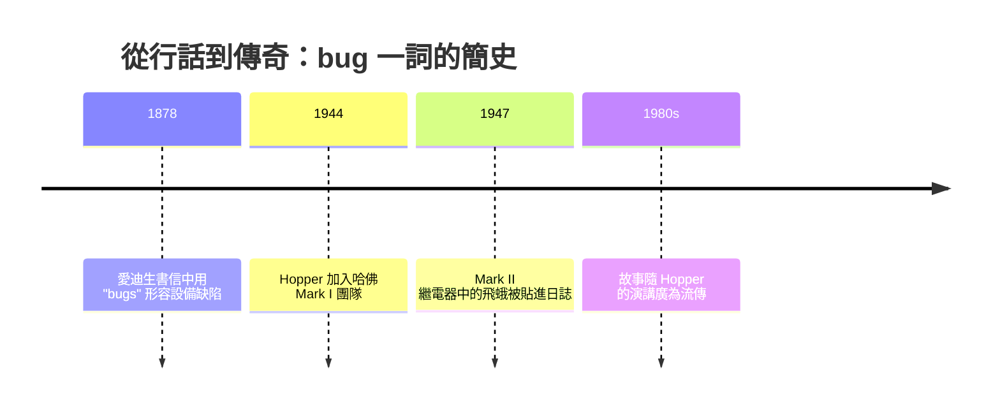

# 從插線板到打孔卡：早期的實體程式

一九四五年夏天，賓州大學摩爾電機工程學院的二樓，一個長三十公尺、重三十噸的龐然巨物正在進行最後的調校。它就是 ENIAC——世界上第一台通用型電子計算機。然而，當陸軍彈道研究實驗室把彈道計算的任務交給這台機器時，一個前所未見的問題浮上了檯面：機器造好了，可是「如何告訴機器該做什麼」，沒有人知道。

## 六位「設定機器」的女性

當時的 ENIAC 沒有儲存在記憶體中的程式，沒有鍵盤，也沒有程式語言。要讓它算一條彈道，工程師必須親手把電纜插在插線板（plugboard）上，設定數千個開關，讓脈衝沿著指定的路徑流動——這叫做「設定機器」（setting up the machine）。

陸軍雇來的，是六位原本就精通數學的女性：Kathleen McNulty、Frances Bilas、Frances Spence、Jean Jennings Bartik、Ruth Lichterman Teitelbaum 與 Marlyn Wescoff Meltzer。她們原本從事人力計算員（human computer）的工作，用手搖計算機算彈道表。戰爭時男性被徵召上戰場，這些手算工作大量由女性承擔；ENIAC 的誕生，正是要把這些耗時數天的手算縮短到幾十秒。

她們從 ENIAC 的邏輯電路圖讀起，在沒有教科書、沒有「程式設計師」這個職稱的年代，自己發明了初步的程式設計方法：把問題分解成子程序，設計讓多個累加器並行運作的技巧。一九四六年二月 ENIAC 對外公開展示時，媒體讚嘆這台「電子大腦」，卻沒有提到幕後設定它的六位女性——記者以為她們只是接待員。她們當時的薪資，遠低於處理硬體的男性工程師，而且多年來在敘述 ENIAC 的正史中幾乎被隱形，直到一九九○年代才逐漸獲得應有的肯定。這不是偶然：在那個時代，「操作機器」被視為文書性、輔助性的工作，真正的榮耀屬於設計硬體的男性學者。軟體的性別化勞動分工，從這裡就埋下了種子。

## 哈佛 Mark I 與 Grace Hopper 登場

同一時期，哈佛大學的 Mark I——IBM 資助、Howard Aiken 主導設計的電機式計算機——於一九四四年啟用，立刻被海軍借調去算彈道與曼哈頓計畫的計算。在這裡，另一位數學家登場了。

Grace Brewster Hopper，瓦薩學院教授、耶魯數學博士，珍珠港事變後申請從軍。海軍起初以體重過輕、年齡偏大、學歷過高為由猶豫，她最終於一九四四年底以中尉階級被派往哈佛，成為 Mark I 團隊的第一批程式員之一。她的第一項任務，是為艦砲引信計算編寫程式——而且她並不擅長操作打孔卡，是團隊裡其他成員先替她把指令打好，她才逐漸上手。

Mark I 的程式是寫在打孔紙帶（punched tape）上的。指令一條條打在紙帶上，機器以繼電器與機械計數器讀取執行，速度以「秒」計，一次加法要零點三秒，一次乘法要六秒。程式設計師的工作，是反覆紙上作業、模擬機器行為，然後把紙帶送到機器上試跑，再面對滿紙錯誤重新來過。這種「紙上邏輯」與「機器執行」的分裂，成了 Hopper 日後推動編譯器的原點——她後來常說，她之所以想讓機器替人類寫程式，就是因為她痛恨自己動手除錯的那種笨拙。

## 一隻飛蛾與一個詞

關於「bug」這個詞，流傳最廣的版本是一九四七年九月九日：Hopper 的團隊在 Mark II 機器（位於維吉尼亞州 Dahlgren 海軍武器實驗室）上追蹤故障，最後在繼電器裡找到一隻被電死、翅膀黏住的飛蛾。團隊成員把飛蛾用膠帶貼進當天的工作日誌，寫下：「發現第一個實際被找出來的 bug」（First actual case of bug being found）——「actual」這個詞正暗示了 bug 一詞早已是行話。那本日誌至今保存於史密森尼博物館。

事實上，愛迪生早在一八七八年寫給友人的信中，就用「bugs」形容電氣設備裡難以捉摸的小缺陷——這是昆蟲鑽進電路這個比喻的源頭。Hopper 團隊的飛蛾，只是把這個行話變成了一則傳奇故事。這段歷史提醒我們：技術詞彙的誕生往往是幾十年行話的累積，而把故事說得精彩的人，決定了後世如何記憶它。

## 打孔卡：程式之前的資料工業

在電子計算機出現前半個世紀，打孔卡已經是一門龐大的產業。一八九○年美國人口普查，傳統手工統計眼看要花上十幾年，Herman Hollerith 發明了電動打孔卡製表機，把普查處理時間壓縮到幾年。Hollerith 的公司幾經合併，一九二四年改名為 IBM。

此後數十年，打孔卡是資料的通用載體：薪資單、選票、稅表，都以「八十欄卡片」流通。一九三七年起，IBM 甚至以社會安全計畫為契機，發展出把整個組織的資料流程機械化的「系統方法」（systems approach）——把卡片當作組織間資訊交換的介面，工程師在紙面上規劃卡片的設計與流程，然後送進機房。這種「先在紙上設計、再由機器執行」的工作方式，就是程式設計的前身。電子計算機問世後，打孔卡順理成章成為輸入程式與資料的主要媒介，Fortran 的原始碼都曾被稱為「卡片疊」（card deck）。一九六八年美國大選，IBM 的打孔卡選票更在芝加哥引爆了著名的計票爭議——一項十九世紀末的統計技術，一路活到了數位時代。

## 硬體綁定與昂貴的機時

初期的電子計算機是真正的孤島：ENIAC 是 ENIAC，Mark I 是 Mark I，每一台機器有自己獨特的指令集、自己的接線邏輯、自己的數值表示方式。程式不能搬移，學會一台機器不代表會下一台。再加上機器造價動輒數十萬美元、占地整個房間、可靠性堪慮，使用時間以小時計費且需要排隊申請——程式設計師往往只能提交紙帶或卡片，隔天才知道跑的結果。整批處理（batch processing）這個日後主導行業三十年的模式，最初就是被「機時昂貴」逼出來的。

在這個生態裡，程式設計是一份沒有名字、沒有職涯階梯、通常由女性承擔的工作。學界視其為技術員的活，企業視其為跑機器的附屬品。然而正是這些人，在插線板與打孔卡之間，摸索出了迴圈、子程序、模擬除錯這些後來被稱為「軟體工程」的基本功。當 Grace Hopper 在下一章登場、主張「讓機器替人寫程式」時，她要對抗的不只是技術難題，更是整個時代對「誰有資格編程」的想像。
