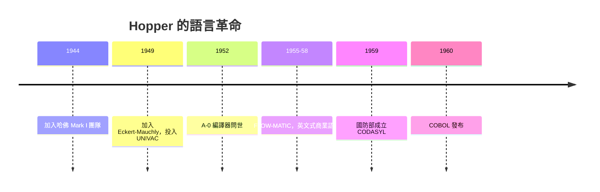

# 葛麗絲霍普與第一個編譯器

一九四四年，三十七歲的 Grace Hopper 站在哈佛 Mark I 面前時，她面對的是一台要以秒為單位完成一次加法的機器，以及一卷寫滿指令的打孔紙帶。四十年後，她以海軍少將身分退役時，世界上幾乎每一行用接近人類語言寫成的程式，都受惠於她的洞見。她一生的主軸只有一句話：**機器應該為人類服務，而不是人類伺候機器。**

## 從數學教授到海軍中尉

Hopper 一九○六年生於紐約，幼年即以拆鬧鐘聞名——家裡的鐘被她拆遍了七座。她在瓦薩學院攻讀數學與物理，一九三四年取得耶魯數學博士——在當時，數學博士學位對女性而言極為罕見。之後她回到母校瓦薩任教，一路升到副教授。

珍珠港事變改變了她的人生。她申請加入海軍預備役（WAVES），因體重不足、年齡偏大曾被拒，最終靠著瓦薩的教職豁免入伍條件。一九四四年底，她被派往哈佛，加入 Howard Aiken 的 Mark I 團隊，成為該機最早的程式員之一。她後來回憶，第一次見到 Mark I 時覺得「那比我想像的任何機器都友善」——但很快她就嚐到了程式設計的苦頭：寫指令、打紙帶、上機、失敗、重來。她討厭手寫出一條條機器碼的枯燥，這份厭惡成了她日後最重要的發明動機。

## UNIVAC 與「瘋狂的」A-0

戰後，Hopper 選擇留在海軍預備役，並離開哈佛，加入 Presper Eckert 與 John Mauchly 剛創立的公司，參與商用計算機 UNIVAC 的開發。一九四九年，世界上第一台商用電子計算機的團隊，只有少數幾個人在想「程式以後該怎麼寫」，Hopper 是其中之一。

一九五二年，她的團隊寫出了 A-0 編譯器：程式設計師用助記符號寫出常式呼叫，編譯器把它展開成機器碼副程式。今天聽來理所當然，當時卻被普遍視為異想天開——「電腦只能算數，怎麼可能替人寫程式？」連她的上司都要求她先證明可行。她後來自嘲，當時「沒有人相信它，大家說電腦只能做算術」。她於是以身作則，先寫出一批實用的資料處理程式建立聲譽，再回頭推銷編譯器的想法。

她的邏輯簡單而深刻：大多數程式錯誤來自人類在細節上的手誤，而電腦最擅長的就是不厭其煩地處理細節。**讓電腦做電腦擅長的事，把人類留給抽象與判斷。** 這個分工原則，日後成為整個軟體工程的信條。

## FLOW-MATIC 與 COBOL 的誕生

一九五○年代中期，Hopper 在 UNIVAC 上開發了 FLOW-MATIC（原稱 B-0），第一個用英文詞彙寫成的資料處理語言——訂單、庫存、薪資，這些商業世界的日常語言直接成為程式語法。她刻意示範給非技術人員看：經理人可以讀懂並檢查程式的邏輯。她的主張從未動搖：**程式設計不該是數學家的特權**。她認為程式語言應該盡量接近英文，讓使用系統的人自己驗證系統。

一九五七年，國防部面對各廠牌機器語言互不相容、程式重寫成本高漲的困境，於一九五九年五月召集製造商與用戶組成 CODASYL 委員會，目標是設計一種通用商業語言。Hopper 的 FLOW-MATIC 成為委員會最有影響力的參考範本——一九五九年的規格幾乎以它為骨架。一九六○年，COBOL 正式發布。Hopper 常被稱為「COBOL 的奶奶」，她本人則堅持：COBOL 不是一個人發明的，而是整個產業對「程式應該用英文寫、應該跨機器通用」這個共識的結晶——而那個共識，很大程度上是她用一台 UNIVAC 和一套 FLOW-MATIC 示範出來的。

## 原諒比許可容易：一位制度內的叛逆者

Hopper 在海軍預備役一待就是數十年，超齡多次獲准延役，一九八五年晉升海軍少將，一九八六年以七十九歲高齡從華盛頓號驅逐艦上榮退——她是當時現役最年長的美國海軍軍官。退役後她加入 DEC，工作到一九九二年元旦辭世，享年八十五歲。

她在演講與訪談中留下兩件最著名的「道具」。其一是名言：「**先斬後奏，比請求許可容易**」——她說這是她一生的行事準則，也提醒聽眾：好的上級應該允許下屬在合理範圍內先做再報告。這句話後來被廣泛引用，成為組織文化的經典格言。其二是那根約三十公分長的金屬絲：光在一奈秒前進約三十公分，她就剪一根這麼長的電線，讓將領與學生親手握住「一奈秒」——再用整捲粗電纜比擬一千奈秒、用放大鏡與胡椒粒比擬更小的尺度。她用一根電線講透了「速度」這個抽象概念，這是史上最成功的科普教具之一。

她獲得的榮譽包括一九九一年美國國家科技獎章；二○一六年，歐巴馬總統追授她總統自由勳章，由她的親屬代為受領。但對 Hopper 而言，最大的報償或許是這樣一件事實：今天全球仍有上千億行 COBOL 在銀行、保險與政府系統中運行，而程式設計早已不是少數數學家的特權。她說過，她這一生最驕傲的不是某個頭銜，而是年輕人對她說——「因為妳，我才能做這一行。」

## 為什麼是她

Hopper 的故事之所以關鍵，在於她同時具備三種罕見的特質：數學家的抽象能力（看出編譯在理論上可行）、工程師的務實（先做出 A-0 證明給所有人看），以及軍官的身分（在國防部體制內，把一項「瘋狂」的想法變成聯邦標準）。冷戰的軍事預算給了她舞台，戰後女性軍職給了她身分，而她給了這個產業一個至今未變的方向：**語言是人的，機器只是翻譯者。**
