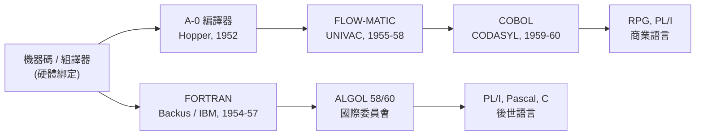

# FORTRAN 與 COBOL：高階語言的生產力革命

一九五三年，IBM 的程式設計師 John Backus 寫了一份不尋常的備忘錄，主張為公司的新機器 IBM 704 開發一套「自動編程」系統，讓數學公式直接變成機器碼。當時的共識是：編譯器產出的程式碼必然又慢又肥，效率無法與手工組譯相比。Backus 賭的是相反的可能——而他贏了。FORTRAN 與 COBOL 這兩套語言，在一九五○年代末期共同完成了軟體史上第一場真正的生產力革命。

## FORTRAN：與機器效率的豪賭

一九五四年十一月，IBM 發布了 FORTRAN 的初步規格（The IBM Mathematical FORmula TRANslating System）。Backus 組了一支十八人的團隊——包括後來在演算法界舉足輕重的 Irving Ziller、Lois Haibt 等人——在紐約的 IBM 大樓裡展開三年馬拉松。

專案的成敗繫於一個問題：**編譯器能否產出逼近手工水準的機器碼？** 如果不能，工程師沒有任何理由放棄組譯器。團隊因此投入大量心力在最佳化上：暫存器分配、公共子表達式消除、迴圈展開——這些日後成為編譯理論基石的技術，在當年都是為了「讓物理學家不嘲笑我們的程式碼」而發明的。一九五七年四月，FORTRAN 編譯器正式交付，用戶發現它產出的迴圈程式碼往往可與手工組譯匹敵。測試規模也驚人：團隊在 IBM 704 上進行了長達數月的系統測試，這種規模的軟體測試在當年是史無前例的。

結果是爆炸性的。到了一九五八年，在 IBM 704 用戶社群中，超過半數的程式碼以 FORTRAN 撰寫——生產力提升的幅度，依當時的估計可讓程式設計師的產出增加數倍至一個數量級。科學計算的世界再也回不去了：核子物理、航空工程、氣象預報、統計分析，全都跑在 FORTRAN 上。同樣重要的是示範效應：FORTRAN 證明了「高階語言 + 最佳化編譯器」這條路在經濟上成立，此後每一種新語言都站在這個先例上。

## COBOL：為商業世界而生

如果 FORTRAN 是給科學家的，那麼銀行、保險公司與政府機關呢？一九五○年代中期，機器已大量進入企業的薪資與帳務部門，但每台機器各有各的組譯器，程式完全綁死在硬體上。企業買了新機器，舊程式就得全部重寫——這在會計年度的邏輯上是災難。

Grace Hopper 的 FLOW-MATIC 已示範了「用英文寫商業程式」的可行性，UNIVAC 的用戶開始要求標準化。一九五九年五月，美國國防部以最大的電腦買主身分出面，在五角大廈召集製造商、用戶與學界組成 CODASYL 委員會。委員會以 FLOW-MATIC 為主要範本（委員會收到的方案中，FLOW-MATIC 是唯一已實際運作並有用戶基礎的商業語言提案），於一九六○年發布 COBOL（Common Business-Oriented Language）。

COBOL 的設計哲學與 FORTRAN 針鋒相對卻又殊途同歸：它刻意讓程式「讀起來像英文段落」，`MOVE A TO B`、`ADD 1 TO COUNTER`，使會計師與主管能讀懂程式邏輯、參與檢核。它把「資料描述」與「程序」分離，呼應商業世界的檔案與流程。批評者嘲笑它冗長囉嗦，但它精準命中了商業組織的需求：**可讀性就是可審計性，標準化就是投資保障。** 美國國防部隨後要求所有新電腦必須配備 COBOL 編譯器，供應商不得不從；COBOL 因此成為史上第一個跨廠牌普遍實作的語言標準。

## 可移植性的商業邏輯

FORTRAN 與 COBOL 的成功，背後是一個全新的經濟命題。在此之前，軟體是硬體的附屬品，隨機器免費贈送；當程式能用一種獨立於機器的語言書寫，**軟體第一次成為可以累積的資產**。企業的薪資系統不必隨換機而重寫，科學家的新方法可以發表給同行在不同機器上重現。廠商之間的競爭，也從「我的機器快」逐漸轉向「我的機器跑得起標準語言」。

IBM 對 FORTRAN 的態度也值得一提：它一度猶豫是否要推廣這個可能打亂自家機器語言生態的東西，但很快意識到——賣出更多 704 才是王道。語言標準反過來成了硬體的行銷工具，這個「平台思維」將統治此後半個多世紀的資訊產業。

## 勞動市場與學科的誕生

兩大語言直接重塑了就業結構。一九六○年代，「FORTRAN 程式員」與「COBOL 程式員」成為明確的職稱與薪資等級：科學計算的 Fortran 崗位集中於實驗室與航太國防，商業資料處理的 COBOL 崗位則在銀行與保險公司大量湧現。程式設計從「設定機器的技術活」變成可訓練、可認證、可階層化的職業——企業開辦培訓班，書商出版自學手冊，女子中學畢業生經過數月訓練即可入行。諷刺的是，當編程變成有錢途的專業，男性從業者比例開始攀升，逐漸改寫了早期「程式員多為女性」的性別構成。

學界也隨之制度化。ACM 於一九四七年創立後持續成長，一九六○年代各大學紛紛把「計算機科學」從數學系、電機系中獨立出來成系成所；一九六八年，史丹佛與普渡等校的博士課程、ACM 的課程建議書（Curriculum '68）確立了資工教育的骨架。語言理論——Backus 本人在一九五九年提出的 BNF 記法，直接催生了 ALGOL 60 的形式語法定義——成為這門新學科的核心課程。

回頭看，FORTRAN 與 COBOL 像一對性格迥異的雙生子：一個精瘦高效、面向科學；一個嚕嗦可讀、面向商業。它們共同證明了一件事——**程式語言不是工程細節，而是組織人類知識與勞動的制度。** 而當軟體資產愈積愈多、系統愈造愈大，新的危機也悄悄逼近：下一章的主角將在太空的極端環境中，先一步撞上「軟體規模」這堵高牆。
