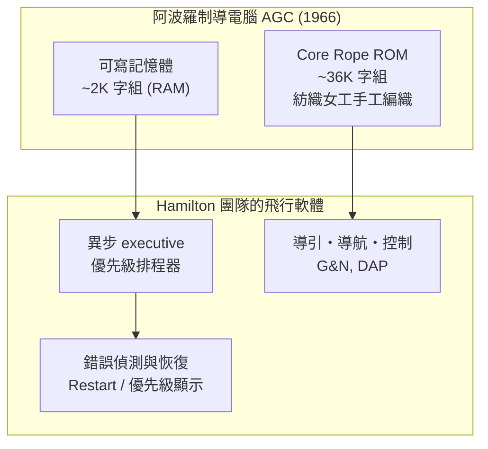

# 漢密爾頓與阿波羅11：預防性排程演算法

一九六五年，在麻省理工學院儀表實驗室（MIT Instrumentation Laboratory）一間堆滿打孔紙帶的辦公室裡，一位二十九歲的母親帶著女兒來加班。小女孩在鍵盤上亂按，竟讓整台模擬中的登月電腦當機了。如果是從來沒出過錯的系統，這只是個笑話；但 Margaret Hamilton 看到的是另一個問題：**萬一太空人在飛行中做出這種動作呢？** 電腦必須在任何情況下都能存活。這個由女兒玩出來的念頭，五年後救了阿波羅十一號。

## 從數學系到阿波羅

Margaret Heafield Hamilton 一九三六年生於印第安納州，在密西根的鄉間長大，後來進入俄亥俄州 Earlham 學院主修數學，輔修哲學——她曾說，哲學教會她從整體看問題。畢業後她先是暫時教高中數學，一九六○年，丈夫就讀波士頓布蘭戴斯大學，她為貼補家計到 MIT 打工，恰好加入儀表實驗室，成為氣象與軍事模擬專案 LX-1 的程式員。她沒受過正規程式訓練，卻以自學摸索出嚴謹的風格——她的名言是：她總是想著「萬一程式出錯了怎麼辦」，而同事只想著讓程式跑起來。

一九六一年，甘迺迪總統宣布登月目標，MIT 儀表實驗室拿下阿波羅制導計算機（Apollo Guidance Computer，AGC）的合約。Hamilton 一九六五年被指派負責阿波羅機載飛行軟體（on-board flight software）——在一個還沒有「軟體工程」這個詞的年代，她實際上定義了這個職位。她的團隊負責指揮艙與登月艙的飛行軟體：導引、導航、控制、數位自動駕駛與系統診斷。

## 一台不可當機的電腦

理解 Hamilton 的設計，必須先理解 AGC 的極端限制。這台由 Raytheon 製造的電腦，記憶體分成兩半：可寫的 erasable memory 約 2K（2048 個 16-bit 字組）的金屬氧化物 RAM；程式則燒死在約 36K 字組的 core rope memory 裡——把每一根導線繞過（或繞不過）磁環來表示 0 與 1。製造它的是雷神公司在麻州工廠裡的紡織女工，她們按編織圖把導線「編」進程式，這種記憶體因此被戲稱為「LOL memory」（Little Old Ladies）。寫錯一條指令，不是改行程式碼，而是要重新編織、重新送檢，週期以月計。

這意味著：**軟體必須一次寫對，而且必須在硬體不可能升級的前提下，處理所有沒想到的狀況。** 太空船的記憶體滿打滿算只有今天一張表情圖片的大小，卻要同時完成導引計算、遙測、導航與控制。

## 異步執行與優先級排程

Hamilton 團隊的關鍵設計，是讓 AGC 的作業系統成為**異步（asynchronous）的系統**。在同步設計中，任務按固定順序執行，一步卡住、全部卡住。Hamilton 的團隊則讓電腦根據優先級動態分配 CPU 時間：緊急的任務（如登月引擎控制）可以打斷不緊急的任務（如更新導航資料的顯示），重要的工作先做，次要的工作排隊甚至直接丟棄。

這就是日後所稱的**預防性排程演算法**（priority scheduling）。與其假設一切正常，不如預設「異常一定會發生」：軟體必須能偵測自己的過載與錯誤，決定該救什麼、該放棄什麼。當電腦過載時，executive 會自動重新啟動被排擠的低優先任務，並在儀表上閃爍「PROG ALARM」與警報編號，讓地面知道發生了什麼。

團隊的另一項原則是**錯誤偵測與恢復（error detection and recovery）**：軟體要持續自我監督，一旦發現異常就嘗試以最安全的路徑恢復，而不是整個崩潰。Hamilton 後來稱之為「系統必須學會診斷與治療自己的疾病」。

## 為「沒想過的錯誤」而設計

Hamilton 對團隊的要求近乎偏執：每一行程式都要寫測試計畫，每一條路徑都要模擬到。她推動「錯誤分析」（error analysis）作為日常工作——不只是找 bug，而是系統性地問「如果輸入是錯的呢？如果人在慌亂中按錯鍵呢？如果兩個程序同時搶資源呢？」

這在當時是異端。航太工程的主流文化相信：系統要經過充分驗證、過程要萬無一失，而不是在飛行中靠電腦自己應變。Hamilton 回憶，她多次在會議上主張「軟體必須能對付異常」，被認為是把錢浪費在「不會發生的事」上——她後來形容，那感覺像是在為一場大家都不信的疾病爭取疫苗預算。她甚至為此寫過備忘錄，要求在登月艙軟體中加入錯誤偵測與恢復機制，一度被高層以「那種事不可能發生」為由打回票。

女兒亂按鍵盤的教訓，她記住了：她堅持在軟體中加入對「太空人錯誤操作」的防護——例如在飛行關鍵階段限制不必要的顯示更新。這條防線的價值，要等到一九六九年七月二十日才被全世界看見。當登月艙老鷹號下降月球時，一個開關的失誤加上電腦的過載，把 Hamilton 團隊多年來「預防異常」的苦功，變成了一場歷史性的驗證——那是下一節的故事。

Hamilton 後來說，阿波羅軟體的成功不在於「程式沒有錯」，而在於**「系統設計得讓錯誤無法造成災難」**。這句話，如今被刻在世界每一本即時系統與安全關鍵軟體的教科書裡——而它的作者，當年只是 MIT 裡一位沒有職稱、帶著女兒加班的年輕母親。
