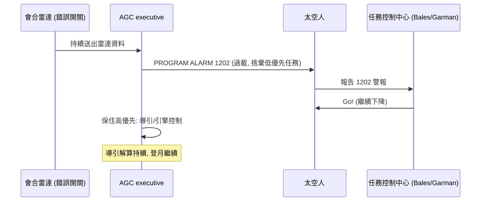

# 雷達超載警報：優先級排程挽救登月

一九六九年七月二十日，登月艙「老鷹號」（Eagle）脫離指揮艙，載著 Neil Armstrong 與 Buzz Aldrin 下降月球。下午四點多（美東時間），登月艙降到約一萬公尺高度時，Armstrong 與 Aldrin 的耳機裡突然響起一連串陌生的警報聲，電腦面板閃出 **PROGRAM ALARM 1202**。登月的關鍵時刻，這台由 MIT 打造的制導電腦，正在向太空人報告：我過載了。

## 1202：電腦在求救

警報編號 1202 的意思是「executive overflow——沒有空閒的核心（no core sets available）」；1201 則是更嚴重的「沒有可用的儲存區域」。翻譯成白話：電腦排定的工作多到超出它的即時處理能力，低優先的任務被擠掉了。

問題的根源，是一個開關的失誤。會合雷達（rendezvous radar）本應在登月艙與指揮艙分離後保持關閉或置於正確位置，但由於起飛前操作程序的一個歧義，開關處於錯誤位置，導致會合雷達持續向電腦送出資料。電腦被迫頻繁中斷去讀取這些「其實不需要」的資料，搶走了登月導引計算的處理時間。下降程序本身就極其繁重——導引、引擎控制、遙測、顯示更新同時進行——再疊加雷達的干擾，executive 的排程器連續溢出，1202 一聲接著一聲。

## 預防性設計的兌現時刻

此時，Hamilton 團隊多年來被視為「浪費錢」的設計，成為唯一的救命索。AGC 的 executive 是**異步的、以優先級驅動的**：當工作量超過負荷，它不會凍結或崩潰，而是按優先級捨棄低優先任務——例如非關鍵的顯示更新與雷達資料處理——保住登月導引與引擎控制這些最高優先的計算。電腦在過載中仍然每秒多次完成導引解算，並在警報燈閃爍的同時繼續飛。

Aldrin 後來回憶，他們報出「Program alarm 1202」時並不知道這代表什麼，他只說了一句：「Give us a reading on the 1202 program alarm.」真正接住這個問題的，是休士頓任務控制中心。

## Steve Bales 與 Jack Garman 的「Go」

控制中心負責制導系統的飛行控制員，是二十四歲的 Steve Bales；他背後的後台工程師，是更年輕的 Jack Garman。下降過程中，兩人只有幾秒鐘可以判斷：這個警報是致命的，還是可以繼續？

他們之所以能「Go」，是因為訓練。阿波羅計畫的模擬訓練極其嚴格，控制團隊在模擬器中反覆演練過各種故障。就在幾個月前的模擬中，Garman 曾遇到幾乎一模一樣的警報，當時一位高階工程師對他說：**只要警報不是持續性、不影響導引與控制，就可以繼續。** 真實的下降中，Bales 與 Garman 看到警報間歇出現、導引資料正常，於是對飛行指揮 Gene Kranz 給出了那個載入史冊的判斷——「Go on that alarm.」太空人收到的是簡短的一個字：**Go**。他們繼續下降。

## 陰影與燃料

警報解決了，危險還沒結束。下降途中 Armstrong 發現自動導引正把登月艙帶向一個佈滿巨石與火山口的區域——那是自動駕駛與地面預想都沒料到的地形。他切換到手動姿態控制，駕駛老鷹號飛越障礙，尋找平坦的落點。與此同時，燃料警告亮起：剩餘燃料一路跌到通常要求「立刻著陸或放棄」的水位以下，控制中心內部開始討論還剩多少秒。Armstrong 最終在一個後來被稱為「西環形山」（West Crater）旁的平坦處，以近乎貼地的姿態著陸，剩余燃料據估計只夠約 25 秒（另有估計更少）。

換句話說，登月成功是三道防線的疊加：**軟體的優先級排程**保住了電腦，**地面與太空人的訓練**保住了判斷，**Armstrong 的手動駕駛**保住了最後的落點。任何一環失守，歷史都會改寫。

## 沒有第二次機會的文化

阿波羅十一號之後，1202/1201 成為軟體史上的經典案例。它教會產業幾件事：

- **即時系統必須在過載下仍可預測**：優先級排程、任務捨棄與重新啟動，從此成為航太、航空與工控系統的標準設計。
- **軟體品質是用模擬訓練換來的**：阿波羅的軟體在地面模擬器中被測試了無數遍，連「雷達開關放錯」這種人為失誤都演練過——品質文化不是口號，是訓練量。
- **關鍵系統沒有二次機會**：Hamilton 事後說，這件事證明了「把錢花在異常防護上」不是浪費，而是任務成敗的分水嶺。

一九六九年那個夏天，全世界記住了 Armstrong 的一小步。而工程界逐漸明白：那一小步背後，是一群人提前數年、在沒人看見的地方，為「不會發生的錯誤」所做的準備。這種精神，很快將在地面上的另一個戰場——規模失控的企業軟體——找到自己的名字：軟體工程。
