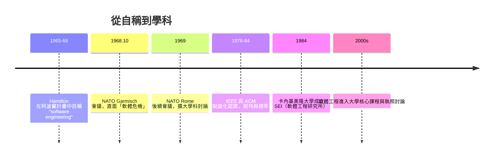

# 軟體工程的命名：爭取工程尊嚴

一九六○年代末，Margaret Hamilton 手中的阿波羅軟體已經膨脹到無人能一眼看盡的規模：數千頁的文件、數十名程式員、按月份推進的里程碑。她向實驗室主管申請預算，想成立正式的軟體可靠性團隊，把「錯誤偵測與恢復」和嚴謹測試納入常規。得到的答覆卻讓她哭笑不得——軟體？那不是工程，頂多算是「附屬的玩意兒」，不必花這麼多錢。多年後她回憶這段往事時說：就在那一刻，她做了一個決定——**在阿波羅計畫裡，這件事要被當作工程來對待**。於是她開始使用一個當時還不存在的組合詞：**software engineering**。

## 命名，是為了要回尊重

Hamilton 的敘事很直白：她注意到，在火箭這種「真正的工程」上沒人會吝嗇，但在軟體上，她的預算一再被砍。她的解法不是忍耐，而是修辭上的「奪權」——她故意把團隊的工作稱為「軟體工程」，讓軟體分享硬體工程學在組織裡的權威、預算與尊重。她後來說：「軟體當時被視為次要的東西，我堅持要讓軟體成為公認的學科，這樣才能得到應有的尊重與資源。」

這不是單純的改名。在阿波羅計畫中，她把這個「名字」實踐為一整套紀律：形式化的規格、多層次的測試與模擬、錯誤分析報告、版本與配置控制。當一九六八年十一月北約（NATO）在德國 Garmisch 召開著名的「軟體工程會議」時，「軟體危機」一詞正是會議的主題——系統越來越大、成本越來越高、專案一再失敗。這場會議普遍被視為「軟體工程」作為學科的誕生點。值得一提的是，Hamilton 曾指出「software engineering」這個詞在阿波羅計畫中早已存在，早於 NATO 會議——兩個版本的敘事並不衝突，而是各自描述了同一件事的兩面：**她為一個團隊的尊嚴而命名，學界為一門學科的存續而命名。** 這兩種命名，一個爭取的是預算與尊重，一個應對的是危機與失控；它們在歷史上各自發生、互相呼應，共同把一門技藝升格為工程學。

## 從尊嚴到制度

Hamilton 的個人命名，最終長成了一套全球制度。IEEE 與 ACM 於二十世紀七十至八十年代陸續出版軟體工程的標準與教材，把需求、設計、測試、維護分階段定義；一九八四年，美國國防部出資在卡內基美隆大學成立軟體工程研究所（SEI），開發出影響深遠的能力成熟度模型（CMM），把「軟體組織的成熟度」變成可分級、可評鑑的對象。各大學的資訊工程系先後把「軟體工程」列為核心必修——課程大綱裡的瀑布模型、需求分析、版本控制，都是當年阿波羅團隊被迫自創的實踐，如今成了全球百萬學生的教科書內容。

這個過程的動力，一半來自教訓：一九六○年代的失敗專案（IBM OS/360 的延期與膨脹、以及無數企業系統的失控）證明，軟體規模一旦超出個人能力，靠「聰明人熬夜」是不夠的。另一半來自經濟：軟體成為產業，就必須可預估、可管理、可驗收——換句話說，必須像工程。

## 延遲五十年加冕

Hamilton 在阿波羅計畫之後創立公司（Highest Technologies 及其後的 Hamilton Technologies），持續推廣「系統導向、以正確性為先」的開發方法，包括她發展的 Universal Systems Language（USL）。但世界真正重新認識她，要等到二十一世紀。

二○○三年，NASA 頒給她「NASA Exceptional Space Act Award」，表彰阿波羅機載軟體的科學與技術貢獻——官方措辭直指這套軟體「協助人類登上月球並安全返航」。二○一六年，歐巴馬總統授予她總統自由勳章，這是美國平民的最高榮譽；頌詞稱她「體現了阿波羅世代的科技精神」。二○一八年，她以八十二歲之齡辭世，訃聞遍及全球主要媒體，標題幾乎一致：「軟體工程」一詞的創造者、拯救阿波羅十一號的人。

這五十年間的遲到，本身就是一段科技史的註腳：軟體的影響力遠早於它的社會承認。Hamilton 生前多次被問到「軟體工程」這個詞的由來，她總是說，她並不在乎誰先誰後——她在乎的是：**軟體必須被當作工程來做，因為人們的生命會依賴它。** 從 MIT 的插線板到今天每一輛自駕車、每一次手機系統更新，這個信念已經成為整個產業的地基。

回望這三章的歷史，可以看到一條清晰的線：Hopper 把程式語言交還給人類，Backus 與 CODASYL 把軟體變成可累積的資產，Hamilton 把軟體的製造升格為工程。她們各自面對的敵人都一樣——**輕視**：輕視編程的人、輕視語言的人、輕視看不見的勞動的人。而她們的武器也一樣：用無可辯駁的成功，把偏見碾成歷史。
