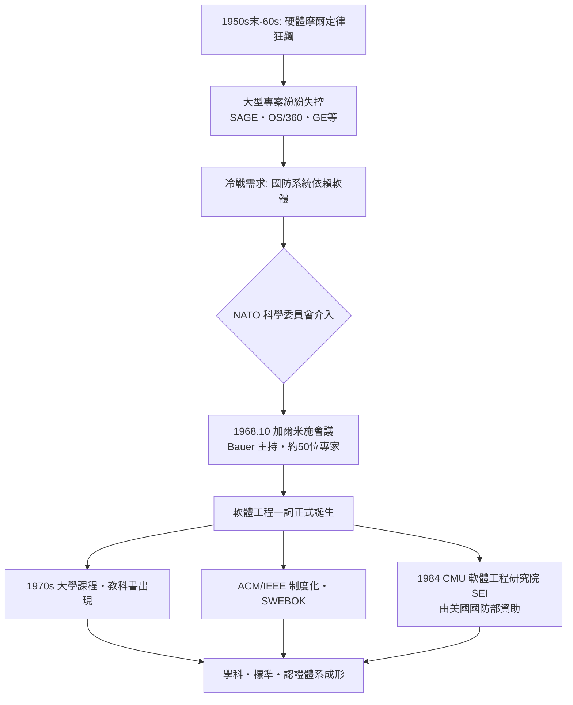

# 1968 年 NATO 加爾米施會議：第一次軟體危機

## 一個產業的集體焦慮

1968 年 10 月 7 日至 11 日，西德南部阿爾卑斯山麓的度假小鎮加爾米施-帕滕基興（Garmisch-Partenkirchen），聚集了約五十位來自十一個國家的計算機科學家、產業界主管與顧問。他們不是來滑雪的。這場由北大西洋公約組織科學委員會（NATO Science Committee）主辦的會議，全名是「軟體工程技術會議」（Conference on Software Engineering Techniques），後來被公認為「軟體工程」一詞正式誕生的歷史時刻，也是整個產業第一次公開承認：我們陷入了危機。

要理解這場會議，必須先理解 1960 年代軟體專案失控的普遍程度。那是一個硬體狂飆、軟體跛行的年代。電晶體取代真空管後，積體電路又迅速接棒，硬體遵循著後來被稱為摩爾定律的節奏飛速進化——密度每兩年翻倍、成本持續下滑。IBM 在 1964 年推出 System/360，一舉投下五十億美元（約當今日數百億美元），賭的是「相容性」這個全新概念，硬體的野心前所未有。

但軟體跟不上了。IBM 為 System/360 開發作業系統 OS/360 的過程，成了整個時代最著名的災難樣本：上千名程式設計師投入數年，開發費用估計超過五億美元，比研發登月火箭還貴，發行版本卻長期充斥錯誤，每個修正版又帶來新的錯誤，形成「打地鼠」式的無盡迴圈。這不是 IBM 獨有的恥辱。同期，美國空軍的 SAGE 防空系統、通用電氣、優利系統（Unisys 前身）的大型專案，幾乎無一倖免：進度延誤以年計、成本膨脹以倍計、品質低到必須靠大量現場維修人員「補網」。業界流行一則黑色笑話：軟體專案唯一能準時交付的東西，是新的延誤估算。

## 危機的政治經濟學

「危機」這個詞的選擇並非單純的技術描述，而是帶有鮮明的政治經濟意涵。1960 年代正值冷戰高峰，北約各國的國防、航太、電信系統高度依賴軟體。如果蘇聯的工程師先解決了大型軟體的可靠生產問題，而西方不能，那就是戰略級的失分。NATO 科學委員會把軟體當作與核物理、雷達同級的戰略科技來看待，這解釋了為何一個技術議題要動用跨國防務組織的資源來開會。

會議的幕後推手包括西德慕尼黑技術大學的弗里德里希・鮑爾（Friedrich L. Bauer），他擔任會議主持人。「軟體工程」一詞一般認為由他定調——刻意借用「工程」二字，是要昭告天下：軟體生產不能永遠停留在手工藝階段，必須建立像土木、機械工程那樣的原則、紀律與度量標準。鮑爾後來回憶，這個名詞帶有一點挑釁與自我激勵的成分：「我們覺得這個問題太重要、太困難，值得用一個响亮的名字來凝聚力量。」

與會者名單如今看來如同計算機科學的名人堂：荷蘭的艾茲赫爾・戴克斯特拉（Edsger W. Dijkstra）、英國紐卡斯爾的布萊恩・蘭德爾（Brian Randell）、編纂會議論文的彼得・納爾與 J. N. Buxton，以及來自 IBM、貝爾實驗室、各國政府採購部門的實務主管。會議的討論風格坦率得驚人。一位與會的顧問直言，軟體開發「像一個泥沼，許多能力出眾的人在其中掙扎」。會議產出的核心共識是：軟體危機的根源不在程式設計技巧，而在於缺乏管理大型系統的方法論——需求不明、設計不當、缺乏測試紀律、人員流動，以及最根本的，沒有一門學科來訓練「如何在預算與時限內建造正確的系統」。

值得注意的是，會議也埋下了日後爭論不休的種子：有人主張解方是更嚴謹的數學與證明，有人主張是更好的管理，也有人——像戴克斯特拉——警告「企圖用管理手段解決技術問題，只會製造更大的災難」。

## 從會議到制度

加爾米施會議的真正影響，不在於它開出的藥方（那時還沒有藥方），而在於它把問題「制度化」了。兩年後，1970 年代的「軟體工程」開始出現大學課程與教科書；ACM 與 IEEE 陸續把軟體工程納入正式學科範疇，並於日後合組推動知識體系（SWEBOK）與專業認證。1984 年，美國國防部出資、卡內基美隆大學成立軟體工程研究院（Software Engineering Institute, SEI），專責研發與推廣軟體流程成熟度評估——那是後話，但血統可以一路追溯到加爾米施。

用一張圖回顧這段因果鏈：

歷史學者後來評論，加爾米施會議最大的貢獻，也許是心理上的：它讓五十位精英公開承認「我們不知道怎麼做好軟體」。承認無知，是一門科學誕生的第一儀式。至於危機是否被解決——五十年後的軟體產業規模萬倍於當年，但專案延誤與品質事故依然天天上演，只是規模更大。危機從未被終結，它只是被馴化成了常態。
