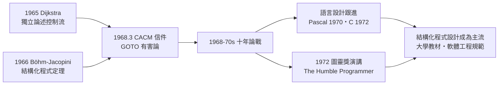

# 戴克斯特拉與 GOTO 有害論：結構化程式設計

## 用鋼筆思考的人

艾茲赫爾・戴克斯特拉（Edsger W. Dijkstra, 1930–2002）是計算機科學史上最特立獨行的人物之一。這位荷蘭人一生幾乎不用電腦寫作——他堅持用鋼筆手寫講稿與筆記，再交由秘書打字。他自編連號的手寫備忘錄被後人稱為 EWD 文件，從 1960 年代的 EWD100 一路寫到 2002 年去世前的 EWD1300 上下，累積一千三百多份，如今是計算機科學史的珍貴檔案。他晚年將這些手稿的影本放在辦公室外走廊供人自由取閱，並留下一句名言：「我是個沒有紀律的教授：我把所有東西都公開。」

他的軼事不勝枚舉：求職時對荷蘭當局自稱職業是「理論物理學家」、語言是「荷蘭語」；1970 年代定居美國德州奧斯汀後，堅持開一台 1963 年的老福斯金龜車，車牌上刻著反諷的字樣——他怕大學行政與會議浪費生命，卻熱衷在鋼琴前作曲自娛。這種近乎偏執的簡潔與秩序感，正貫穿他對程式的全部主張：正確性來自結構的清晰，而非測試與除錯的數量。

## 一封信引發十年戰爭

1968 年 3 月，ACM 通訊（Communications of the ACM）刊出一封短短一頁多的信，標題是《Go To Statement Considered Harmful》（GOTO 語句被視為有害）。這封信的主張是：GOTO 這種可以跳到程式任意位置的指令，會讓程式的靜態文本與動態執行過程失去對應關係，程式員被迫在腦中同時追蹤無數可能的跳躍軌跡，「我們的心智太不發達，無法承受濫用 GOTO 的程式」。他主張應以順序、選擇、循環三種結構化控制來取代，讓程式文字的書寫順序反映執行順序。

有趣的是，這個著名的標題其實是時任 CACM 主編尼克勞斯・維爾特（Niklaus Wirth，日後 Pascal 之父）改寫的。戴克斯特拉原稿的題目平淡得多，據他本人多年後的說法，原標題只是〈反 GOTO 個案〉之類的直白陳述。維爾特借用語言學家 Anthony Hooper 風格的「X considered harmful」句式，造就了計算機文獻史上被引用與被戲仿最多的標題。

論戰隨即爆發且延燒逾十年。反對者認為 GOTO 是必要的逃生門，禁用是教條主義；支持者則高舉「GOTO 是萬惡之源」（後來 Knuth 在 1974 年那篇著名的〈Structured Programming with go to Statements〉做了更持平的技術分析，承認某些 GOTO 用法有其效率價值，但也支持大多數場景該被結構取代）。戰場很快從語言設計延伸到軟體工程全盤方法論。

## 理論的基石：Böhm–Jacopini 證明

戴克斯特拉的主張並非空想，它踩在兩年前的理論成果上。1966 年，義大利學者 Corrado Böhm 與 Giuseppe Jacopini 在 CACM 發表證明：任何可計算的函式（等價於任何圖靈機演算法），都可以只用順序、選擇（if）、循環（while）三種控制結構表達，不需要 GOTO。這就是著名的結構化程式定理。它從可計算性層面證成：禁用 GOTO 不會損失任何表達能力。儘管後人指出該定理只保證「可表達」而不保證「好寫」，且戴克斯特拉本人早在 1965 年就有獨立論述，但這個證明無疑為結構化革命提供了數學背書——「GOTO 可以被淘汰」從品味主張升格為定理支持的原則。

## 謙遜的程式員

1972 年 8 月，戴克斯特拉在紐約接受 ACM 圖靈獎，發表了名為〈The Humble Programmer〉（謙遜的程式員）的演講。這篇演講的姿態極具個人風格：他回顧 1950 年代程式設計剛萌芽時，早期先驅（如 Wilkes、van der Poel）如何在資源極度匱乏下寫出漂亮的程式，然後主張：軟體規模爆炸之後，唯一的救贖是「心智的謙遜」——承認人類心智容量有限，因此必須用數學式的抽象與結構化，把程式切成人腦能一次掌握的小塊，用「證明式」的思維在寫下每一行時就確保正確，而非事後除錯。他甚至預言：軟體工程的大部分問題，終將由更好的語言設計而非更好的管理來解決。這個預言，在今日函式式程式設計與型別系統復興的時代看來，近乎先知。

## 對現代語言的深遠影響

論戰的實際勝利體現在語言上。1970 年 Wirth 設計的 Pascal 完全以結構化控制流為骨架，成為此後二十年的教學主流語言；1972 年誕生的 C 雖保留了 goto，但 Kernighan 與 Ritchie 在《The C Programming Language》中明示其應「幾乎不用」，並提供了完備的 while、for、switch 等結構。此後幾乎所有主流語言——從 Ada、Java 到 Python——都把 goto 邊緣化為殘存設施，Java 甚至將其列為保留字卻不提供。今日工程師在 code review 中反對巢狀過深、主張早返回與函式拆分，其思想譜系都能追溯到 1968 年那封一頁的信。

戴克斯特拉於 2002 年過世。葬禮幾週前，他寫下了最後一份 EWD 文件，題目正是關於自己死亡的安排。一個用鋼筆對抗混亂的人，連告別都寫成了結構清晰的手稿。
