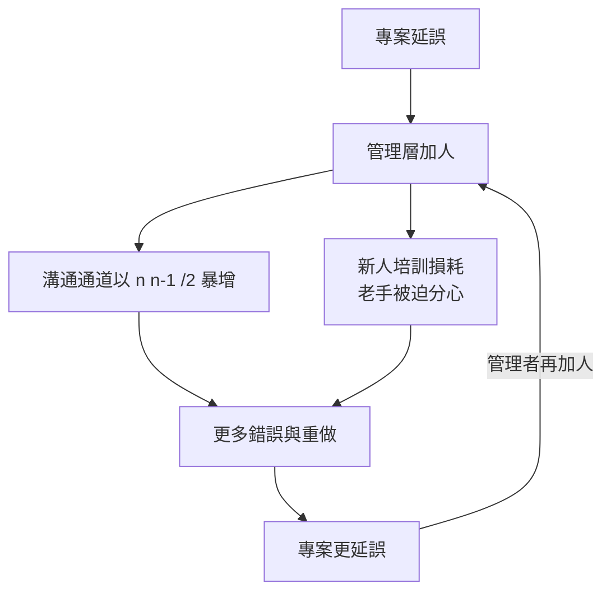

# 布魯克斯與《人月神話》

## 一個專案經理的懺悔

小弗雷德里克・布魯克斯（Fred Brooks, 1931–2022）不是旁觀的評論家，而是災難的當事人。1964 年，這位北卡羅萊納出生、擁有哈佛應用數學博士學位的 IBM 工程師，出任 System/360 這個史無前例專案的專案經理，直接負責作業系統 OS/360 的開發。IBM 為 360 系列投入約五十億美元（相當於研發曼哈頓計畫的量級），軟體動員上千人、延續數年。結果是軟體界最著名的失敗之一：OS/360 進度一再滑期、錯誤叢生，最終版本發行後仍需數百人長期修補。布魯克斯後來自嘲，這段經歷讓他獲得了一個流傳至今的綽號——他自己引用別人的話：「編寫大型系統的教訓，教訓之一就是：『誰來當那個吃力不討好的人？』——我當了。」

1975 年，已離開 IBM、轉任北卡羅萊納大學教堂山分校教授的布魯克斯，把這些血淚整理成《The Mythical Man-Month》（人月神話）。書名本身就是第一定律的來源——「神話般的人月」：以為一個人的工作可以等量切割給更多人以加速完成。布魯克斯以親身觀察寫下影響半世紀的 **Brooks 定律**：

> 向延誤的軟體專案增加人手，只會讓它更加延誤。（Adding manpower to a late software project makes it later.）

## 為何人月是神話：溝通的數學

這條定律背後有一個優雅的數學直覺。若團隊有 $n$ 個人，兩兩之間的溝通通道數為：

$$\frac{n(n-1)}{2}$$

三人團隊只需 3 條通道；九人團隊就是 36 條；當專案從 3 人膨脹到 9 人，工作量未必變三倍，但協調成本卻暴增十二倍。新人加入還需要培訓——老手必須放下手邊工作帶新人，短期內產出反而下降，這就是所謂的培訓損耗。布魯克斯總結為：「九個女人也不能在一個月內生出一個孩子。」軟體中真正難以分割的部分（設計、架構、概念），根本無法靠堆人加速。

## 概念完整性與外科手術團隊

面對這個困局，布魯克斯提出的正面藥方是**概念完整性**（conceptual integrity）：一個優秀系統最要緊的特質，是它像出自一個頭腦——設計理念的一致性勝過功能的完備。為此他提出「外科手術團隊」：由一位首席程式設計師（外科醫生）掌握設計主導權，配以副手、編輯、程式管理員、測試者等支援角色，讓團隊對外像一個人一樣思考。這個模型源自他在 IBM 的觀察——最好的系統往往由極少數天才定調。它也是後世「架構師」角色的思想源頭。

## Conway 定律：組織的影子

與人月神話相互輝映的是**康威定律**。1968 年，程式語言學者梅爾文・康威（Melvin Conway）在論文〈How Do Committees Invent?〉中提出：系統的結構，必然映照設計該系統的組織的溝通結構——四個團隊做編譯器，就會得到四段式編譯器。這條定律與布魯克斯的溝通成本分析互為表裡：既然組織形狀會烙印在系統上，那麼團隊的編組方式就是最重要的架構決策。半世紀後，微服務與「Team Topologies」風潮讓康威定律重新成為顯學，工程組織甚至刻意「逆向康威」（inverse Conway maneuver）——先設計想要的團隊結構，再讓系統長成那個樣子。

## 沒有銀彈：本質複雜性

1986 年，布魯克斯在《IEEE Computer》發表姊妹篇〈No Silver Bullet: Essence and Accidents of Software Engineering〉，次年擴充成書。他提出一個更冷峻的診斷：軟體的困難分兩種——**本質複雜性**（essence：問題本身不可簡化的複雜、不可見性、可變性、一致性）與**附屬複雜性**（accident：工具、語言帶來的額外負擔）。過去十年工具進步（高階語言、分時系統、IDE）已大幅削減附屬複雜性，但本質複雜性無法被任何單一技術消除。因此：

> 未來十年，沒有任何單一技術或管理技術，能讓軟體生產力提升一個數量級。

他進一步警告，開發正確的東西（規格錯誤）遠比正確地開發（實作錯誤）更難，因此「打造拋棄式原型」是必要的——呼應他書中名句：「計畫拋棄一個，你反正會拋棄的設計。」（Plan to throw one away; you will, anyhow.）這句話後來被敏捷社群奉為原型開發的先聲。

## 為何五十年常青

《人月神話》出版至今近半世紀，仍在幾乎每個軟體團隊的必讀書單上。原因令人不快卻真實：它描述的失敗模式從未消失。今日的專案用 Slack 與 Jira 取代了打孔卡，但溝通通道的數學沒變、概念完整性的稀缺沒變、新人的培訓損耗沒變、銀彈幻想也沒變——每個新框架問世，總有人宣稱它終將終結延誤。布魯克斯的偉大之處，在於他身為當事人敢於承認自己的錯誤（他在二十週年版中坦承當年發行的 OS/360 設計決策中，個人最大的錯誤之一是堅持了錯誤的架構），並把個案昇華為近乎人類學的觀察。他於 2022 年以 91 歲高齡辭世，留下的是軟體工程史上最誠實的一面鏡子。

工程的進步，往往始於一個失敗者願意詳細寫下自己是如何失敗的。布魯克斯是第一位，也仍是最重要的一位。
