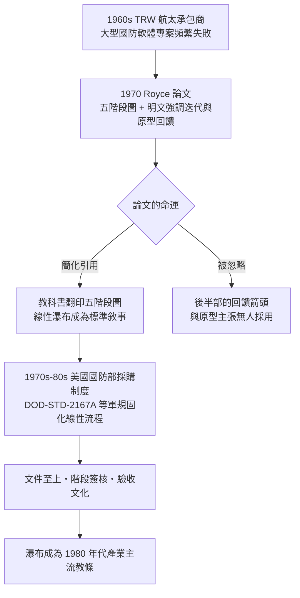

# 1970 羅伊斯論文與瀑布模型

## 航太承包商的產物

1970 年，一位在美國航太巨擘 TRW（Thompson Ramo Wooldridge）任職的工程師，發表了一篇僅七頁的論文，題目平淡無奇：《Managing the Development of Large Software Systems》（大型軟體系統開發之管理）。作者溫斯頓・羅伊斯（Winston W. Royce, 1929–1995）是航太國防產業的老兵——TRW 是 1960 年代美國飛彈與太空計畫的主要承包商，替空軍與 NASA 開發的系統動輒數百萬行程式碼。羅伊斯擁有加州理工學院博士學位，親身經歷過多個失敗與勉強成功的大型國防軟體專案。這篇論文，就是他對「為什麼這些專案總是失敗」的診斷。

羅伊斯的出發點是航太工業的兩段式開發傳統：硬體先造原型、測試、再量產。他指出，製造業的經驗法則是「先做兩次」——第一次學到教訓，第二次才做對。但軟體專案的殘酷在於：它的「原型」往往就是交付給客戶的最終產品，第一次嘗試失敗的成本無法像硬體那樣被吸收。他的論文正是試圖回答：既然軟體幾乎不可能一次做對，管理流程該怎麼設計？

## 那張著名的圖：五個步驟

論文中，羅伊斯畫了一張流程圖：需求分析 → 系統規格 → 程式設計 → 程式撰寫（Coding）→ 測試 → 操作與部署，各階段依序向下排列，如同階梯。這張圖後來被無數教科書翻印，成為「瀑布模型」（waterfall model）的視覺原型——儘管羅伊斯從未使用過「瀑布」一詞。順帶一提，早在 1956 年，貝爾實驗室與 SAGE 專案的 Herbert Benington 就畫過極其相似的階梯圖，1976 年 T. E. Bell 與 T. A. Thayer 的論文也出現類似階段圖；「瀑布」這個名字要到 1976 年前後才被學者（一般歸於借用礦業術語的通俗稱呼）給予正式命名，然後才被追認到羅伊斯頭上。

羅伊斯在論文中承認這種線性流程是「簡化」：在理想世界裡，你可以在紙上完成全部設計、證明無誤，然後一次寫完程式。但他隨即指出，這在真實的大型專案中從未成功——因為測試階段才發現的需求誤解與設計缺陷，代價是災難性的。前幾個階段的任何假設錯誤，都要等到最後才被揭穿。

## 羅伊斯真正的藥方：回饋與迭代

關鍵在於：論文的後半部明確說明，五步驟圖只是「起點」，是藥方的「病症」而非「處方」。羅伊斯接著畫了第二張圖——在各階段之間加上向下的內部迭代（每階段內部允許回頭修正），然後是第三張圖——在相鄰階段之間、甚至跨階段之間加上**向上回饋的箭頭**。他特別強調兩件事：

1. **每個階段都應該與其前一階段「以書面形式互動」**，設計者必須持續回到需求與規格層次驗證自己的理解；
2. **先做一個「試驗性原型」給客戶試用**，在投入最終開發前，讓使用者對程式有實際的操作體驗。他寫道：「我 相信在正式開發之前，必須讓客戶在實際操作中試用與評估這個軟體。」——這正是十五年後敏捷方法中「工作軟體勝過詳盡文件」的先聲。

換言之，羅伊斯的完整主張是一套**帶有迭代與回饋的階段模型**，而非純線性的瀑布。他的原話甚至帶有諷刺意味：線性流程是「有勇無謀」（an invitation to failure）的做法，只有小型、熟悉的專案才碰巧能走通。

## 制度的接力：DoD 把階梯固成教條

然而，歷史開了一個殘酷的玩笑。1970 年代，美國國防部正是羅伊斯所屬產業的最大客戶，其採購體系渴求的是**可簽約、可稽核、可驗收**的階段化流程：先簽需求規格、再簽設計、再簽開發、最後驗收測試，每個階段以大量文件（需求規格書、設計文件、測試計畫）作為付款與法律責任的依據。這種「文件至上」的航太文化，把階梯圖從「簡化的起點」捧成了「標準作業程序」。1985 年 DoD 發布的標準 DOD-STD-2167A，將軟體開發週期正式規範為需求、初步設計、細部設計、程式碼與單元測試、整合測試的線性階段——瀑布自此有了法律效力。承包商為了符合軍規，把專案組織成一個文件接一個文件的審查鏈，實際的回饋探索則轉入地下。

諷刺的是，羅伊斯的本意在業界大行其道時，恰恰被徹底誤讀了。他晚年看著自己的論文被奉為「瀑布之父」，成為最被批判的對象，內心的無奈可想而知——那是另一位故事的開端。
