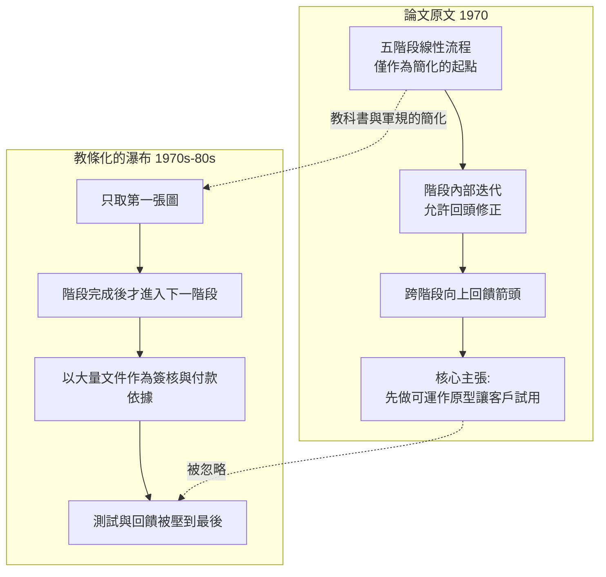

# 歷史的誤讀：羅伊斯原本提倡迭代

## 一篇被自己的圖背叛的論文

科技史上很少有文獻遭遇如此奇特的命運：一篇論文最廣為人知的，恰恰是作者極力反對的那一半。

羅伊斯 1970 年的論文確實畫了那張五階段階梯圖，但只要讀過原文就知道，他的語氣是批評而非提倡。他稱簡單的線性流程為「簡化卻危險」的做法，緊接著用後半的篇幅主張：各階段之間必須有向回的迭代與回饋，開發者應先做出可運作的原型供客戶試用，「若能及早讓客戶實際接觸，設計上的誤解才會被揭露出來」。換句話說，羅伊斯論文的「結論」正是後來敏捷宣言的核心信條——只是大部分引用瀑布模型的人，從未讀過論文的後半部。

## 兒子的見證

這樁誤讀最有力的平反，來自羅伊斯的家族。他的兒子小溫斯頓・羅伊斯（Winston Royce II，業界稱 Walker Royce）本人也是軟體工程界的重要人物，長期在 Rational 軟體公司任職，是 Rational 統一流程（RUP）與迭代式開發方法論的推動者。Walker 多年在演講與文章中為父親「平反」，明確指出：「我父親的論文常常被引用為瀑布模型的源頭，這其實是個錯誤。他的論文主張的正是迭代開發——只是大家只記得第一張圖，忘了第二、第三張圖。」Rational 公司採用迭代開發的立場，與羅伊斯家族的血緣傳承並非巧合：兒子做的事業，正是父親論文後半部主張的工程實踐。

羅伊斯本人於 1995 年因心臟病突發辭世，享年 65 歲。他生前目睹自己的名字與「瀑布」永久綁定，眼睜睜看著 1980 年代產業界把線性階段奉為軍規教條、又看著 1990 年代批判瀑布的浪潮興起——批判者引用的靶子，仍是他的名字。他晚年的談話中流露過這種無奈：自己被記住的，是那個被簡化到失真的第一張圖。歷史給了他「瀑布之父」的頭銜，而他真正想當的，也許是「迭代之父」。

## 敏捷社群的歷史重審

2001 年 2 月，十七位軟體界人士在猶他州滑雪勝地雪鳥（Snowbird）簽署敏捷宣言，「敏捷」（Agile）成為對瀑布教條的正式反叛。反叛運動興起後，一群科技史研究者與敏捷實踐者開始追溯瀑布的譜系，驚訝地發現：這場運動批判的「瀑布」，其理論源頭恰恰主張敏捷式的回饋。2000 年代，Craig Larman 與 Victor Basili 在 2003 年發表的重要回顧論文〈Iterative and Incremental Development: A Brief History〉系統梳理了證據：迭代開發的思想早於瀑布數十年——從 1950 年代的 SAGE 專案、1960 年代的 IBM 與貝爾實驗室實務，到羅伊斯 1970 年的論文，線性瀑布從來不是業界實際成功案例的主流；它更多是**管理與採購制度的產物，而非工程實踐的總結**。羅伊斯的「瀑布之父」招牌，被重審為一樁歷史冤案。

這段重審也揭示了軟體工程史上最深刻的教訓：一個工程概念如何被官僚制度與教科書放大成自己的反面。羅伊斯的五階段圖之所以流行，不是因為它描述了成功，而是因為它**適合簽合約**——階段邊界清晰、文件可稽核、責任可切割，這正是國防採購體系需要的。教材需要一個簡單的對比圖式（「瀑布 vs 迭代」），於是第一張圖被單獨抽出、命名、批判，後半部的回饋箭頭在複印與轉述中消失。誤讀經由教材的複製而制度化，最後連批判誤讀的人都得借助這個誤讀才能發聲。

## 教訓：圖比文字跑得快

羅伊斯的悲劇留給後世一個值得所有工程作者警惕的結論：**圖的傳播力遠大於文字的論證力**。他花後半篇論文寫的細膩論證，敵不過前半篇一張一眼可解的階梯圖。半世紀後，人們記得瀑布，忘了原型；記得階段，忘了回饋。而在敏捷已成顯學的今天，另一種鏡像風險又悄悄出現——把敏捷儀式（站立會議、看板）當教條，卻忘了宣言背後同樣細膩的工程判斷。歷史不會重演，但它會押韻：任何把流程圖當真理、把文件當目的的時代，都可能正在製造下一個被誤讀的羅伊斯。
