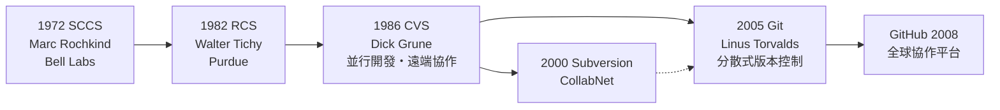

# QA 與版本控制的誕生：SCCS

## 貝爾實驗室裡的第二次發明

1969 年前後，貝爾實驗室（Bell Labs）正在開發一個名為 MERT 的多工程式即時作業系統。實驗室的程式師馬克・羅奇金德（Marc Rochkind）面對一個日益惱人的問題：上百個原始碼檔案在多位開發者手中反覆修改，沒有任何機制記錄「誰、何時、為什麼、改了哪一行」。改壞了想退回上個能用的版本？只能靠手工備份檔案與過人的記憶。羅奇金德的解法是寫一套工具，把每個檔案的修訂歷程系統化管理：以 delta（增量差異）的方式只儲存版本之間的變動，用 SID（版本識別號，如 Release.Level.Branch.Sequence 的四段編號）標記每個版本，並提供取得（get）、存入（delta）、分支、合併與鎖定等命令。這就是 **SCCS（Source Code Control System）**，1972 年問世，公認為世上第一套版本控制系統。

SCCS 誕生在貝爾實驗室並非偶然。這裡正是 UNIX 的誕生地——湯普遜（Ken Thompson）與里奇（Dennis Ritchie）在 1969–1973 年間打造了 UNIX 與 C 語言，而 SCCS 與它們是同一文化的产品：小工具、組合使用、以檔案為中心。1970 年代，SCCS 隨 UNIX（特別是 PWB/UNIX，程式設計師工作台版本）分發到各大學與企業，成為工程文化的隱性基礎建設。版本控制這個觀念——**原始碼的歷史本身是一等公民、變更是需要被審計的事件**——就這樣跟著 UNIX 散播開來。

## 工具譜系：從 SCCS 到 CVS

SCCS 之後，譜系開枝散葉。1982 年，普渡大學的華特・蒂奇（Walter Tichy）發表 **RCS（Revision Control System）**，簡化了 SCCS 繁瑣的版本編號，改用符號名稱與更直觀的命令（ci/co），成為 1980 年代末 UNIX 工作站的標配。1986 年，荷蘭阿姆斯特丹自由大學的迪克・格魯內（Dick Grune）為了與學生平行開發一個編譯器，寫了一組 shell 腳本包裹 RCS，讓多人可以各自檢出、修改、再提交合併——這就是 **CVS（Concurrent Versions System）**，第一套支援多人並行開發與遠端協作的版本控制系統。CVS 在 1990 年代成為開源運動的動脈：Linux 核心早年透過郵寄 patch，而無數 GNU 套件與 SourceForge 時代的專案跑在 CVS 上，直到 2000 年代被 Subversion 與日後的 Git（2005，Linus Torvalds 為 Linux 核心開發而寫）相繼取代。每一代工具都在回答同一個問題：如何讓**協作**不摧毀**品質**。

## 測試文化的搖籃

版本控制只是品質問題的一半。另一半——**如何系統性地證明軟體是對的**——同樣在貝爾實驗室成形。UNIX 的開發文化裡，測試從來不是事後補丁：湯普遜與里奇寫 UNIX 時養成了「寫完就跑、立即回饋」的迴圈，而實驗室的工程師（如 Mike Lesk 以 awk 寫的測試輔助、日後 Jon Bentley 等人的程式設計珠璣專欄）把「用小而狠的測試案例攻擊程式」內化為職業本能。1970 年代末，貝爾實驗室的 William Hetzel 等人組織了最早的軟體測試學術會議，測試從手工藝升格為有方法論的學科。這種文化隨 UNIX 與 C 語言的散播，滲入整個產業，最終在 2000 年代結出持續整合（CI）與自動化測試的果實。

## 標準與成熟度：制度化的品質

品質觀念的制度化則發生在標準組織與國防體系。1983 年，IEEE 發布 **IEEE 730：軟體品質保證計畫標準**，首次以正式標準規範「軟體品質保證計畫應包含什麼」——品質目標、文件要求、審查與稽核程序。這是 1968 年加爾米施會議以來，軟體工程制度化路線的又一里程碑。

更具產業衝擊力的是 **CMM（能力成熟度模型）**。1984 年，美國國防部出資在卡內基美隆大學成立軟體工程研究院（SEI），任務直指國防採購的痛點：如何判斷一家承包商「有能力把軟體做好」？SEI 的瓦茨・漢弗萊（Watts Humphrey, 1987 年起）提出以成熟度分級評估組織的軟體流程——從第一級「混沌」到第五級「最佳化」，每級定義關鍵流程域。漢弗萊本人是 IBM 資深出身（參與過 System/360），深知大型專案的病根。CMM 及其 2000 年代的後繼 CMMI，一度成為全球軟體外包與國防合約的通行證：印度軟體業正是靠大規模 CMM 認證打進歐美市場。

CMM 的歷史地位因此充滿張力：它把「流程會影響品質」這個正確洞見推向全球，卻也催生了「為認證而寫文件」的官僚病，成為敏捷運動批判的靶心。這與瀑布的命運驚人地相似——好的洞見，被制度放大成自己的反面。

## 結語：品質是文化的沉澱

回望 1972 年貝爾實驗室那個苦於檔案版本的下午，很難想像它會長成一整個產業的基礎設施：今日任何一次 Git push、每一條 CI 流水線、每一份測試報告，血統都源自 SCCS 與那個時代的測試文化。版本控制與品質保證，本質上是同一件事的兩面——**把個人的記憶與良心，轉化為組織可以稽核、可以改進的紀錄**。軟體工程從手工藝走向專業，靠的不是某個天才的單點突破，而是像羅奇金德這樣的人，把日常的煩惱做成工具，再把工具沉澱為文化。
