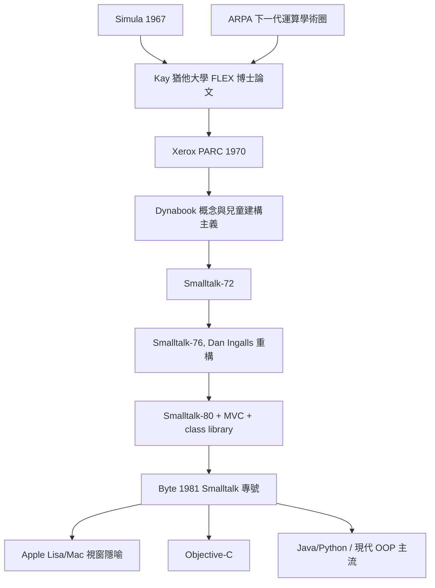

# 阿蘭凱與Smalltalk：OOP的誕生

## 空軍基地裡長大的孩子

1940 年，Alan Kay 出生於麻薩諸塞州，在空軍軍官家庭長大。父親不斷調動駐地，他的童年就在一連串的臨時安置中度過——在真正上學之前，他不僅早已學會閱讀，還常常在班上比老師懂得多。他後來半開玩笑地說，自己夷平了 Paul Revere 駐地小學的〔升學測驗〕紀錄，結果老師不是因材施教，而是叫他閉嘴、罰站，甚至動用皮尺懲罰。這段經歷讓他一生對「體制化教育」深懷戒心：學校往往不是點燃好奇心的火種，而是撲滅它的滅火器。

Kay 的第一個職業選擇是音樂——他曾是職業爵士吉他手，在丹佛做過音樂代課教師。後來他憑空軍預備役軍官的身分進入科羅拉多大學，主修分子生物學。IBM 650 的程式設計課是他與電腦的初遇；當時他在生物實驗室裡反覆推演細胞機制，發現自己不得不「手寫出整台機器的行為」，於是体会到：模擬生命與創造生命，原來是同一件事的兩面。1966 年他申請研究所時，同時送出機械、數學、生物、音樂與電腦科學的申請書，最後只有猶他大學的 ARPA 計畫收留了他——而那個單位的名聲，正是「把最難的東西交給最不需要操心的人」。

## 猶他：ARPA 下一代運算的溫床

1960 年代的 ARPA（美國國防部高等研究計畫署）以每年數千萬美元的規模，資助著一個橫跨 MIT、CMU、Stanford、Utah（以及稍後的 Xerox PARC）的「下一代運算學術圈」。這些教研室裡沒有課表，只有彼此借來抄的程式碼、接力送出的研究生，以及一種近乎宗教的使命感：電腦不該是報表機，而該是能放大人類智性的互動夥伴。Utah 是圖形學的重鎮——David Evans 領導的教研室裡，Ivan Sutherland 的 Sketchpad 殘餘影響仍在，而 Kay 的博士輩同窗就有Jim Clark（後來的 Silicon Graphics 創辦人）、Alan Davis、John Warnock（後來的 Adobe 共同創辦人）等人。Kay 的博士論文題目 FLEX，正是全 Jah*_一 window-based 互動語言的雛形：Flex Machine 的哲學，用的正是 Simula 的 class觀念——這是他第一口嘗到 Simula 滋味的 duct。

Kay 反覆強調，ARPA 體系的塑造力遠大於任何單一課程。「ARPA 是一個說：你這輩子想做的事，錢在這裡，去做吧」——這句話的最佳註解是：ARPA IPL 的研究經費往往一給就是激勵，要求的是「去做那件想做但缺錢的事」。

## PARC：為了不存在的孩子而造機器

1970 年，Xerox 在史丹佛研究院旁成立了 Xerox PARC，聘請了一批年輕而有先見的科學家，其中包括 Kay（他自願主動去表示雇主可以省錢）。Xerox 當時的商業動機，是擔心影印機的印刷文化終有一天會被「無紙化辦公」取代——PARC 的 brief 正是要發明那個「取代印表機」的辦公室。資金充裕、人員精銳、且沒有過 eerlijke 度的中期審核，使 PARC 成了美國工業史上最接近「理想研究地」的所在。

Kay 剛到 PARC 不久（1971 年前後），提出了 Dynabook：一台 A4 紙大小、平價、無線、以觸控與鍵盤輸入、能讓孩子攜帶一生的互動電腦。它不只是裝置，而是一種教育哲學的物化。Kay 從 Piaget 的兒童認知發展理論出發，加上 Bruner 與 Papert 的 constructionism（建構主義）主張——孩子是主動的知識建造者，不是被動的接收桶。類似 Papert 的 Logo 所做的，Dynabook 要給孩子一種「可以用來思考與表達」的介質，而這個介質必須是程式語言：當孩子畫出一隻烏龜、教它走路時，其實是在用運算做思維實驗。

這個理念決定了技術路線：Dynabook 需要一種「每個物件都是活的、可被孩子檢視與改寫」的環境。同時期 PARC 的同事 Chuck Geschke、John Warnock、Bob Metcalfe、Butler Lampson 等人屢屢借鑑 Kay 的想法；而				      Kay 也從 Englebart 的「所有展示都是呼叫」的互動傳統中取材。

## Smalltalk：一門為孩子而生、卻改寫了業界的語言

Smalltalk 不是被「設計」出來的，而是在 PARC不但被孩子——也被同事和孩子身上——「被長出來的」。1972 年的第一版 Smalltalk-72，是一張一頁紙的語言定義、一個在 idle moments 之間成形的 interpreter，其語法是「一切皆訊息」的孩子式極簡。接著是 Smalltalk-76 的重大重構（由 Dan Ingalls 主導）引入了 object model 的 hashing、block context 等，而 Smalltalk-80 則是第一套完整的商業化版本：內建 class library、MVC（Model-View-Controller，此架構即誕生於這個專案）、Browser、 bit-blit 的顯示層，以及彩色 Wall screens。

兩個名字必須並列記載。Adele Goldberg 是 Smalltalk 的共同設計者與守門人：她負責語言的 clarity、文件的撰寫，以及——尤其是—ให้ Smalltalk 的教學與推廣；她堅持版本之間的一致、執筆了那整套藍色書皮的三卷本手冊，並且對「這門語言屬於孩子，不該被商業提前偷走」懷有近乎家長式的執著。Dan Ingalls 則是 Smalltalk 的首席工匠：他寫出 interpreter、寫出 bit blit、發明 SimpleSmalltalk（Squeak 的前身的心血也是他），而且以「將系統壓縮到一個聰明高中生能在幾週內讀完」為目標——Smalltalk 能成為一個可被完全理解的宇宙，多半是 Ingalls 的美德所致。

Smalltalk 的數學之美，在於它把三件看似平凡的性質推到了極端：

1. **封裝（encapsulation）**：物件內部狀態只能透過該物件的方法觸及。這不只是工程規範，而是一個數學上的「不可穿透的邊界」：物件的行為構成一個完整的代數系統，外界所看到的只是其操作的介面，而非其內部表示。
2. **訊息傳遞（message passing）**：呼叫方法不是「執行函式」，而是「向物件發送訊息、由物件自行決定如何回應」。接收者可以做任何事情：回應、轉發、忽略、問別的物件。「問句總是好的，命令才是粗魯的」——Kay 這樣解釋它與過程式呼叫的本質差異。
3. **晚綁定（late binding）**：訊息到哪個方法，到執行期才決定。這在數學上等於允許系統在不重編譯的情況下擴展其行為集合——從而將「可擴展性」從語言外部特權變成語言本身的能力。Kay 曾說，這是「我所知的唯一一種，能讓一個人在幾千行程式中表現出任意複雜系統的方式」。

1981 年 8 月，Byte 雜誌出刊 Smalltalk 專號——整期以 Smalltalk 為主題，Adele Goldberg 主編，登出那張後來成為時代的圖像：一支鉛筆、一個气球與一個實作於 PARC 的 bitmap editing 界面。這期專號把 Smalltalk 的 IDE、MVC、bitmap 顯示、object model 傳遍整個業界；Apple 的 Steve Jobs 恰好在 1979 年參觀 PARC 後帶走了視窗、滑鼠與物件導向的直覺——後來的 Apple Lisa 與 Macintosh、Objective-C（Brad Cox 與 Tom Love 都受過 Smalltalk 浸染）、Python 的 object model，都在這條譜系的延長線上。

Kay 的另一句話也成為世紀標語，出現於 1971 年的 PARC 會議紀錄：

> The best way to predict the future is to invent it.

——預言未來最好的方法，就是發明它。這不是宣言，而是那個年代的 ARPA 人共同的日常。他們真的靠發明未來，而縮短了我們抵達未來的時間。

