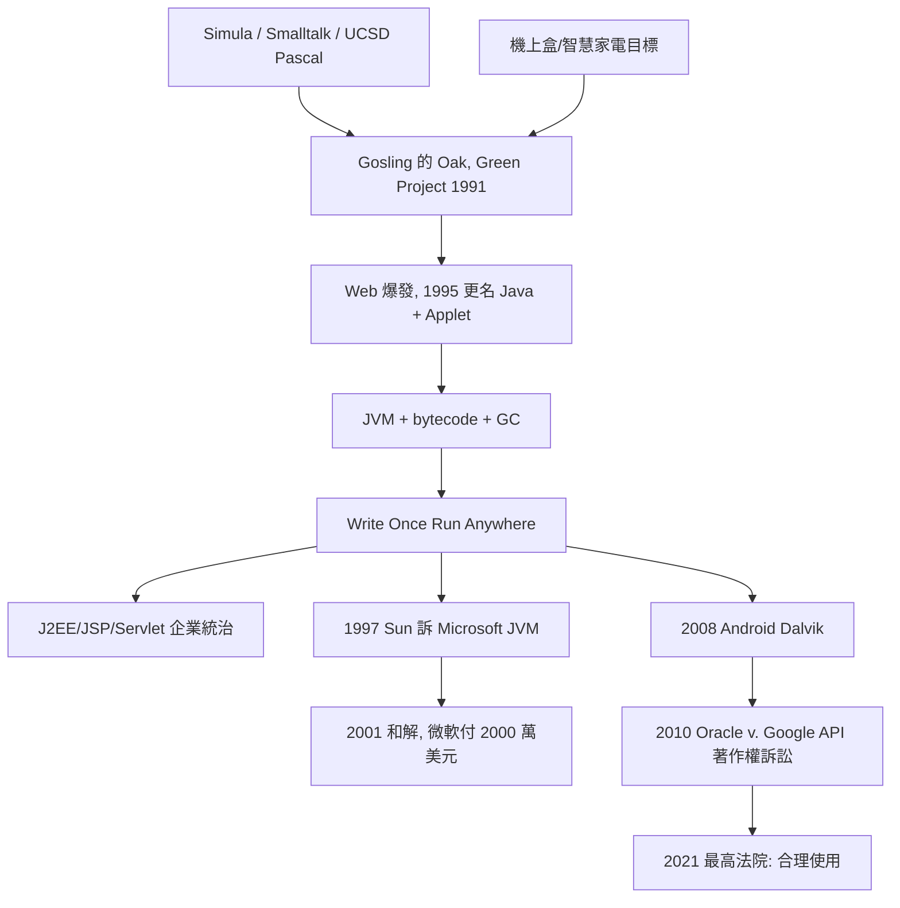

# C++與Java：跨平台JVM的承諾

## Bell Labs 里的丹麥人

Bjarne Stroustrup 1950 年生於丹麥 Aarhus，家中是工人階級，他是家族裡第一個上大學的人。他在 Aarhus 大學讀數學與電腦科學時接觸了 Simula——那門在挪威被發明出來的語言開啟了他對 class 的興味，也讓他在英國劍橋大學的博士研究中被迫面對一個實際工程問題：模擬 UNIX 核心的分散式系統，Simula 太慢，C 不夠抽象。1979 年，他進入紐澤西的 Bell Labs，以 C 為基底、借 Simula 的 class 概念，開始寫 C with Classes。

Stroustrup 的骨子裡是一個帶有北歐式務實的工程師：「我永遠記得，程式要能寫得出來，也要能用二十五年。」他刻意避開所有會導致執行時間 overhead 的設計：沒有 garbage collection（他認為嵌入式系統與作業系統承受不起）、虛擬函式的 dispatch 儘量造成極小成本、template（1980s 後期才加入，1983 年語言更名 C++）使其成為靜態多型的手段。他有一句名言，是 C++ 哲學的濃縮：「你不使用的，不必為它付出代價（You don't pay for what you don't use）」。

C++ 的成功，與其說是語言之美的勝利，不如說是「末班車效應」：它把物件導向的抽象能力「移植」到已經稱霸 UNIX 圈、極其高效的 C 上，於是既有 C 程式設計師可以漸進升級，企業不需要推倒重來。1990 年代，凡是需要「效能與規模並存」的地方——金融系統、電信交換機、遊戲引擎、作業系統——C++ 幾乎全面接管。這同時也付出代價：語言的複雜度被加入太多歷史包袱，而成為後來批評者的標靶。

## Green Project：一批為有線電視機上盒而生的語言

1991 年，Sun Microsystems 內部成立了一個秘密小專案，代號 Green Project，由 James Gosling 主導。目標是智慧家電：機上盒、互動電視的 set-top box——要求裝置橫跨不同的硬體與晶片，因此必須有一種「不綁定 CPU 架構」的程式碼。Gosling 的初衷語言叫 Oak（他發明這門語言的辦公室外有一棵橡樹），其語法看起來像 C++，但理念來自曾影響 UCSD Pascal 與 Smalltalk 的 bytecode 技術：程式先編譯成虛擬機的中間碼，由 Java Virtual Machine（JVM）執行。

中間碼加上垃圾回收與自動記憶體管理，看似對 C++ 工程師是一種「降級」的笨重，Gosling 的直覺卻是——安全比效能更稀有：一個會造成記憶體洩漏的 TV 遙控器，是人們可以理解的災難；而 Web 將把這個「安全」變成全球經濟議題。

1994–95 年，機上盒的商業談判破裂，Green Project 幾乎夭折。命運的轉折來自 Web 的爆發：Netscapeavigator 1994 年問世，瀏覽器成為一個可以「內嵌程式」的 새로운 通道。1995 年 5 月，Sun 在 SunWorld 正式宣布 Java，Oak 因商標衝突更名、 además 不再是 a TV box language，而是「能讓瀏覽器跑 Applet 的語言」——Applet demo 的畫面（一個在網頁裡跳舞的動畫）、以及 Write Once, Run Anywhere 的口號，瞬間席捲開發者大會。1996 年 Netscape 宣布瀏覽器內建 JVM，微軟也於 1996 年取得 Java 授權、將 JVM 放入 Internet Explorer。

## Write Once, Run Anywhere：一個商業諾言與兩場官司

「一次撰寫、到處執行」不僅是技術宣示，也是 Sun 的營運模式承諾：Java 免費散布、靠品牌與相容性測試吃市場，並以此為策略在 UNIX 工作站的老人 Sun、以及新興的企業伺服器市場之間，架起與微軟對抗的橋樑。JavaSoft 一度是矽谷最風光的組織，1999 年 J2EE（Java 2 Enterprise Edition）問世，把 JVM、Servlet、EJB、JSP 包裝成企業資訊系統的標準平台，幾乎所有銀行、保險、電信的核心系統都轉向 Java；2000 年代初，Rod Johnson 的一本書催生的 Spring 框架，以輕量地取代 EJB 的繁瑣而壯大，成為 Java 生態的實質領袖。

相容性卻是火藥庫。1997 年，Sun 宣佈 Microsoft 的 IE 專屬 JVM（加了 Windows 專屬擴充、並未通過相容測試）違反授權合約，提起訴訟，主張「Java 必須到處一樣」。幾經折衝，2001 年雙方和解，微軟支付 Sun 2000 萬美元、並在最終版本 IE 中移除了自家的 JVM——這件訴訟的象徵意義在於：跨平台是一場關於「控制權」的鬥爭，而不是純技術問題。

第二場官司持續更久。Google 於 2005 年收購 Android，2008 年第一支 Android 手機問世；Android 開發用 Java 語言，但 Google 沒有用 Sun 的 JVM，而是自己實作了 Dalvik VM——並複製了 java.* 套件的 API 簽章以方便開發者遷移。2010 年，被 Oracle 併購後的 Sun，正式起訴 Google，主張 API 的宣告結構受著作權保護。這個案子打了一個十年：2012 年舊金山地方法院一度判 API 不受著作權保護，2014 年聯邦巡迴法院上訴改判受保護，2016 年陪審團認定 Google 是「合理使用」，2018 年又被聯邦巡迴法院推翻，2021 年 4 月，美國最高法院以 6 比2 判決 Google 的複製屬於合理使用、不必賠償——理由是 Java API 的宣告已經變成整個產業的「標準介面」，Google 只取用了極小、必要的部分，而這樣的使用「促進了創造性的進步」。這份判決畫下的時代界線：API 可以受著作權保護，但成為產業事實標準之後，他人出於促進創新的目的使用，可以落入合理使用。

Java 的影響力，最終超過了語言本身：bytecode + VM 的技術路線，被 C#（微軟 2000 年推出的 .NET CLR，可謂 JVM 的回敬）、Python 的位元碼、WebAssembly 等繼承；垃圾回收從「慢」變成一種企業界理直氣壯的配置；而由 JVM 養出來的工程文化——依賴管理、單元測試框架、企業級框架、開源社群——成為今日「現代軟體工程」的標配。Gosling自己在 2010 年（Oracle 併購 Sun 後）離開了，他寫道：「關於 Oracle 的 Sun 合併，我能說的最誠實的一句話就是——再見了。」

