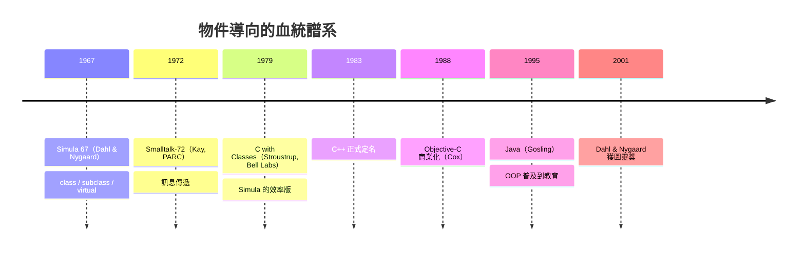

# 從面向過程到物件導向的思維轉變

## 一、挪威的冬天：Simula 與 class 的發明

物件導向的故事要從一個不太起眼的地方說起：1960 年代初的挪威計算中心（Norwegian Computing Center, NCC）。Ole-Johan Dahl 與 Kristen Nygaard 兩位研究員當時的任務並不浪漫——為挪威的核子反應爐、港口物流與社會經濟系統做模擬。他們發現，模擬程式的本質不是「一連串程序呼叫」，而是「一群彼此互動的物件」：船、碼頭、貨櫃，各自有自己的狀態與行為。

1967 年，他們發表 Simula 67，第一次把 `class`、`subclass`、虛函式（virtual method）與物件實例做成了正式語言機制。這個出自社會科學模擬需求的設計，後來成了整個軟體工業的語法祖先。Simula 沒有商業成功，卻透過兩條路徑統治了世界：一條到猶他大學與 Xerox PARC（Smalltalk），一條到貝爾實驗室（C++ 的 C with Classes）。有趣的是，Dahl 與 Nygaard 拿到圖靈獎時已是 2001 年——距離發明 class 整整三十四年。

## 二、程序式思維的天花板

在物件導向之前，主流是程序式（procedural）設計：程式是一張函式呼叫圖，資料在全域與參數之間流動。它對中小型程式完全夠用——FORTRAN 與 C 撐起了整個科學與系統軟體世界。但 1980 年代兩股力量把它推到極限。

第一股是**規模**。百萬行的系統裡，任何人改一個全域結構，都可能引爆遠方的程式碼。程序式設計沒有語言層面的「邊界」概念，資料與操作它的函式之間只有約定俗成的紀律，沒有編譯器的保證。

第二股是**團隊分工**。當 Conway 定律開始發酵，企業發現軟體組織需要把「維護某類資料的責任」明確分給某個人或小組。物件恰好是這種責任邊界的語言化身：一個 class 的私有狀態只有它的方法能碰，於是「誰能改什麼」第一次變成編譯器可以執行的事情。

這是思想層面的轉變：從「程式是指令的序列」轉為「程式是互動物件的生態系」。前者像流水線，後者像城市。

## 三、三位一體與 Rational 三傑

1980 年代末，方法論戰國時代來臨。Grady Booch 的 Booch Method（強調迭代與巨觀/微觀開發循環）、James Rumbaugh 的 OMT（通用電器出身、偏重分析建模）、Ivar Jacobson 的 OOSE/Objectory（愛立信出身、發明 Use Case）。三人的方法論各擁山頭，企業客戶被迫學三套圖法。

1994 年前後，三人先後匯流到 Rational 公司，開始「統一」方法論——最後統一出的不只是方法，而是 1997 年被 OMG 採納的 UML 標準語言。Rational 後來被 IBM 以 21 億美元收購（2003），可見「方法論」本身是多麼有利可圖的生意。

## 四、教育制度的最終確立

OOP 能統治世界，最關鍵的一推其實來自**教育與語言生態的合謀**。1995 年 Java 問世，Sun 打出「每個電腦都該跑 Java」的口號；到 1990 年代末，美國大學的入門課程（CS1/CS2）大規模從 Pascal/C 改用 Java——因為它免費、跨平台、有丰富的 GUI 函式庫、自動記憶體管理，而且天生「必須」寫在 class 裡。一代工程師就這樣被養成了物件腦。

這裡有制度經濟學：Sun 免費開放 Java 教學授權，教育界成本近零地全面換血；課程大綱（ACM/IEEE Computing Curricula 2001）正式把 OOP 列為核心；出版社與認證考試（SCJP）再推一把。語言、教材、證照、就業市場形成迴路，OOP 從此不只是一種技術選擇，而是行業的預設文化。

## 五、批評與反動

主流化的代價是教條化。1998 年，Tcl 的作者 John Ousterhout 投下炸彈：腳本語言才是未來，物件導向對腳本世界是負擔。之後陸續有學者指出：繼承的深層次結構脆弱易碎（fragile base class problem）；「用物件模擬現實世界」的口號在很多領域（數值計算、資料轉換）根本是偽命題；Go 語言在 2009 年乾脆不提供繼承，只保留組合與介面，被視為對 OOP 過度化的正式糾偏。

但公允地說，物件導向留給軟體工程的三個永久遺產無可取代：**封裝**（責任邊界可由編譯器強制）、**介面抽象**（依賴可以反轉、實作可以替換）、**多型**（同一個呼叫點容納行為的多樣性）。今天的微服務架構，本質上是把「物件 = 封裝狀態 + 訊息介面」的定義放大到系統層級——整個服務就是一個大物件。Dahl 與 Nygaard 在挪威冬天寫下的那個關鍵字，就這樣一路長成了雲端時代的骨架。
