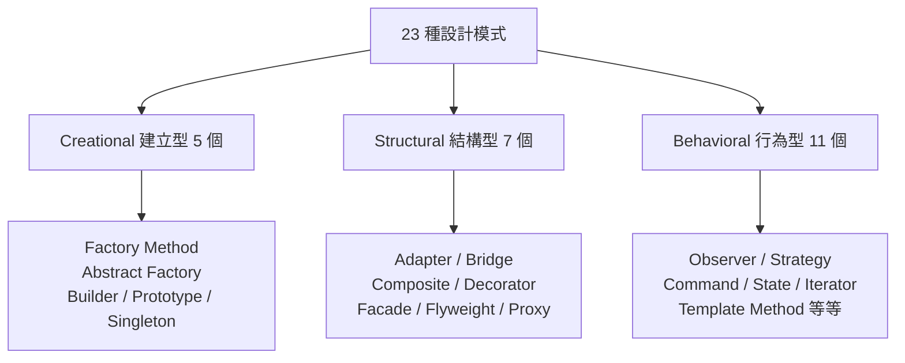

# 四人幫與 1994 年《設計模式》

## 一、四個人的相遇

《設計模式》的四位作者——Erich Gamma、Richard Helm、Ralph Johnson、John Vlissides——後來被社群暱稱為「四人幫」（Gang of Four, GoF）。他們的相遇並非精心策劃的出版計畫，而是 1990 年前後物件導向社群自然匯流的結果。

Erich Gamma 是蘇黎世大學的博士生，研究物件導向開發環境；他在 OOPSLA 會議上認識了在 IBM 任職的 Richard Helm；Ralph Johnson 是伊利諾大學香檳分校（UIUC）的教授，师承 Smalltalk 社群，長期主持物件導向研究小組；John Vlissides 則是 IBM Watson 研究中心的研究員、Stanford 博士。1991 年前後，Gamma 到 UIUC 訪問，四人發現彼此都在做同一件事：收集「物件導向系統裡反覆出現的設計形態」。原本各自的研究，於是合流為一本書。

## 二、從建築學借來的詞

「設計模式」（design pattern）這個詞不是軟體界的發明，而是從建築師 Christopher Alexander 那裡借來的。Alexander 在 1977 年《A Pattern Language》中提出：優良的建築空間（門廊、庭院、窗台的採光）會反覆出現，可以命名、可以描述它解決的張力、可以重複使用。每個模式是「在特定情境下，反覆出現的問題與其解法的核心」。

Ralph Johnson 是最早把 Alexander 引進軟體圈的人之一。1993 年他與 Kent Beck 等人創辦 PLoP（Pattern Languages of Programs）工作坊，專門討論軟體模式，採用作家研討會（writers' workshop）的形式互相審稿——這種社群儀式本身也是從建築學借來的。GoF 書稿就是在這個圈子裡成形的。

## 三、二十三個模式

1994 年 10 月，《Design Patterns: Elements of Reusable Object-Oriented Software》出版。全書把 23 個模式分成三大類：

每個模式用統一格式描述：意圖（intent）、動機、適用性、結構圖、參與者、後果、實作與範例。其中最深入人心的包括 Observer（事件訂閱——今天 GUI 與訊息佇列的心臟）、Strategy（把演算法做成可替換的物件）、Singleton（全域唯一實例）、Decorator（動態疊加職責）。

書名中的「Elements of Reusable」點出了真正的貢獻：這本書把「好設計的口訣」變成**可傳授、可檢索的詞彙表**。工程師從此可以說「這裡用 Observer」而不必描述半天——共享詞彙本身就是生產力。

## 四、爆紅的時代土壤

模式熱潮的爆發有其產業背景。1990 年代中期，C++ 成為大型系統主流，但 C++ 太自由，新手寫出來的系統千奇百怪；企業急需把「資深工程師的品味」傳給新人。模式的可命名性恰好滿足了這個培訓需求。加上 OOPSLA 會議的推波助瀾、Java 的崛起（標準函式庫大量使用模式：AWT 的 Observer、Collections 的 Iterator）、以及後來 Gamma 自己寫的 Eclipse 平台成為模式教科書級的實作——設計模式在 2000 年前後成為面試必考、簡歷必寫的通行證。

## 五、物極必反

熱潮也製造了反彈。批評者指出三個問題：其一，GoF 的 23 個模式中有不少是**語言缺陷的補丁**——Peter Norvig 在 1998 年指出，在動態語言（如 Lisp、Smalltalk）中，23 個模式有 16 個「隱形或更簡單」，Singleton 不過是全域變數，Strategy 不過是把函式當參數傳；其二，教條化的「模式洗腦」讓新手到處套模式，反而製造過度設計（over-engineering）；其三，模式社群後來擴張出 process patterns、anti-patterns 等大量衍生品，品質參差。

GoF 本人也意識到這點。John Vlissides 在《Pattern Hatching》中呼籲「用模式，不要崇拜模式」。遺憾的是 Vlissides 於 2005 年因病早逝，年僅 44 歲。

## 六、歷史定位

無論如何，1994 年這本書確立了一件事：**軟體設計經驗可以被命名、編目與傳承**。它是軟體工程從「個人技藝」走向「制度化知識」的里程碑。Gamma 後來主導了 Eclipse 與 JUnit（與 Kent Beck 合作），把模式精神帶進工具本身。今天每個使用事件驅動框架、依賴注入容器的工程師，其實都活在 GoF 建立的詞彙系統裡——只是他們可能不知道罷了。
