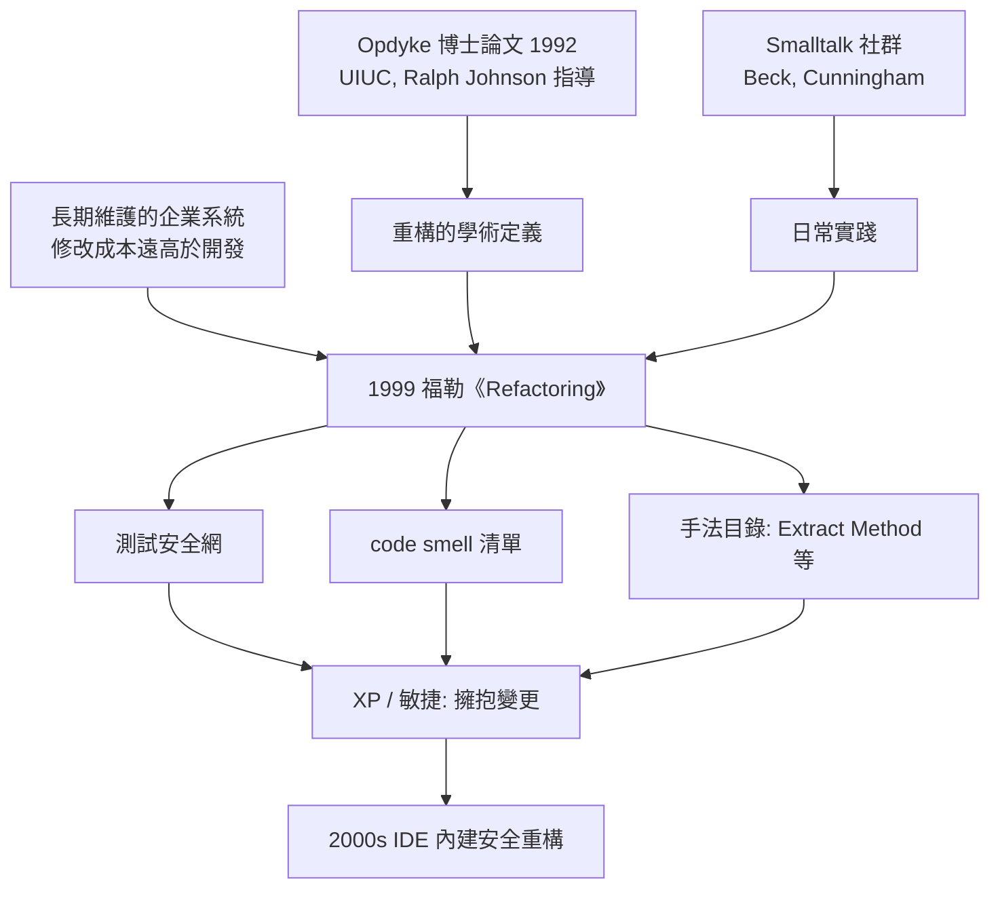

# 重構與馬丁・福勒

## 從 Melrose Park 到 ThoughtWorks

Martin Fowler 1963 年生於英國倫敦近郊的 Walsall，在倫敦大學學院（UCL）主修電子工程與電腦科學。他的職業起點並不顯赫：1980 年代在一家軟體顧問公司寫 COBOL 與 C，卻在無意間展現了寫作天賦——他把工作中學到的技術整理成清楚的文章。1994 年，他將對分析設計的思考寫成《UML Distilled》的前身（Analysis Patterns 於 1997 年出版，UML Distilled 則在 1997 年問世），薄薄一本卻精準切中要害，讓他一舉成名。2000 年，他離開英國，加入芝加哥的 ThoughtWorks——一家由 Roy Singham 創辦、以敏捷實踐聞名的顧問公司，此後以「首席科學家」身分成為敏捷運動最重要的傳聲筒之一。

Fowler 的寫作風格自成一格：他不做原創理論，而是扮演「業界經驗的編纂者與翻譯者」——把散落在學術圈與一線工程師手中的實踐，提煉成主管與工程師都讀得懂的書。這個定位正是《Refactoring: Improving the Design of Existing Code》（1999 年 6 月，Addison-Wesley）成功的祕密。

## 重構的學術源頭：Opdyke 與 UIUC

「重構」這個詞其實早有學術血統。UIUC 的 Ralph Johnson（GoF 作者之一）的研究團隊自 1990 年代初就深耕 Smalltalk 環境的演化問題。他的博士生 William Opdyke 在 1992 年完成的博士論文《Refactoring Object-Oriented Frameworks》首次系統化地定義了重構：**在不改變外部可觀察行為的前提下，改變程式內部結構以提升可理解性與可修改性**。Opdyke 來自 AT&T 貝爾實驗室，處理的是 C++ 大型框架（如 UNIDATA 資料庫）難以修改的現實問題；他把這些改寫手法整理成有前置條件、後置條件的「程式轉換」，並證明這些轉換可以安全地機械化。此外，Opdyke 與 Fowler 都承認靈感部分來自 Bill Griswold 1991 年關於程式重組（restructuring）的研究。

Johnson 的圈子裡，Kent Beck 與 Ward Cunningham 也早已在 Smalltalk 中實踐「讓程式碼持續變乾淨」的手藝。但把這些散珠串成項鍊的，是 Fowler：1990 年代末他在為 Thinking in Patterns 等社群材料作準備時，發現「重構」正是解釋自己日常工作的最好詞彙，於是在 Kent Beck、Ron Jeffries 等人的協力下（書中許多手法源自 Beck 的清單，書的扉頁也寫明獻給這個社群），完成了這本手冊化的《重構》。同年，極限程式設計（XP）的另一本開山之作 Beck 的《Extreme Programming Explained》也出版——重構恰好是 XP 十二個實踐之一，兩書互相成就。

## Code Smell：給壞味道一個名字

《重構》最有穿透力的貢獻，是發明了**「程式碼的壞味道」（code smells）**這個詞（由 Kent Beck 首先提出）。與其講抽象原則，Fowler 列出一張直覺清單：重複程式碼、過長函式、過大的類別、過長的參數列、發散式變化（Divergent Change）、霰彈式修改（Shotgun Surgery）、依戀情結（Feature Envy）、資料泥團、基本型別偏執、switch 驚悚、平行繼承體系、冗贅類別、誇誇其談的通用性、暫時欄位、訊息鏈、中間人……壞味道不是罪證，而是「該重構了」的嗅覺訊號。

與之配套的是一套基礎手法目錄：**Extract Method（抽離方法）** 是全書使用頻率最高的招式——把一段難以理解的程式碼抽成獨立函式並取一個好名字；**Rename** 變數與函式改名；**Inline Method** 反向合併；**Move Method/Field** 把職責搬到正確的類別；**Replace Conditional with Polymorphism** 以多型取代條件判斷；**Extract Class、Introduce Parameter Object** 等等。每個手法都附帶逐步操作程序與前置條件，像食譜一樣可照做。Fowler 強調兩條鐵律：小步快走、每一步之後跑測試。

## 測試安全網：重構的共生夥伴

重構在 1999 年能被工業界接受，靠的是另一個前提交換：**沒有自動化測試，就不要重構**。Fowler 在第一章反覆警告：重構的前提是「有可靠的測試告訴你行為沒變」。這與 JUnit（1997 年由 Kent Beck 與 Erich Gamma 在飛機上合作寫出）的普及形成共生——JUnit 讓「單元測試」從口號變成三分鐘就能上手的工具，而重構給了寫測試一個目的：測試是安全網，安全網讓人敢改程式。兩者合流後，「先寫測試、再重構」的 TDD 循環（紅燈—綠燈—重構）成為 2000 年代敏捷團隊的心跳節奏。這在經濟上是一場論證方式的翻轉：瀑布思維假設「改動是災難，所以要先設計好」，重構思維主張「改動成本可以透過測試與小步驟壓低，所以可以晚一點、在資訊更充分時再決定」——把不可預測的變化從敵人變成輸入。

## 從手工藝到 IDE 按鈕

重構最初是手工藝，靠紀律執行。2001 年 IBM 出資的 Eclipse 3.0（2004）內建了完整的重構選單（Rename、Extract Method、Inline、Move 等），JetBrains 的 IntelliJ IDEA 更早在 2001 年就達到相當成熟的重構支援，Visual Studio 2005 跟進。機械化的安全重構由編譯器等級的語意分析保證：工具檢查所有參照點、自動改寫，把 Opdyke 論文中「重構可機械化」的預言變成每天幾十次的一鍵操作。此後「重構」這個動詞甚至進入了 IDE 快捷鍵文化（IntelliJ 的 Shift-F6 改名成為幾代工程師的肌肉記憶）。

## Fowler 的更廣版圖與第二版

重構之外，Fowler 的另一支柱是企業應用架構。2002 年的《Patterns of Enterprise Application Architecture》（PoEAA）系統整理了分層架構（Layering）、領域模型、Table Module、**Active Record**、Data Mapper、Repository、MVC 在 Web 時代的變體等上百個模式——這些詞彙後來直接成為 Rails（2004，DHH 明言借鑑 PoEAA）、Hibernate、Spring 生態系的官方術語。他用一本書為整個 Web 開發世代提供了架構詞彙表。2018 年 11 月，《重構》第二版出版，範例語言從 Java 換成 JavaScript，新增了「準備重構的分支管理（Feature Branch vs. Trunk-Based）」與自測程式碼的章節，並把「不該被神化」的態度寫得更直白：重構是日常衛生，不是儀式。

三十年回望，Fowler 最大的功績是改變了工程師與「舊程式碼」的關係：在他之前，遺留程式碼是沼澤，人人繞道重寫；在他之後，改進既有程式碼是一種有方法、有工具、有安全網的日常工藝。「讓程式碼比昨天更好一點」——這句樸素的信條，成了敏捷世代留給軟體工程最持久的遺產之一。
