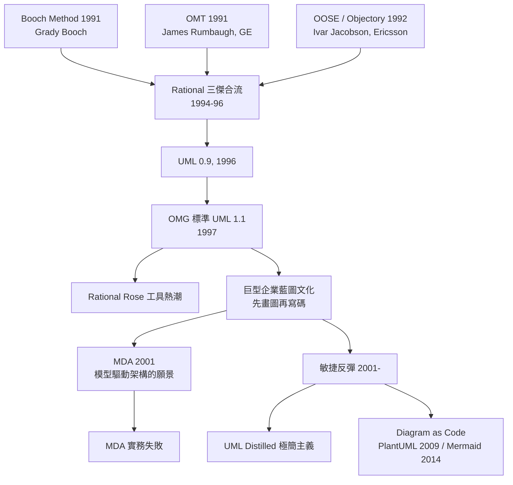

# UML 狂熱：藍圖式設計的巔峰與反思

## 三傑合流：1994–97 的統一大業

1994 年 10 月，James Rumbaugh 離開任職十八年的奇異（GE）研發中心，加入位於加州聖塔克拉拉的 Rational Software，與 Grady Booch 會合。當時物件導向方法論市場正如戰國：Booch Method（1991）在 Ada 與 C++ 陣營強勢，Rumbaugh 的 OMT（Object Modeling Technique, 1991）以嚴謹的資料建模見長，Ivar Jacobson 的 OOSE/Objectory（1992）則從愛立信的電信實戰中帶來 Use Case 的革命性概念。記號互不相容，客戶選邊站隊，訓練市場被切割得支離破碎。

Rational 的解法很商業也很聰明：把三大宗師請到同一個屋簷下，統一記號。Rumbaugh 與 Booch 在 1995 年提出 Unified Method 0.8；1995 年秋 Jacobson 的 Objectory 被 Rational 收購而加入，「三傑」（Three Amigos）齊聚。1996 年 6 月他們發表 UML 0.9，並巧妙地將 UML 移交給物件管理組織（OMG）的公開流程，號召 IBM、HP、Oracle、微軟、Plug-in 各方提交意見，把一個公司產品變成開放標準。1997 年 11 月，OMG 正式採納 UML 1.1 為產業標準。

背後還有一層經濟邏輯：Rational 的真正產品不只是 UML，而是整套「以 UML 為圖紙、以 Rational Rose 為繪圖桌、以 Rational Unified Process（RUP，與 Philippe Kruchten 主導的迭代流程）為施工規範」的完整供應鏈。標準化 UML 等於替自家工具生態圈鋪鐵軌——2003 年 IBM 以 21 億美元現金收購 Rational，可見這條鐵軌的商業價值。

## 藍圖文化：先畫圖、後寫碼的巔峰

UML 1.x 共定義了九種圖：Use Case 圖、類別圖、物件圖、循序圖、合作圖、狀態圖、活動圖、元件圖、部署圖。在 1990 年代末的巨型企業裡，這催生出一種完整承接營建業隱喻的文化：系統分析師畫 Use Case，架構師畫類別圖與循序圖，開發者「填空」寫碼，文件櫃裡躺著數千頁的 UML 模型，與現實程式碼漸行漸遠。這正是 Winston Royce 瀑布模型批判的再演：把「設計」與「實作」切成兩個階段、兩群人、兩種產物，回饋迴路被拉長到以季計。某些政府與國防專案合約甚至以「交付 UML 模型」為驗收條件——圖紙本身成了交付物，寫碼反而成了附屬品。

工具熱潮推波助瀾。Rational Rose 以「正向工程／逆向工程」為賣點：從圖生成程式碼骨架、從程式碼回吐圖。1999 年前後，Rose 授權費一人份動輒數千美元，Rational 營收突破數億美元，訓練與認證產業隨之而起——「會畫 UML」成了履歷上的專業證照。後起的工具如 Together ControlCenter、Sparx Enterprise Architect、微軟 Visio（2000 年併入 Office 家族，附 UML 樣版）分食市場。

## MDA：一個太早的夢

2001 年，OMG 再上層樓，提出 **Model Driven Architecture（MDA）**：以平台無關模型（PIM）為唯一真相，透過轉換規則自動生成平台相關模型（PSM）與程式碼。願景極具野心——「軟體工程師應該像積體電路工程師一樣，設計一次、到處合成」；UML 是電路圖，編譯器替你寫碼。這個夢想有學術淵源（模型轉換、特定領域語言）與部分成功後裔（後來的 Eclipse Modeling Framework、模型驅動工程在嵌入式領域的應用），但在企業軟體界全面失敗。原因殘酷而簡單：需求會變、模型不會自動跟上，UML 缺乏精確的執行語意，自動生成的程式碼只佔真實系統的一小部分，而「改圖再生成」的成本遠高於直接改碼。模型與程式碼的雙重真相（dual truth）永遠會漂移——工程師最終用腳投票，回到程式碼本身。IMSU 的顧問統計與社群調查一再顯示，MDA 工具採用率遠低於 OMG 的宣傳，2010 年代 OMG 自己也不再主推這個口號。

## 反彈：《UML Distilled》與敏捷的「夠用就好」

反彈的聲音來自內部。1997 年，Martin Fowler 出版薄薄 100 多頁的《UML Distilled》，直球對決大部頭規格書：他只挑類別圖、循序圖、Use Case 圖等最值錢的幾種圖，主張「UML 是溝通工具，不是契約文件；圖是草圖（sketch），不是藍圖（blueprint）」。這本書賣得比任何嚴肅規格書都好——市場用購買行為宣告：工程師要的是 20% 的記號解決 80% 的溝通需求。

2001 年 2 月敏捷宣言誕生，17 位簽署者中就有 Jacobson 的老戰友與 UML 圈的重要人物；宣言明言「工作的軟體高於詳盡的文件」，等於對藍圖文化正面開火。Jacobson 本人 2000 年代初也承認 RUP 被濫用為重流程的瀑布變體，晚年轉而提倡「Use Case 2.0」的輕量用法。敏捷團隊實務中的 UML 退守到白板：畫在白板上的圖拍張照貼在 wiki，即生即滅，圖的價值在「畫圖當下的對話」，而非文件本身。Fowler 總結為三種用法：草圖（溝通）、藍圖（精密契約——僅在少數高風險場合）、程式語言（MDA 式執行——大多數場合已死）。

## Diagram as Code：樸實的回歸

弔詭的是，UML 沒有死，而是換了一種更工程師的方式活著。2009 年德國工程師開源的 **PlantUML** 讓開發者用純文字描述序列圖與類別圖，由工具渲染成圖——「圖跟著程式碼一起進版本控制」解決了雙重真相的老問題。2014 年瑞典人 Knut Sveidqvist 發表的 **Mermaid** 更進一步，把語法嵌入 Markdown，GitHub 在 2022 年原生支援，圖表成為 README 的一部分。今日，uML 式的序列圖、狀態圖在開發文件裡隨處可見，只是它們以程式碼的形態存在，隨 commit 一起演進。

這場從藍圖到草圖、從文件到程式碼的弧線，正是軟體工程思想成熟的縮影：UML 的發明者們正確地診斷了「大型系統需要共同視覺語言」這個問題，但把解答寄託在「先驗的完整設計」上，低估了軟體的本性——它不是蓋大樓，更像一座不斷改建的城市。最後留下來的，不是幾千頁的模型文件，而是白板上的幾筆草圖，與 repo 裡那幾行會隨程式碼更新的文字。
