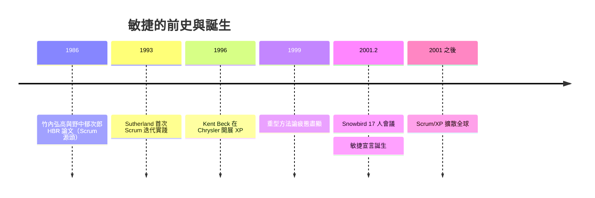

# 2001 年《敏捷宣言》：雪鳥勝地的 17 位專家

## 一、世紀末的窒息

1990 年代末，大多數企業軟體團隊活在「重型方法論」的陰影下。Rational Unified Process（RUP）有上千頁指南；CMM 評級把團隊變成文書工廠；一個專案動輒先寫半年需求規格書，等到程式碼開始動工，市場早已變了三輪。文件與實際代碼脫節、專案延期成為常態、工程師士氣低落——行業在等待一場反叛。

反叛的火種其實早已四處點燃：Kent Beck 的極限編程（XP）、Jeff Sutherland 與 Ken Schwaber 的 Scrum、Alistair Cockburn 的 Crystal、David Anderson 的 FDD、Jim Highsmith 的 Adaptive Software Development、Peter Coad 的 FDD 前身等。這些「輕量級方法」彼此獨立發展，卻共享同一種直覺：短迭代、人與人的直接溝通、擁抱變化。

## 二、雪鳥會議：兩天的雪與一份宣言

2001 年 2 月 11 日至 13 日，17 位軟體界人士聚在猶他州滑雪勝地 Snowbird 的 Lodge 會議室。發起人是檢驗兩大陣營的中間人：當時在 Agile 與 CMM 社群都活躍的 Bob Martin（Uncle Bob）與 Jim Highsmith。與會者包括 Kent Beck、Ward Cunningham、Martin Fowler、Jeff Sutherland、Ken Schwaber、Alistair Cockburn、Andrew Hunt、Dave Thomas、Jon Kern、Ron Jeffries、Steve Mellor、Brian Marick、James Grenning、Robert Martin、Jim Highsmith、Mike Beedle、Arie van Bennekum。

會議的奇蹟在於：17 個意見極強的人，居然在兩天內對**四條價值觀**達成共識——

> 我們一直在實踐中探尋更好的軟體開發方法：
> **個體與互動** 高於 流程與工具
> **可工作的軟體** 高於 詳盡的文件
> **客戶合作** 高於 合同談判
> **響應變化** 高於 遵循計畫
>
> 也就是說，右項雖有其價值，但我們更重視左項。

措辭的關鍵是 Martin Fowler 提議的「X over Y」句式：不否認右項的價值，只是宣告優先序。這個妥協讓各方都能簽字。宣言簽署者後來另擬十二條原則作為展開。有趣的是，「敏捷」（Agile）這個名字是會後才定的——有人建議叫「輕量級方法」被嫌太工程味，Highsmith 提的 Agile 一詞勝出，取其「靈活機敏」之意。

## 三、四條價值的深意

**個體與互動高於流程與工具**：這是對 Conway 定律的正面回應——軟體品質最終取決於溝通質量，流程只應輔助而非取代對話。**可工作的軟體高於詳盡的文件**：唯一不會說謊的進度報告是能跑的系統；文件會過期，代碼不會（它就是行為本身）。**客戶合作高於合同談判**：瀑布式「簽約即凍結需求」的商業模式無法適應不確定性，需要客戶持續參與調整。**響應變化高於遵循計畫**：計畫是預測，而預測在快速變動的市場中必然失準——不如建立「能隨時轉向」的能力。

這四條的深層是一個知識論斷言：軟體開發不是製造業（可預測、可標準化），而是探索活動（不可預測、需持續學習）。這個視角源自 Cockburn 等人對「軟體是發明性遊戲」的哲學思考。

## 四、從宣言到產業運動

宣言之後是擴散的二十年。Scrum 因其簡單（三個角色、三個工件、幾個儀式）而成為企業首選；XP 的實踐（TDD、結對編程、持續整合）滲入日常開發文化；Kanban 從豐田生產系統改編而來，為不適合迭代的維運團隊提供選項。2005 年前後，敏捷認證（CSM 等）產業興起，教練（Coach）成為新職業；2020 年代，SAFe 等大規模敏捷框架試圖把敏捷推廣到千人大組織——也引來「敏捷已死」「敏捷官僚化」的持續批評。

最尖銳的批評來自內部：當初的簽署者 Martin Fowler 與 Dave Thomas 先後公開表示，敏捷已被顧問產業異化成新的教條與收費工具，與 2001 年那份反叛精神漸行漸遠。但無論如何，宣言的四條價值已深植於行業直覺：今天沒有任何一家嚴肅的軟體公司會主張「先寫半年文件再寫碼」「需求凍結後不許改」——這就是雪鳥那兩天的雪，留下的永久地形改變。
