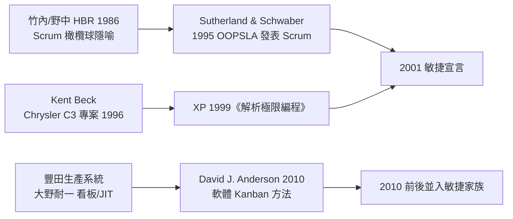

# Scrum、Kanban 與極限編程（XP）

## 一、三個源頭，一種直覺

敏捷宣言只是價值聲明，真正讓敏捷落地的，是三套各具性格的方法：Scrum、Kanban 與極限編程（XP）。它們源頭各異——Scrum 來自日本製造業的研究論文、Kanban 來自豐田生產系統、XP 來自美國顧問在汽車廠的實驗——卻共享同一直覺：縮短回饋迴路，讓學習快過變化。

## 二、Scrum：橄欖球的集體衝刺

Scrum 的學術源頭是 1986 年竹內弘高與野中郁次郎在《哈佛商業評論》的論文〈The New New Product Development Game〉。兩位知識管理學者研究佳能、本田、富士通的產品開發後發現：頂尖團隊不像接力賽（分工後一棒傳一棒），而像橄欖球的 Scrum 集團衝刺——**全員混成一體、持續互動、整體推進**。Jeff Sutherland（越戰飛行員出身、後任醫療系統 CTO）與 Ken Schwaber（過程建模顧問）在 1995 年 OOPSLA 會議上首次公開 Scrum 軟體方法。

Scrum 的結構刻意簡單：三個角色（Product Owner、Scrum Master、開發團隊）、三個工件（Product Backlog、Sprint Backlog、增量）、幾個儀式（Sprint 規劃、每日站會、Review、Retrospective），以一到四週的 Sprint 為心跳。其深刻處在於**承認不可預測性**：複雜領域不做長期甘特圖，只做「以經驗為據的迭代控制」（empirical process control）——透明、檢視、調整三支柱。每日站會的十五分鐘同步，本質上是把控制論的回饋頻率從「月」壓到「日」。

## 三、XP：把工程實踐推到極限

XP 的誕生場景是 1996 年瀕臨失敗的克萊斯勒薪資系統專案（C3）。Kent Beck 被請去救火，索性把團隊認為「有用但過於辛苦」的實踐全部推到極限：如果 code review 有用，那就**結對編程**（pair programming，兩人一機、隨時互審）；如果測試有用，那就**測試先行**（TDD）；如果整合有用，那就**持續整合**（一天整合多次）；如果小版本有用，那就**每兩週上線**。加上現場客戶（on-site customer）、簡單設計、重構、集體代碼所有權、程式碼規範與每週四十小時工作制，構成著名的十二個實踐。

XP 與 Scrum 是完美互補：Scrum 規定「做什麼節奏」，XP 回答「怎麼寫好代碼」。1999 年 Beck 的《Extreme Programming Explained》與 2000 年《解析極限編程》讓 XP 名聲大噪，但企業採用率不及 Scrum——結對編程與現場客戶在成本會計眼裡太「奢侈」。這也暴露了制度經濟學的張力：XP 信任工程師的判斷，而多數組織的治理結構並不信任。

## 四、Kanban：從豐田到看板牆

Kanban 的祖先是大野耐一在豐田生產系統（TPS）中的發明：超市補貨式生產——下游取用多少，上游才生產多少（Just-in-Time），以實體「看板」卡片作為取貨與生產指令，從而**限制在製品**（WIP limit）、暴露瓶頸。這套思想經《豐田生產方式》與後來的精益（Lean）運動傳播到西方。

2010 年，David J. Anderson 出版《Kanban: Successful Evolutionary Change for Your Technology Business》，把看板改編為知識工作的管理方法：視覺化工作流、限制在製品、管理工作流、讓策略明確化、以反饋迴路改進。與 Scrum 的「革命性改組」不同，Kanban 主張**從現狀出發的漸進演化**——先視覺化你現在的亂象，再一小步一小步地改，因此特別適合維運、支援等事件驅動型團隊。敏捷看板牆上「待辦—進行—完成」的欄位與 WIP 數字，如今已是全球辦公室的通用風景。

## 五、碰撞與融合

三種方法後來在實務中大量混血：Scrumban（用 Kanban 的 WIP 限制救 Scrum 的過載）、XP 實踐內嵌於 Scrum 團隊、OKR 與敏捷疊加。方法論的融合恰恰證明雪鳥宣言的遠見——它只約定價值，不壟斷手段。2001 年那十七人各自的老本行（Scrum、XP、Crystal、FDD）今天已難嚴格分家，但他們共同留下的東西清晰可辨：**以小步迭代取代大爆炸交付，以系統的學習速度對抗環境的變化速度**。這不是流程偏好，而是複雜系統工程的基本生存策略。
