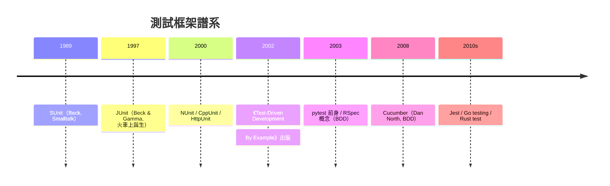

# TDD 與 JUnit：用測試織出安全網

## 一、SUnit：測試框架的始祖

單元測試框架的故事始於 1989 年的 Smalltalk 社群。Kent Beck 在研讀麻省理工學院李察·斯多曼（Richard Stallman）等人的思想與 Smalltalk 環境後，為自己寫了一個極簡的測試工具——SUnit：能把一組「測試案例」自動跑一遍，紅燈表示失敗、綠燈表示通過。它只有幾十行程式碼，卻確立了沿用至今的模式：TestCase（測試案例）、setUp（前處理）、assert（斷言）、test suite（測試組合）。

Beck 的洞見不在工具本身，而在使用方式：**測試應該先於程式碼存在**。先寫一個會失敗的測試（紅燈），再寫最少的程式碼讓它通過（綠燈），然後重構清理——這個「紅-綠-重構」循環就是測試驅動開發（Test-Driven Development, TDD）。測試不再是寫完程式碼之後的驗收儀式，而是**設計工具**：你要先想清楚「這段程式碼應該長成什麼介面、有什麼行為」，才能寫出它的測試。測試驅動著介面設計。

## 二、JUnit：與 Gamma 的火車對談

1997 年，Kent Beck（當時在 Erann Gat 等人圈中活躍的 Smalltalk 顧問）與 Erich Gamma（GoF 之首、IBM Zurich 研究員）在搭飛機/火車同行的旅途中對談。Gamma 正想學 Smalltalk 的開發文化，Beck 開玩笑說「那我們寫個 Java 版的 SUnit 吧」。兩人真的在旅途中用膝上型電腦把它寫了出來——這就是 JUnit 的誕生，也是著名的一段軟體史佳話（兩人後來在採訪中證實了旅途寫作的情節）。

JUnit 選擇了 Java 這個正確的載體。1997-98 年正是 Java 在企業爆發的年代，JUnit 隨 Java 課程與開源文化一起擴散，成為史上被複製最多的軟體之一：Python 的 pytest/unittest、C# 的 NUnit、C++ 的 CppUnit、JavaScript 的 Jest（概念血統）、Go 的內建 testing，全部都是 JUnit 家族。「框架本身不到三千行，卻改變了全世界的工程習慣」——這是 Gamma 後來的自我評價。

## 三、TDD 的實踐節奏

TDD 的操作極簡，難在紀律：

1. **紅燈**：寫一個小測試，描述你想要的一小塊行為。執行它，看它失敗。
2. **綠燈**：寫**最少的**程式碼讓測試通過——哪怕作弊（hard-code）也行。
3. **重構**：在綠燈保護下清理結構，消除重複（「三角定位」：用第二個測試案例逼出一般化實作）。

這個節奏的深意是經濟學：缺陷修復成本隨發現時間指數上升（需求階段修復成本是上線後的百分之一到千分之一，Boehm 的經典曲線），TDD 把發現時刻壓縮到「寫碼的幾分鐘內」。同時，測試套件累積成**回歸安全網**——日後任何改動跑一遍測試，就能確認沒有弄壞舊功能，這正是重構（Fowler，1999）能安全進行的前提。TDD 與重構、持續整合（CI）構成 XP 的技術三角，彼此互為條件。

## 四、擴散、修正與 BDD

2002 年 Beck 出版《Test-Driven Development: By Example》（用錢的例子示範 TDD），2003 年 Dave Astels 等人推波助瀾，TDD 成為敏捷運動的技術旗幟。但教條化也隨之而來：有人主張「100% 覆蓋率」「永遠測試先行」，專案被幾千個脆弱測試淹沒。反彈在 2014 年爆發：Ruby on Rails 之父 DHH 公開撰文〈TDD is dead. Long live testing.〉，指出過度追求單元測試隔離會造成測試地獄（mock 泛濫、重構反而困難）。這場論戰的建設性結論是修正而非否定：**測試金字塔**（單元測試多、整合測試中、端到端測試少）、按風險配置測試深度、測試是手段不是指標。

另一次重要的觀念修正來自 Dan North：他發現客戶聽不懂「測試」的語言，於 2003-06 年提出行為驅動開發（BDD）——把測試案例寫成自然語言的行為描述（Given-When-Then），工具代表是 Cucumber（2008）。BDD 讓規格、測試與溝通合流，是 TDD 向業務語言的延伸。

## 五、在 CI 時代成為地基

進入 2010 年代，TDD 的遺產以另一種面目成為行業地基：持續整合伺服器（Jenkins）上每一次提交都自動執行測試套件；GitHub 的 Pull Request 必須通過 CI 綠燈才能合併；DevOps 的部署管線以測試為閘門。今天軟體工程的日常——紅燈不許合併、綠燈才可部署——正是 1989 年 SUnit 那幾十行程式碼長出的制度。

Kent Beck 對 TDD 的自我總結堪為本節收尾：「我不是要你寫很多測試，我是要你**能夠無所畏懼地修改程式碼**。」恐懼是軟體維護的頭號敵人——而測試，就是把恐懼轉換成勇氣的機器。
