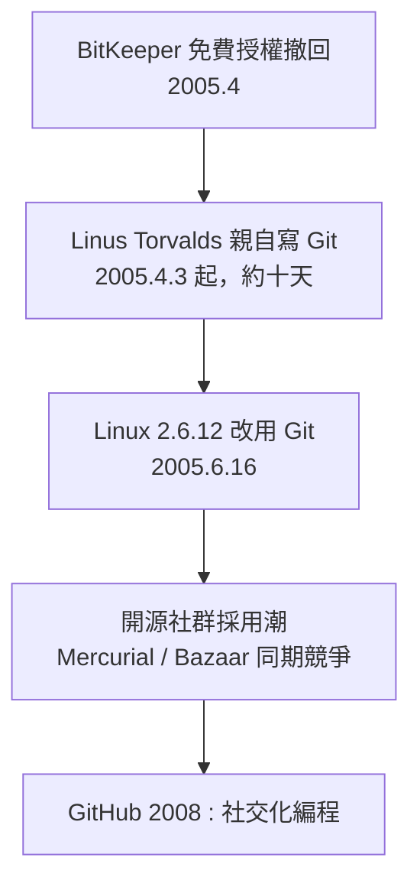

# 2005 年林納斯與 Git：分散式版本控制的革命

## 一、失控的「免費」授權

2005 年 4 月，Linux 核心開發社群遭遇了一場制度危機。從 2002 年起，核心開發一直使用專有軟體 BitKeeper 做版本控制——這在開源社群裡一直充滿爭議，但 BitKeeper 的作者 Larry McVoy 免費授權給開源開發者使用，Linus Torvalds 力排眾議採用了它。爭議在 2005 年爆發：Andrew Tridgell（Samba 的作者）對 BitKeeper 協議進行逆向工程，試圖做出相容工具；McVoy 認為這違反授權條款，於 2005 年 4 月**撤回免費使用權**。Linux 核心頓時失去了版本控制系統。

現有的替代品都令 Linus 無法忍受。CVS 與 Subversion 是集中式模型：單一伺服器保存歷史，開發者只是「簽出者」；提交慢、分支昂貴、離線幾乎無法工作。而 Linux 核心有上千名貢獻者、每天數百個 patch，維護者層層樹狀分發。Linus 說過他痛恨 CVS：「如果你用的是 CVS，那你已經輸了。」

## 二、十天寫出的 Git

Linus 的反應是親自下場。2005 年 4 月 3 日開始，他以寫作業系統核心的方式寫版本控制系統，大約十到十四天後，Git 已能自舉（用 Git 管理 Git 自己的程式碼）。6 月 16 日，Linux 核心 2.6.12 正式以 Git 發布。

Git 的設計哲學徹底顛覆了集中式模型：

- **分散式**：每個開發者的電腦上都有**完整的**版本歷史——倉庫不是「伺服器上的寶物」，而是可以隨意複製、推送、分支的本地物件集合。離線照樣提交、照樣看歷史。
- **內容定址**：每個檔案版本、目錄樹、提交都用其內容的 SHA-1 雜湊命名。內容一變，雜湊全變——資料的完整性由數學保證，而非伺服器的管理員。
- **分支是廉價的**：一個 branch 只是 41 位元組的指標檔案。建分支、合分支的成本趨近於零——「經常分支」從禁忌變成習慣。
- **提交是快照而非差異**：每次 commit 記錄完整目錄樹的快照，使歷史操作（revert、rebase、cherry-pick）成為圖論操作。

## 三、同一時間的另一匹馬

2005 年 4 月 BitKeeper 危機時，Samba 開發者 Matt Mackall 也幾乎同時開始寫分散式版本控制系統 Mercurial（Hg）——他甚至在郵件列表上與 Linus 互相討論設計。Mercurial 用 Python 寫成，介面更友好，一度與 Git 平分秋色（Mozilla、Facebook 長期使用）。Canonical 的 Bazaar 則服務於 Ubuntu 專案。這場分散式 VCS 的「寒武紀大爆發」最終由生態決定勝負——而生態的勝負手，是下一節的主角 GitHub。

## 四、Linus 的性格與這場革命的意義

Git 的介面以難學聞名（「index/staging area」的概念、上百個子命令），Linus 自己承認 Git 的使用者介面「很髒」，他只為核心效能與資料模型負責。但 Git 的難學恰恰說明它的模型革命性：它把版本庫從「檔案櫃」重新定義為**內容定址的物件圖**——commit、tree、blob、tag 都是雜湊物件，歷史是一張有向無環圖（DAG）。理解了這張圖，Git 的所有怪異都變得理所當然。

更深遠的是它對協作制度的重構。集中式系統裡，「誰能提交」是伺服器權限問題——少數人有寫入權，多數人只能寄 patch。分散式系統裡，**人人都有完整倉庫**，貢獻門檻從「獲得權限」變成「發起請求」。這個變化與 Linux 核心的樹狀維護者制度（lieutenant model）天然契合，也為後來的 fork / pull request 文化鋪好了土壤。

Linus 十天寫出的不只是工具，而是把「開放協作」從社會理想落成了工程機制。2005 年那個被斷供的春天，成了此後二十年全球軟體協作方式的起點。
