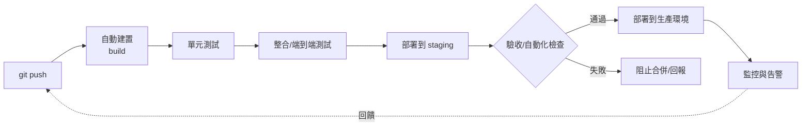

# DevOps 與 CI/CD：打通開發與維運的鋼鐵管線

## 一、牆：開發與維運的百年敵對

2000 年代的軟體公司普遍存在一道內牆：開發部門（Dev）的使命是「盡快交付新功能」，維運部門（Ops）的使命是「保持系統永不宕機」。兩個部門用同一套 KPI 考核，卻目標相反——開發者希望頻繁發布、維運者希望減少變更（每一次部署都是風險）。結果是荒謬的制度：發布申請單、變更審批委員會（CAB）、每季一次的「發布窗口」，以及雙方在郵件裡互相指責的黑色幽默。開發者把應用「扔過牆」（throw it over the wall）給維運，這個隱喻本身就是問題的診斷書。

牆的根源是分工制度的遺產：瀑布時代，寫碼與運行是兩種職業、兩種預算、甚至兩種企業文化（敏捷 vs ITIL）。但當網際網路服務要求「每天多次上線」成為競爭力（Flickr、Amazon 的先驅實踐），每季一次的發布節奏就成了商業自殺。

## 二、Flickr 的演講與 DevOps 的命名

2009 年 6 月，Velocity 會議（O'Reilly 的網站性能與維運大會）上，Flickr 的約翰·阿爾斯帕（John Allspaw，維運副總）與保羅·哈蒙德（Paul Hammond，工程師）發表了一場日後被視為經典的演講：〈10+ Deploys Per Day: Dev and Ops Cooperation at Flickr〉。他們展示了 Flickr 如何做到一天十次以上的部署：共享的部署工具、自動化測試、小幅發布、以及最重要的——**讓開發者參與維運、讓維運者參與開發的組織設計**。這場演講被公認為 DevOps 運動的思想起點之一。

四個月後，2009 年 10 月，比利時獨立顧問派翠克·德博瓦（Patrick Debois，人稱「DevOps 父親」）在根特舉辦第一屆 Devopsdays 研討會。他原本想叫「DevOpsDays」，推特標籤限制讓 #devops 流傳開來——「DevOps」一詞就此定名。有趣的是，運動的命名權屬於社群而非任何公司：DevOps 從第一天起就是民間自下而上的文化運動，沒有商標、沒有創始公司。

## 三、CI/CD：管線的機械化

DevOps 的技術骨幹是持續整合（Continuous Integration）與持續交付/部署（Continuous Delivery/Deployment）。

**CI 的思想來自 XP**（Kent Beck 的實踐之一）：每個開發者每天多次把代碼整合進主線，每次整合都自動建置並跑測試。工具史很清晰：CruiseControl（2001，ThoughtWorks 的開源 CI 伺服器先驅）→ Hudson（2004，Sun 的川口晃等人開發）→ 2011 年甲骨文收購爭議後社群分叉出 **Jenkins**（由 Kohsuke Kawaguchi 領導），Jenkins 從此成為全球最普及的 CI 伺服器。

**CD 的理論化**歸功於 2010 年耶茲·漢布爾（Jez Humble）與大衛·法利（David Farley）的《Continuous Delivery》一書（Jolt 大獎）：把「從提交到上線」的路徑建模為**部署管線（deployment pipeline）**——提交 → 自動建置 → 自動測試（單元、整合、端到端分層）→ 自動部署到類生產環境 → 一鍵/自動上生產。核心原則：**任何時刻，主幹上的代碼都應該是可發布的**。上線從儀式變成流水線的自然產出。

## 四、DORA：用數據證明文化

2013 年，金·金姆（Gene Kim，工程師出身、《The Phoenix Project》小說作者）、Jez Humble 等人創立 IT Revolution，並與 Puppet Labs 合作展開「State of DevOps」年度調查。2018 年，Nicole Forsgren、Jez Humble、Gene Kim 出版《加速》（Accelerate），提出後來成為行業標準的 **DORA 四個關鍵指標**：

1. **部署頻率**（deployment frequency）——多久上線一次；
2. **變更前置時間**（lead time for changes）——從提交到上線要多久；
3. **變更失敗率**（change failure rate）——多少比例的部署出問題；
4. **服務恢復時間**（time to restore service，後加入 MTTR）——出事後多久恢復。

多年的大樣本數據（每年數萬受訪者）給出一個曾被懷疑的結論：**部署頻率與穩定性不衝突**——高頻部署的組織，故障率與恢復速度反而更好（因為每次變更小、回滾容易）。這為「牆的拆除」提供了實證彈藥。

## 五、SRE：Google 的工程化維運

DevOps 運動的另一個重要分支來自 Google。2003 年前後，Google 內部面對「工程師不想做運維、運維團隊跟不上系統規模」的問題，本·特雷諾（Ben Treynor Sloss）建立了 Site Reliability Engineering（SRE）部門：**用軟體工程的方法做維運**。SRE 的招牌制度包括：錯誤預算（error budget，可用性目標之內的「允許故障額度」——燒完預算就暫停新功能、專心穩定性）、SLO/SLI 服務目標體系、以及「運維工作上限 50%」的工程紀律。2016 年 Google 出版《Site Reliability Engineering》（俗稱 SRE 書），SRE 做為職業與方法論輸出全球。

## 六、歷史定位

DevOps 的本質，是用工程手段消解組織牆：管線讓「發布」不再需要勇氣，自動化讓「穩定」不再需要保守。它與敏捷宣言（2001）、Git（2005）、GitHub（2008）、Docker（2013）、Kubernetes（2014）共同構成了 2010 年代「雲原生」的完整拼圖。Devopsdays 根特那個小研討會的影響力證明了一件事：軟體工程最重要的變革，常常不是新語言或新演算法，而是**讓兩個互相拖後腿的部門，開始說同一種語言**。
