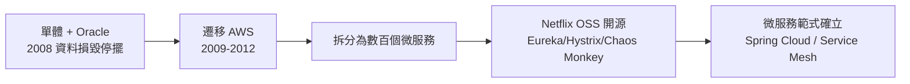

# 單體架構的極限：百萬行的部署噩夢

## 一、單體的黃金年代

在微服務之前，所有大型系統都是單體（monolith）：一套應用程式、一個部署包、一個資料庫。這不是落後，而是理性選擇——單體開發體驗簡單：一個 IDE、一次啟動、本地就能除錯；事務一致性天然保證；部署只有一份工件。Rails、Django、Spring 的時代精神都是「先建單體，跨過橋再說」。Bazaar 與 CVS 時代的企業級 J2EE 應用、ERP 系統，都是單體的黃金年代產物。

問題不在單體本身，而在**單體＋大組織＋快速變化的組合**。

## 二、百萬行代碼庫的病理

單體的病變隨規模而來。第一個症狀是**建置與部署時間**：當編譯要一小時、全套自動化測試要數小時，開發者一天只能做兩三次完整驗證；CI 從安全保障變成排隊噩夢。第二個症狀是**耦合的不可見性**：百萬行代碼裡，改一個共用類別可能影響任何角落——模組邊界只是資料夾名稱，不是強制邊界。第三個症狀是**發布風險**：整包發布意味著任何一個未完成的功能都得等所有功能一起上線，或用繁瑣的功能開關遮蔽；一次回滾就是整包回滾。第四個症狀是**組織排隊**：上百個工程師改同一個代碼庫，合併衝突、共享資料庫 schema 的協調，讓 Conway 定律以最扭曲的方式顯形——溝通成本 $n(n-1)/2$ 直接寫進了代碼結構。

這些症狀互為因果，形成惡性循環：部署越痛 → 越不敢部署 → 批次越大 → 風險越高 → 部署更痛。

## 三、Netflix 的燒毀與重生

單體危機最著名的教科書案例是 Netflix。2008 年 8 月，Netflix 的單體 Oracle 資料庫發生資料區塊損毀，DVD 郵租業務停擺三天——對一家以「可靠性」為生命線的服務公司而言，這是生存級事故。管理層做出兩個影響深遠的決定：**把系統整體遷移到 Amazon Web Services 雲端**，以及**把單體拆解為數百個小型服務**（2009-2012 逐步完成）。

拆分後的 Netflix 不僅恢復，還發明了一套雲原生工具箱：Eureka（服務註冊）、Hystrix（熔斷器，2012）、Ribbon（客戶端負載均衡）、Chaos Monkey（主動製造故障的混沌工程）。2010 年代初，Netflix 開源了這批工具，「Netflix OSS」成為微服務時代的事實手冊，直接催生了後來的 Spring Cloud 與服務網格生態。

## 四、思想源頭：從 SOA 到 Conway 定律的正面應用

微服務並非憑空發明。它的直接祖先是 1990 年代末的**服務導向架構**（SOA）：把企業系統拆成可復用的「服務」，用 SOAP/ESB（企業服務匯流排）通信。SOA 的理念正確，但被廠商（IBM、Oracle）的工具化糟蹋了——重量級 ESB、昂貴的商業中介軟體、XML 泛濫，讓 SOA 淪為採購部門的名詞。

微服務繼承 SOA 的拆分思想，卻反其道而行：**去中心化治理**（每個服務自選技術棧）、**輕量通信**（REST/JSON 而非 SOAP）、**智慧端點、啞管道**（把 ESB 的邏輯放回服務內部）、**按業務能力而非技術層分服務**。2011 年 5 月，一群架構師在威尼斯附近的研討會上討論這種風格，需要一個名字；2012 年 5 月的同一場合，「microservices」一詞被正式採用。2014 年，Martin Fowler 與 James Lewis 發表〈Microservices〉一文，把它定義為「以可獨立部署的最小服務為單位、圍繞業務能力組織」的架構風格——這篇文章成為範式的正典。

更深的思想根基是 Conway 定律的**正面應用**：既然系統結構必然映照組織結構，那就反過來——先設計小團隊（亞馬遜的「兩個披薩團隊」，2000 年代初 Bezos 的命令），再讓每個團隊擁有端到端的一個服務。Amazon 的「你 build it, you run it」（Werner Vogels, 2006）原則，讓服務邊界與責任邊界重合。微服務因此不只是技術決策，更是**組織設計決策**。

## 五、代價與清醒

微服務不是免費午餐，清醒的聲音一直存在。分散式的代價清單：網路不可靠（分區、超時、重試風暴）、最終一致性的心智負擔、分散式事務的深淵、可觀測性需求（分散式追蹤、集中日誌——這催生了 OpenTelemetry 生態）、以及「分散式單體」的常見死法：拆了服務卻沒拆資料庫，服務間同步呼叫成鏈，部署一樣要全體一起上。

業界最誠實的忠告來自 Martin Fowler 本人 2015 年的〈MonolithFirst〉：大多數成功的微服務系統，都是從一個成功的單體長出來的；直接從微服務起步的專案往往死於過早的邊界劃分——因為你還不知道正確的邊界在哪。單體的噩夢是真的，但解藥不是「永遠微服務」，而是**知道什麼時候拆、怎麼拆**。這個判斷力，正是軟體工程師在 AI 時代依然無可替代的核心技藝之一。
