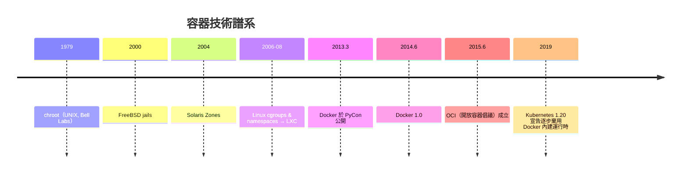

# Docker 容器革命：輕量級虛擬化的勝利

## 一、「在我機器上明明可以跑」

2010 年代初，軟體工程師最共同的抱怨是「在我機器上明明可以跑」（works on my machine）。應用程式依賴錯綜複雜：作業系統版本、語言執行環境、函式庫版本、環境變數、組態檔——開發、測試、生產三套環境的漂移（drift）是部署故障的最大來源。虛擬機器（VM）能解決環境問題，但太重：每個 VM 都要帶一份完整作業系統，啟動以分鐘計、記憶體以 GB 計。工程界需要的是**輕量、可攜、可複製的環境封裝**。

## 二、三十年的技術地基

容器革命不是從石頭裡蹦出來的，它的每一塊基石都有一段歷史：

- **chroot**（1979，UNIX 7th Edition，Bell Labs）：改變進程看到的根目錄，是檔案系統隔離的始祖；
- **FreeBSD jails**（2000）：第一個接近現代意義的作業系統級虛擬化；
- **Solaris Zones**（2004）：Sun 把容器化做到企業級；
- **Linux Namespaces 與 cgroups**（2006-2008）：核心貢獻者 Paul Menage 與 Rohit Seth 等人在 Linux 核心實現了資源隔離（cgroups）與視圖隔離（namespaces：PID、網路、掛載點……），2008 年 LXC 做出易用封裝。

到 2010 年，所有必要的核心能力都在 Linux 裡了，缺的只是一個**好用的介面**——這正是 Docker 的歷史角色：它自己幾乎沒有發明底層技術，卻把「容器」從核心駭客的玩具變成了每個工程師的日常工具。這是軟體史反覆出現的模式：**革命不在演算法，而在介面**。

## 三、Solomon Hykes 與 dotCloud 的賭注

Solomon Hykes 是在法國長大的美國人，2008 年在巴黎創立 PaaS 平台公司 dotCloud。PaaS 業務要求在同一台機器上運行各種語言、各種客戶應用，環境隔離與快速遷移是核心需求——容器正是為此而生的內部技術。2010 年，Hykes 與創辦夥伴（包括 Kamel Founadi 與 Sebastien Pahl）把公司搬到舊金山加入 Y Combinator。2013 年，dotCloud 的 PaaS 業務競爭不過 Heroku 等巨頭，Hykes 做出關鍵決定：**把內部的容器引擎開源，公司全力轉型**。

2013 年 3 月，Hykes 在 PyCon 大會上公開 demo Docker（0.1.0）；同年 10 月 dotCloud 公司更名為 Docker, Inc.。Docker 的殺手級組合是三件事：**鏡像**（image——把應用＋依賴＋檔案系統打包成不可變的分層映像）、**Registry**（Docker Hub——像 GitHub 分享代碼那樣分享環境）、以及**一條命令**（`docker run`——三秒內啟動一個隔離環境）。2014 年 6 月 Docker 1.0 發布，Docker Hub 上的 pull 次數以驚人的速度成長，容器從運維圈擴散到每一台開發者筆電。

## 四、十二要素與不可變基礎設施

Docker 走紅的另一個思想推手是 **12-Factor App**（2011 年，Heroku 工程師 Adam Wiggins 整理雲端應用的十二條方法論）：程式碼與組態分離、依賴顯式聲明、無狀態進程、 disposability（可隨時啟停）。Docker 鏡像恰好是十二要素的物理載體：**不可變基礎設施**（immutable infrastructure）——伺服器不再是需要「登入保養」的寵物（pets），而是用完即棄的牲口（cattle）；環境不再漂移，因為環境本身就是鏡像。

## 五、標準化與政治

Docker 的成功引來競爭與反噬。CoreOS 推出 rkt，Google 準備把內部的 Borg 血統容器技術開源（2014 年的 Kubernetes），業界面臨碎片化風險。2015 年 6 月，各方在 Linux 基金會下成立 **OCI（Open Container Initiative）**，把鏡像格式與運行時規範標準化——這是容器能成為行業公地而非私有生態的關鍵制度設計。後來 Kubernetes 逐步把容器運行時介面抽象化（CRI、containerd），Docker 本體反而退居幕後——**引擎可以被替代，但鏡像格式贏得了永生**。

## 六、歷史定位

Docker 的故事再次證明軟體工程的鐵律：**沒有好的介面，再強的底層技術都改變不了世界**。chroot 等了三十四年才等到那個把 `docker run` 打進教科書的瞬間。容器革命重構的不只是部署——它讓「環境」本身成為版本控制的對象，讓開發、測試、生產第一次跑在位元級相同的系統上，也為 Kubernetes 與微服務的大戲搭好了舞台。一句「works on my machine」，就此成為歷史。
