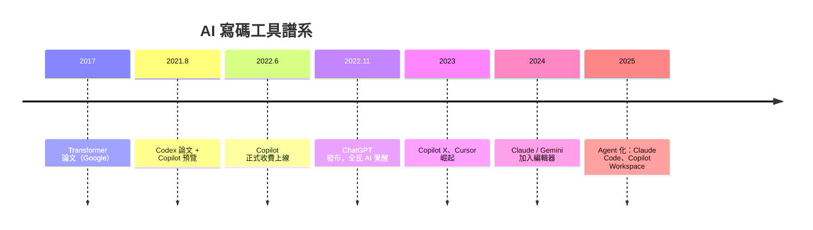

# Copilot 與 Codex：從補全到語意生成

## 一、技術源頭：Transformer 與 Codex

AI 寫碼的源頭是 2017 年 Google 的論文〈Attention Is All You Need〉：Vaswani 等人提出 Transformer 架構，用注意力機制（attention）取代循環網路，讓模型能同時掌握長上下文的關聯，並且可以平行訓練——超大規模語言模型（LLM）的地基就此打下。OpenAI 的 GPT 系列（2018 GPT-1、2019 GPT-2、2020 GPT-3）沿此路線指數成長。

寫碼能力的專門化版本是 **Codex**：OpenAI 以 GPT-3 為基礎，用 GitHub 公開倉庫的數千萬程式檔案與相關文字微調訓練的代碼模型。2021 年 8 月，Codex 論文發表；同一時間，GitHub 宣布 **Copilot** 技術預覽——把 Codex 嵌進編輯器，成為「AI 結對程式員」。

## 二、Copilot：改變打字的意義

2021 年 6 月 29 日，GitHub Copilot 技術預覽開放；2022 年 6 月正式上市（個人版每月 10 美元，學生與熱門開源維護者免費）。它的使用體驗重新定義了「自動補全」：傳統 IntelliSense 補全的是你已經想好的識別字；Copilot 生成的是你**還沒寫出來的邏輯**——寫下註解「// 驗證 email 格式」，它給出完整的驗證函式；寫下函式簽名，它猜測實作；看著你的測試檔，它補出整組測試。

數據證明了範式轉移的力度。GitHub 2022 年發表的研究：實驗組用 Copilot 寫 HTTP 伺服器任務，完成速度快 55.8%；在真實使用中，Copilot 建議的**接受率**（accepted suggestions）長期維持在三成上下——生成代碼的實用率高於大多數人的預期。2023 年 Copilot X 加入 GPT-4 級聊天、PR 生成與語音互動；2024 年起，Copilot 進入企業版與多模型路線。

## 三、法律暗流：訓練資料的戰場

Copilot 從預覽第一天就背著法律疑雲。它的訓練語料是 GitHub 公開倉庫——包括 GPL 等著佐權（copyleft）授權的代碼。2022 年 9 月，程式設計師 Matthew Butterick 與 Joseph Saveri 律師事務所對 GitHub、Microsoft、OpenAI 提起集體訴訟，主張 Copilot 未經授權複製代碼且未遵守歸屬（attribution）條款；同年，軟體自由保護協會（Software Freedom Conservancy）公開批評 Copilot 違反 GPL 精神。訴訟歷經多次裁決與修正（多數聲明部分被駁回，案件聚焦於契約與 DMCA 主張），至今仍是 AI 訓練資料合法性的指標案件之一。這場爭議的更廣泛意義在於：**公開可取得的≠可以拿去訓練的**——整個生成式 AI 產業的智慧財產基礎，正被一場場官司重新界定。

## 四、Cursor 世代：AI 原生 IDE

Copilot 是外掛，Cursor 是重造。2023 年，Anysphere 公司（MIT 輟學生創業團隊）推出 **Cursor**——以 VS Code 分支為基礎的 AI 原生編輯器：整個編輯器圍繞 AI 重建，支援多檔案上下文、Composer 式多檔編輯、Agent 模式。2024-25 年 Cursor 的 ARR（年度經常性收入）以罕見速度破億美元，成為史上成長最快的開發者工具之一。同期競品全面開花：Windsurf（Codeium）、JetBrains AI、Amazon Q Developer、Replit Agent；Anthropic 的 **Claude Code**（2025）則把 AI 結對搬進終端機——CLI 介面、直接讀你的倉庫、自主執行多步驟任務。開發工具市場在一夜之間重新洗牌。

## 五、從補全到語意：本質的轉變

這場革命的深層意義，是**編程介面的抽象層級又升了一級**。回顧歷史：機器碼 → 組合語言 → 高階語言（FORTRAN，Hopper 的compiler）→ 高階框架 → 雲平台 → 現在：**自然語言**。每一層抽象都把工程師從機械細節解放，把精力推向更上游的設計問題。AI 寫碼把「打字」這個動作的成本降到近零，於是價值迅速遷移到兩端：上游的**意圖清晰化**（說清楚要什麼），下游的**驗證與整合**（確認產出正確、安全、可維護）。

這也是工程師焦慮的來源：當模型能寫出 80% 的樣板代碼，「會寫代碼」還是核心能力嗎？答案藏在前九章的歷史裡：每一次生產力躍進（編譯器、高階語言、開源庫、雲服務）都沒有減少工程師總數，只是重新定義了「工程師」一詞的內涵。這一次的不同只在於：變化的速度，第一次快過了職業生涯的長度。
