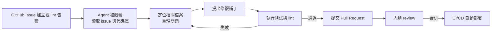

# AI Agent 與自動化 Bug 修復：從 Devin 到自主開發

## 一、從補全到代理：Agent 的技術台階

Copilot 之後，AI 輔助開發的下一級台階是 **Agent（自主代理）**：不再逐行補全，而是接受一個高階任務（「修掉這個 issue」「實作這個功能」），自主規劃步驟、呼叫工具、執行、驗證、回報。Agent 的技術拼圖在 2022-2024 年間就位：

- **ReAct 框架**（Yao 等人，2022）：讓 LLM 交替「推理（Reason）→ 行動（Act）→ 觀察」的循環，成為所有 coding agent 的範式基礎；
- **工具使用**（tool use / function calling，2023 年 OpenAI 正式 API 化）：讓模型能執行 shell 命令、讀檔案、呼叫測試；
- **長上下文與多模態**：128K 以上上下文讓 agent 能「讀完」整個中型倉庫。

## 二、Devin：2024 年的震撼彈

2024 年 3 月，新創公司 **Cognition Labs** 發布 **Devin**，自我定位為「第一位 AI 軟體工程師」：展示影片中，Devin 自主完成環境配置、修復開源倉庫的真實 issue、端到端部署網站。影片引爆輿論，也引發同等力度的質疑：獨立開發者（如 Internet of Bugs 頻道）逐幀分析影片，指出 Devin 的「自主修復」中有多處未能復現、或實際上靠人工輔助。這場爭論成為 AI Agent 泡沫的第一次公眾檢驗——**demo 與生產之間的鴻溝**，是評估所有 agent 產品的基本素養。

儘管如此，方向已被驗證。2024-25 年，Agent 化成為全行業路線：GitHub Copilot 進化出 Workspace 與 Agent 模式（讀倉庫、跑測試、提交 PR）；Anthropic 的 **Claude Code**（2025 年 2 月上線）以終端機介面快速贏得工程師口碑；OpenAI 的 **Codex**（2025 年以雲端 agent 形式重啟）平行跑多任務；Google 的 Jules、ByteDance 的 Trae、字節與阿里等中國團隊的 Agent 產品全面湧現。

## 三、SWE-bench：用考試逼出真相

Agent 能力如何客觀衡量？答案是 2023 年普林斯頓大學團隊提出的 **SWE-bench**：從真實開源倉庫（Django、sympy、scikit-learn 等）挑選真實 GitHub issue，要求模型在完整倉庫中自主定位並修復，以該倉庫的單元測試判定通過。這個 benchmark 把「AI 修 bug」從演示變成可複現的競技場，分數進化速度驚人：2023 年最好的模型通過率僅個位數百分比，2024 年 GPT-4o/Claude 3.5 Sonnet 約 50%，2025 年頂尖 agent 系統在 SWE-bench Verified（人類校驗版）上突破 70%。

進步的另一面是兩個技術事實：其一，SWE-bench 的任務與生產環境的複雜度仍有鴻溝（真實倉庫的跨系統依賴、隱性需求、部署環境遠比 benchmark 骯髒）；其二，模型成績在「孤島式」任務上好，在需要與人類持續協商的長週期工程上仍弱。Agent 的真實形態因此是「**有耐心的初級工程師**」——快、便宜、不知疲倦，但仍需要人類的任務設計與最終把關。

## 四、自動化 Bug 修復的工作流

當下的 Agent 修 bug 工作流已相當具體：

Google 在 2024-25 年公開說明其內部已用 LLM 自動化相當比例的代碼遷移與測試撰寫；Meta 的 TestGen-LLM 研究展示了 LLM 自動增補單元測試並通過人工評審的流程。真正的量產化仍集中在**邊界清晰的任務**：升級依賴、補測試、修 lint、小 bug 修復——而不是開放式的新功能設計。

## 五、經濟學的震盪

Agent 的成本結構正在改寫軟體業的報價邏輯。當一次「修 bug agent 任務」的成本是幾美元到幾十美元的推理費用，而不是數百美元的人力工時，**外包與初級外包市場**（接單修小 bug、寫樣板）首先被壓縮。就業市場數據開始顯現跡象（各大招聘平台 2024-25 年對初級軟體職位的縮減有 AI 因素的討論，但因果仍有爭議——同期的利率與裁員潮也在作用）。同時新職位湧現：AI 工程師（AI engineer）、Agent 平台工程、評測工程（evals）——歷史再次重複 Brooks 的觀察：工具進步創造的新工作，多於它消滅的舊工作，但**轉場期是殘酷的**。

## 六、未完成的地圖

從 Hopper 的編譯器（讓機器翻譯程式）到 Copilot（讓機器猜代碼）到 Agent（讓機器自主完成任務），軟體自動化的六十年線索清晰可辨：每一代工具都把「下一層機械性」交給機器。Agent 時代尚未解決的核心問題依然古老：**需求的模糊性、驗證的嚴謹性、責任的歸屬**。機器能跑完測試，但誰為上線後的資料外洩負責？這正是下一章的主題。
