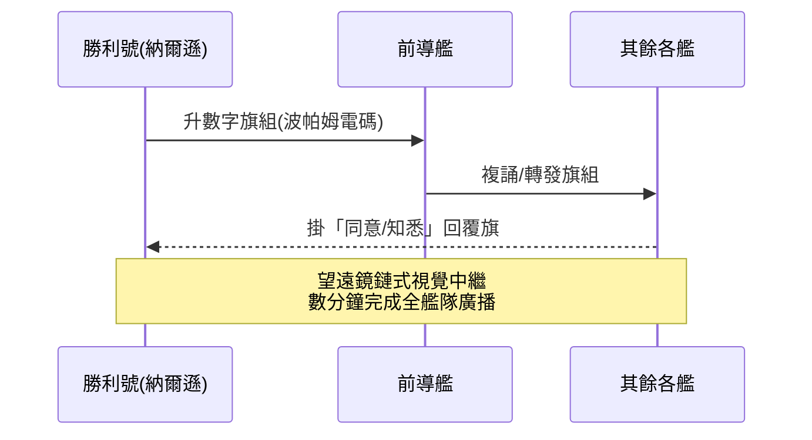
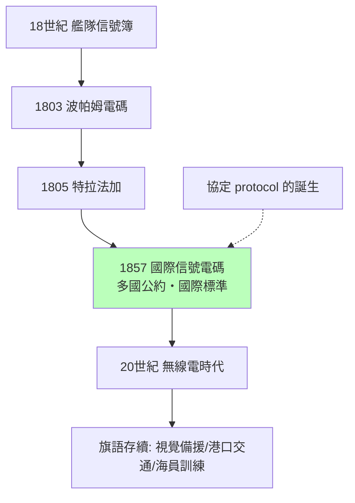

# 節標題：海事旗語：視覺幾何的國際規範

## 把手臂變成字母

當法國人用石塔橫臂把訊息射向陸地邊境時，海上的軍人面對一個更難的問題：艦隊散布數十浬的洋面，風浪搖晃、能見度不定，如何指揮？答案是把「角度」變成字母——水手以雙手持兩面旗，每個字母對應一組固定的雙臂角度（八個方位，兩臂組合出數十種姿態），望遠鏡中的姿態序列即可拼出詞句。這就是手旗信號（semaphore flags）：一座不需塔基的「人體電報」，隨艦移動，隨時開網。

海軍信號的成熟是十八世紀的產物。在此之前，艦隊靠炮聲、號角與少數幾面約定旗傳令，戰術上只能「一窩蜂接舷」。到法國大革命與拿破崙戰爭年代，信號簿已可下達複雜機動命令，艦隊第一次能像一個大腦指揮的手指般運轉。1793 年成立的英國海軍部委託發展的數字信號旗系統，與霍姆·波帕姆（Home Popham）1803 年《電碼信號詞書》（Marianne/Popham code，以數字旗組對應詞彙簿）把這套能力推向巔峰。

## 特拉法加：兩句旗語的戰史地位

1805 年 10 月 21 日，特拉法加海戰。納爾遜在旗艦「勝利號」上打出那段後來刻進英國記憶的信號：「England expects that every man will do his duty」（英格蘭要求人人恪盡職守）。這句話用波帕姆電碼編成數字旗組，須逐字逐旗升落，花費數分鐘才傳完整艦隊；副官曾建議改用「Nelson confides」以節省吊旗時間，納爾遜堅持用「England」以鼓舞全軍——一個對「傳輸成本」心知肚明的通訊決策：每個字都是真實的時間成本，關鍵詞值得多花旗次。信號效果驚人：艦隊士氣大振，皇家海軍以新穎的「兩列穿插」戰術殲滅法西聯合艦隊，納爾遜本人卻中彈陣亡。旗語在此展現了它的雙重性格：既能下達戰術命令，也能承載政治與情感的動員。

## 1857：誰在制定「協定」？

特拉法加之後的百年，航海貿易全球化，各國旗號五花八門、互不相通，事故頻仍。標準化的呼聲由英國商務部（Board of Trade）接下：1857 年發布首版《國際信號電碼》（International Code of Signals），以四十面旗（26 字母旗、10 數字旗、代用旗與回覆旗）的組合對應多語詞句簿，任何國籍的船舶都可「掛旗通話」。這是通訊史上劃時代的一步：第一次，一套符號系統由多國公約採納，成為真正的國際標準——「協定（protocol）」從兩艦間的默契，升格為全球的公法。其中單旗緊急信號至今仍在：Alfa＝「本船有潛水員下水請遠避」、Oscar＝「有人落水」、Victor＝「本船急需援助」，加上著名的「NC」求救旗與遇難組合。

值得注意的是「誰在定標準」：十九世紀中葉，英國掌握全球航運與海權，國際電碼實質是英式實踐的輸出——正如後來海底電纜網、格林威治時間與英制航運慣例。通訊標準從來不只是工程問題，而是權力的投影：誰的碼表成為世界的碼表，誰就掌握了海上資訊秩序。1859 年起各海洋國家陸續採用修訂版，國際信號旗成為至今仍在生效的最古老國際通訊標準之一。

## 無線電之後：備援的智慧

二十世紀無線電興起，旗語理應退役，卻沒有。原因有三：其一，無線電有噪音、干擾、靜默管制與被敵方偵聽的風險，視覺信號在燈火管制與無線電靜默時是可靠備援（二戰艦隊大量使用信號燈與旗語）；其二，港口、航道狹窄處的高密度船舶交通，旗號直觀無歧義；其三，制度慣性——國際海事組織（IMO）至今把旗語與國際信號旗列為海員基本訓練與《國際海上避碰規則》的一部分。今天的商船船長仍須認得四十面旗、會打手旗，這是通訊史上罕見的「兩百年不退役」。

## 思想史的意義：協定的先聲

旗語與信號電碼留給後世的，不只是戰史與習俗，而是一個思想範式：**通訊需要共同約定的符號系統**。無論是納爾遜的數字旗組、1857 年的國際電碼，還是後來的摩爾斯電碼、ASCII，乃至今日的 TCP/IP，本質上都是同一件事的迭代——在異質的機器（或人、艦、國家）之間，用公開標準讓訊息可互譯。當英國人在 1857 年把四十面旗寫進國際公約時，他們為整個資訊時代立下了第一塊「協定基石」：標準先於速度，協議先於傳輸。這一課，將在下一章的電線上，以更快的速度重演。
