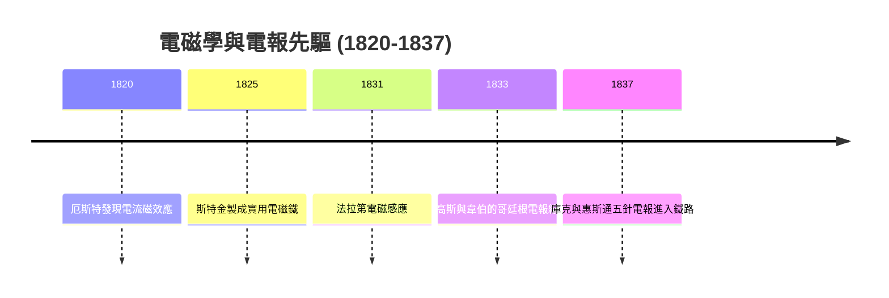
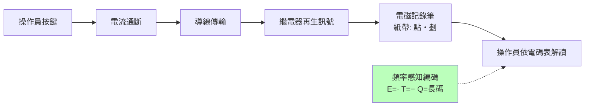

# 節標題：厄斯特的電流磁效應與莫爾斯電碼

## 1820：一根磁針的偏轉

十八世紀末，電與磁被視為兩個互不相干的自然王國：靜電是琥珀與萊頓瓶的把戲，磁是羅盤與鐵礦的古老美德。丹麥哥本哈根大學的物理學家漢斯·克里斯蒂安·厄斯特（Hans Christian Ørsted, 1777–1851）卻深受德國自然哲學（Naturphilosophie）影響，相信自然界諸力同源、可以互相轉化——這個當時被牛頓派視為浪漫玄想的信念，成了他的實驗指南。1820 年春，他在一堂為學者與學生準備的示範課上，把通電導線放到小磁針上方：磁針輕輕偏轉了。厄斯特在課堂上或許還未意識到發生了什麼，隨後數月他以系統實驗確認：電流通過導線時，會在其周圍產生環形磁效應。同年 7 月他以拉丁文發表《關於電衝突對磁針效應的實驗》，整個歐洲科學界為之震動。安培聞訊在數週內完成電動力學的定量理論；「電磁學」作為一門學科就此誕生——而電報的物理大門，也在此刻打開：**電流可以在遠端產生可察覺的機械效應**。

接下來十年是接力賽。1825 年，英國的威廉·斯特金（William Sturgeon）做出第一具實用電磁鐵（軟鐵芯繞線，通電即吸、斷電即放），把厄斯特的效應放大成工程可用的「遙控開關」。1831 年，法拉第（Michael Faraday）發現電磁感應，證明磁也能生電——這為後來的發電機、乃至海底電纜的傳輸理論埋下伏筆。同年，美國的約瑟夫·亨利（Joseph Henry）已展示用電磁鐵遠距鳴鈴。理論、元件、效應三件套齊備，電報的發明只剩工程整合與「誰先誰後」的競賽。

## 先驅競賽：從哥廷根到倫敦

第一波實用電報出自德俄英。1832 年，曾在中國與遠東任外交官的俄國男爵希林（Pavel Schilling）在聖彼得堡展示五針電磁電報；1833 年，哥廷根的數學王子高斯（Carl Friedrich Gauss）與物理學家韋伯（Wilhelm Weber）在校園與天文台之間架起約 1.2 公里的雙線電磁電報，以磁針偏轉方向與次數編碼，這是世界上第一條以科學家之手運行的穩定電報線。高斯甚至構想了「每秒多次收發」的編碼效率問題——科學家的頭腦已在思考頻寬。

英國線則率先商業化。威廉·庫克（William Cooke）受希林演示啟發，拉上倫敦國王學院的教授查爾斯·惠斯通（Charles Wheatstone），1837 年取得專利，建成五針電報，並沿大西部鐵路（Great Western Railway）在帕丁頓與西德雷頓之間架線——這是電報第一次進入商業運輸體系。鐵路與電報自此共生：火車以前所未有的速度飛馳，而只有電報能防止兩列車駛上同一條軌道。一個新運輸速度，召喚出一個新資訊速度。

## 畫家莫爾斯與工程師維爾

賽局的終局卻屬於一個「外行人」。塞繆爾·莫爾斯（Samuel Morse, 1791–1872）是耶魯畢業的肖像畫家，紐約國家設計學院首任院長，對電學一竅不通。1832 年秋，他自歐洲返美的薩利號（Sully）郵船上，午餐時聽乘客查爾斯·傑克遜談論電磁鐵實驗，突然抓住一個念頭：既然電流瞬時可達電線任何一端，訊號就能瞬時傳遞——只要能把它編成可記錄的符號。他在船上速寫本裡畫下構想，並用了此後十二年（期間艱困地重操畫筆糊口）把它變成現實。

莫爾斯的天才在於概念架構：發信鍵、電磁記錄筆（在紙帶上劃出點與劃）、以及一套將字母對應到訊號的電碼。而把它變成可靠機器的，是機械師阿爾弗雷德·維爾（Alfred Vail, 1807–1859）。維爾出身新澤西的斯皮德韋爾鐵廠（Speedwell Ironworks），1837 年與莫爾斯合夥（家族出資換股份），隨後做出關鍵工程貢獻：改良繼電器（relay，讓微弱訊號再生、遠距接力）、設計便捷的操作鍵，並大幅重構電碼本身。1838 年 1 月，兩人在莫里斯敦與紐約之間公開演示「莫爾斯電碼」。

## 頻率感知的編碼：資訊壓縮的先聲

莫爾斯—維爾電碼的深遠之處在它的分配原則：**常用字母給短碼，罕用字母給長碼**。據維爾自述，他數過家鄉報紙鉛字盤裡每個字母的出現次數，得出 E 出現最多，因此配以最短的一個「點」（·）；T 也是單「劃」（−）；而 Q、Z 等冷僻字母則是四個符號的長碼。這是人類第一次按「使用頻率」分配「編碼長度」——用最短的平均時間傳送一段英文，等價於一次實用的壓縮。資訊理論史家會在百年後認出這個思想：它與香農（Shannon）1948 年的熵編碼、與 Huffman 1952 年的最優前綴碼，遵循同一條原理——訊息不是等價的，高頻符號值得更便宜的傳輸。莫爾斯電碼因此不只是讓機器「說話」的字典，更是編碼效率思想的第一次實作。

## 時代的合流

回望這段歷史，電報不是天才孤例，而是時代合流的產物：德國自然哲學給了厄斯特「力之統一」的信念；丹麥的講堂給了他示範課的偶然；英國的工匠與鐵路給了電磁鐵商業應用的舞台；而一個失意畫家與一個鐵廠工程師的相遇，把物理效應翻譯成社會可用的訊息系統。制度也在同步就位：專利制度保護發明、鐵路公司鋪設走廊、報業渴求快訊、政府為軍事郵政買單。1837 年庫克—惠斯通在英國申請專利時，莫爾斯尚在大西洋對岸苦候國會青睞——下一章，就是這位畫家如何在華盛頓的議事廳裡，用三年賭局換來那句「上帝創造了何等奇蹟」。
