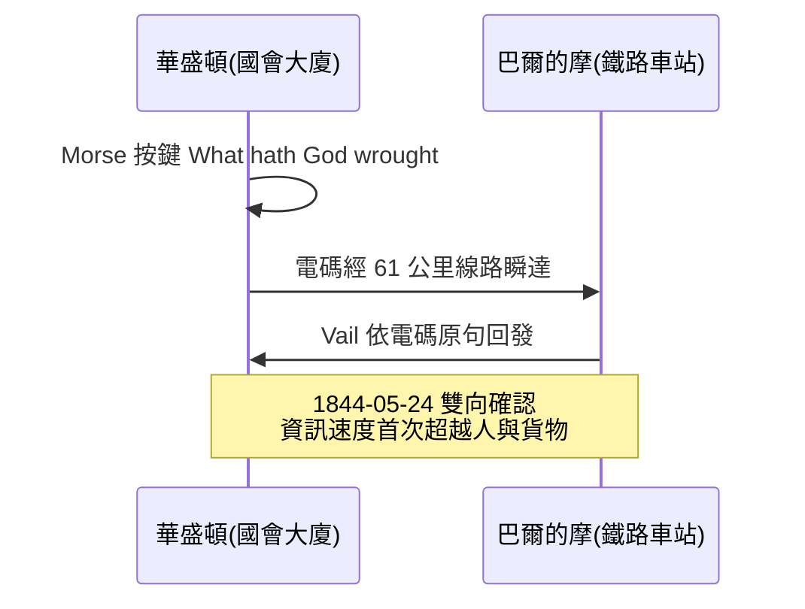

# 節標題：1844 年「上帝創造了何等奇蹟」：第一條商業電報線

## 對議員推銷魔法：六年長跑

1838 年 2 月，莫爾斯與維爾受邀在華盛頓向國會委員會演示電報，操作員在數英里外的線路一端收訊、當場譯出。議員們看得目瞪口呆，卻問出一個流傳後世的問題：「這玩意能幹嘛？」（能同時傳兩封訊息嗎？能傳到法國嗎？）——沒有一個議員的職業生涯裡存在過「資訊比人跑得快」的世界，因此也無從想像它的用途。莫爾斯請求國會撥款三萬美元建造華盛頓—巴爾的摩試驗線，提案在國會連年懸而未決。莫爾斯窮困潦倒地等著，自嘲「郵包裡裝著可能餓死的發明」。

轉機出現在 1843 年 2 月的最後一夜：國會年度撥款案已近表決尾聲，多數議員急著散會回家，在昏暗中某人朗讀條文時，「三萬美元」的電報試驗款混在漫長的撥款清單裡被混雜投票通過——有議員後來說，若非那晚的疲憊與疏忽，此案未必過關。技術史上最大的勝利之一，是以一張疲憊議事桌上的霧票完成的。

## 1844 年 5 月 24 日

線路沿巴爾的摩—俄亥俄鐵路的路權敷設，最初試驗地下管道（受不得力的包覆絕緣所苦），後改為架設在木柱上——這是「電報桿」成為北美地景的開端。全線約 61 公里（38 英里）。1844 年 5 月 24 日，莫爾斯在華盛頓國會大廈聯邦最高法院舊廳室內，敲出《民數記》23 章 23 節的一句話：

> **What hath God wrought**（上帝創造了何等奇蹟）

這句話的選擇本身是個故事：巴爾的摩的小姐安妮·埃爾斯沃思（Annie Ellsworth，專利局局長之女，莫爾斯的世交晚輩）建議這句《聖經》經文，莫爾斯欣然採納。巴爾的摩一端的維爾依電碼原樣收錄、回發同一句，兩地往返確認。一次宗教意味濃厚的雙向握手，宣告了電訊時代降臨——莫爾斯刻意不選自己寫的句子，而讓「神」替技術背書，這在十九世紀虔敬的美國，是最好的宣傳。

## 反向的第一則「新聞」：輝格黨大會

歷史隨即送上戲劇性的驗證。數日之後，輝格黨全國大會正在巴爾的摩舉行，提名亨利·克萊（Henry Clay）競選總統。華盛頓的人們習慣上要等驛馬快車或特快船捎來大會消息——通常要一天以上。這一次，提名結果經電報在**數分鐘內**傳回華盛頓；聽聞者先是拒絕相信，組成委員會搭火車親赴巴爾的摩核實，回來後才公開承認。這則小插曲是媒體史的里程碑：政治訊息的權威性，從「信使帶來的紙」轉為「電線帶來的碼」。老世界的時間感開始崩塌。

## 商業爆發：報業、鐵路與金融

此後數年，私營電報公司在美國如雨後春筍，沿鐵路蔓生。三個產業率先被重塑：

- **報業**：1846 年，幾家紐約報紙合組港務新聞聯盟，共享華盛頓—紐約電報線傳送國會消息，即今日美聯社（Associated Press）之濫觴——通訊社是「為省錢而共享頻寬」的制度發明。戰場快訊、選舉結果、航運消息自此以小時而非天為單位。
- **鐵路調度**：電報成為鐵路的神經系統。列車間隔、誤點通告、單線會車命令全靠電報下達，「鐵路時間」與「電報網」互為表裡；電報公司乾脆把辦公室設進車站，車站後來兼任「發報局」。
- **金融與商情**：農產與商品的產地價格、交易所行情首次即時互通，基差交易、跨市套利、期貨定價的資訊基礎誕生——價格不再隨馬車晚到而失真。

一句話概括這場革命：**資訊的速度第一次超過人與貨物的速度**。此前的通訊史，本質上是運輸史的一部分（信與貨同車同船）；1844 年之後，兩者永久分道，時間的價值被重新定價。

## 壟斷、縮語與「按字付費」的文化

隨後數十年，電報公司經過野蠻競爭與併購，到 1870–80 年代，西部聯盟（Western Union）幾乎壟斷美國電報業，網路達數十萬公里、連接全國城鎮。壟斷帶來效率也帶來爭議（高費率、記者罷工事件催生了後世對通訊業的公共監管討論），但它也塑造了一種文化：**按字計費**（cost-per-word）。多付一個字就多花錢，於是發明出電報縮語文化——「ARRIVE MONDAY STOP HOTEL PLAZA STOP」式的電報體，捨棄冠詞與敬語，只留資訊骨架；專用縮語碼（如商業密語碼本）把長句壓成一個詞。這是普通人第一次被價格機制訓練去「壓縮語言」，也預示了百年後簡訊與推特的字數經濟學。

## 小結

從「這玩意能幹嘛」到全國神經網路，只用了四分之一個世紀。1844 年那一句《民數記》不僅宣告電報可行，更宣告了一個新範式：訊息可以不依附運輸而獨立流通——報紙、鐵路、金融市場、乃至戰爭與外交，從此都活在電線的節奏裡。而當資訊開始渴望跨越海洋、把北美與歐洲接上同一根導線時，人類將發起通訊史上最悲壯的工程遠征：跨大西洋海底電纜。
