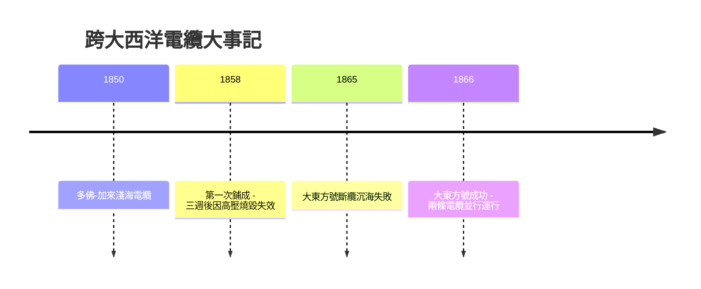

# 節標題：跨大西洋海底電纜的悲壯工程

## 五十年等待、兩千里海水

1844 年電報在陸地上飛馳之後，最大的障礙是大西洋：北美與歐洲之間，訊息仍需十天半月的郵船。要在深海鋪設電線，需同時解決三個難題：絕緣材料、信號衰減、以及把數千噸電纜沉入四千公尺深海的船隊工程。前兩項的關鍵在 1840 年代後期到位：英國醫生兼業餘博物學家蒙塔古—佩里爾在馬來亞發現的古塔膠（gutta-percha）——一種常溫絕緣、耐海水、可熱塑的天然樹脂——1848 年起被製成海底電纜的絕緣護層，1850 年英法多佛—加來線在淺海鋪成。深海只是「淺海放大一百倍」的想法，自此有了物質基礎。

## 賭徒菲爾德與兩個工程師的戰爭

把夢想押上賭桌的是美國商人賽勒斯·菲爾德（Cyrus Field, 1819–1892）。他三十歲靠造紙業致富退休，1854 年經胞兄介紹接手紐芬蘭電報計畫，隨即把它升級成跨大西洋的狂想。此後十二年，他往返大西洋數十次，遊說英美兩國政府（兩國各自補助與提供艦船）、組織資本家（包括英國大西洋電報公司內的工程與金融巨頭）、在屢敗屢起中不肯認輸——他是募資者、政治說客與精神支柱，本身不諳電學。

技術內部卻存在一場決定成敗的路線之爭。電氣總工程師懷特豪斯（Wildman Whitehouse，內外科醫生出身的電學愛好者）相信電流在長電纜中的衰減是「電容器充放電」式的延遲，可用**高壓強送**（感應線圈產生的高壓電擊）硬推過去。而在格拉斯哥的物理學教授開爾文勳爵威廉·湯姆森（William Thomson, 1824–1907）則基於傅立葉熱傳導數學，論證長電纜的訊號延遲與失真（後來所謂「電纜定律」），主張只能用**微弱但精確的低壓訊號**，配以極靈敏的接收器，並放慢發報速率。這場分歧不只是技術路線，更是科學（數學物理）與工匠經驗主義的對決。

## 1858：三週的勝利與一場燒毀

第一次遠征飽嘗風暴與斷纜（1857 年在愛爾蘭外海斷裂沉海）。1858 年夏，兩艘軍艦阿伽門農號與尼亞加拉號在大西洋中部會合，各向兩岸鋪設，歷經風暴與數次斷裂終於成功。8 月 16 日，維多利亞女王與布坎南總統互致賀電，兩國教堂鳴鐘、百炮齊放，報紙宣稱「大西洋消失了」。但女王 98 個詞的賀電竟花了十六小時以上才傳完——懷特豪斯的高壓電擊正以千伏級脈衝轟擊電纜，加速擊穿絕緣。9 月 1 日，訊號永久靜默。輿論從狂熱翻轉為嘲諷，有人質疑整個工程是騙局，公司破產重整。菲爾德背上「魯莽」之名，卻在股東散去後說出那句著名的誓言：問題終會被克服，「我已投入太多，不能停手」。

事後調查確認了禍首：懷特豪斯的高壓操作燒毀了電纜絕緣。開爾文的路線——弱訊號加靈敏接收——被證明是唯一正解。工程界第一次領教：**電纜的極限不是材料強度，而是電磁學的數學**。

## 1865–66：巨船、斷纜與鏡式電流計

第二次遠征需要一艘能一次裝載全長 3700 公里電纜的巨船。大東方號（SS Great Eastern）——布魯內爾設計、服役五年無所事事的全球最大輪船——被租來擔此重任。1865 年 7 月，大東方號自愛爾蘭啟航，鋪設近三分之二後電纜斷裂，打撈多日無果，抱憾返航；這根沉入三千多米深海的斷纜，成為工程史著名的未竟之痛。1866 年 7 月，大東方號捲土重來，全程鋪設成功；更戲劇性的是，該年夏末公司重返失事點，竟用抓鉤把 1865 年的斷纜從海底撈起、接續鋪完——一電一舊兩條大西洋電纜同時運行，每分鐘數字可達 6–8 字。

勝負手正是開爾文的**鏡式電流計**（mirror galvanometer）：把一枚輕如睫毛的小磁鏡懸於細絲上，微弱電流使其偏轉，光束放大讀數——能接收百萬分之一安培級的訊號。他稍後又發明虹吸記錄器（siphon recorder）成為長期標配。數學物理與精密儀器，戰勝了高壓蠻力。

## 科學與資本的婚姻

開爾文在工程中確立了「以數學定工法」的權威，也因此致富：他任大西洋電報公司董事、專利入股，電纜與儀器收入遠超劍橋教授俸祿；1866 年因電纜功勳受封爵士，1892 年晉陞開爾文男爵——他成為科學家以智識入股產業的第一批典範，此後「教授創業」成為技術史的常態。而懷特豪斯的下場是黯然去職——工程史上第一次，不是「誰的手巧」而是「誰的方程式對」決定了勝負。

## All-Red Route 與資訊地緣政治

電纜的意義遠超商業。大英帝國沿著紅土航線修建了全部經停英屬領土的 All-Red Route，把倫敦與加拿大、印度、澳大利亞以帝國電纜網串成一體；電報同時催生了路透社的全球新聞網與倫敦金融城的定價權。資訊通道成為戰略資產：1884 年列強已開始討論「電纜中立」的國際法（這個問題至今未決）；1914 年開戰首日，英國皇家海軍剪斷德國的海底電纜，德國被迫改用無線電——而無線電訊號可被英國截聽，齊默曼電報因此落入美國手中，改寫了一戰結局。剪電纜，成為二十世紀資訊戰的第一槍。

時間也被重塑：此前跨洋資訊以「天」計，電纜後以「分」計——倫敦與紐約的匯率、新聞與軍令共享同一分鐘。全球第一次擁有了同步的「現在」。四分鐘變數分鐘，看似微小，卻把世界從一組彼此錯開的地方時間，縫合成一張即時的神經網——今天我們稱之為「全球化」，而它最早的心跳，來自 1866 年那根沉入北大西洋的銅芯。
