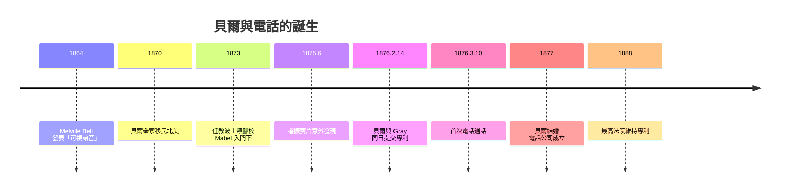

# 貝爾與聲學：從盲人教育到電話

## 一個為「聽不見」而生的人

電話的發明故事，若只看 1876 年 3 月 10 日那一天，就錯過了它真正的起點。Alexander Graham Bell（1847–1922）的一生，從出生那一刻起就與「聲音」和「聽不見」深度綁定。他的家族是蘇格蘭愛丁堡的演說學世家：祖父 Alexander Bell 以「矯正口吃與咬字不清」的演說矯正術聞名；父親 Alexander Melville Bell 則在 1864 年發表了震動一時的「可視語音」（Visible Speech）系統——用一套符號描繪舌位、唇形、喉部發聲的方式，使任何一種語言的發音都能「寫下來、看得見」。這套系統最初的目標，正是教聾人說話。

更深的羈絆來自家庭內部：貝爾的母親 Eliza 幾乎全聾，他幼年時便習慣湊近母親耳邊、以額頭貼近她的額骨感受她說話時的震動；多年後，他的妻子 Mabel Hubbard 也是失聰者。三代人與聾人教育、語音科學糾纏在一起——貝爾後來自己說過，電話不過是「可視語音」研究的副產品。這句話半是自謙、半是實情：他畢生最愛的頭銜其實不是「電話發明人」，而是「聾人教師」。

貝爾的青年時代並不順遂。他的兩個兄弟相繼死於肺結核，1870 年，二十三歲的貝爾在醫囑下舉家移民加拿大，之後南下美國，落腳波士頓。這座城市當時是美國聾人教育的中心——荷蘭移民學者 Thomas Hopkins Gallaudet 開創的手語教育傳統（以為紀念而創建的 Gallaudet 大學）與「口語教學」傳統在此激烈競爭。貝爾堅定站在口語派一邊：他相信聾人不該被隔離到手語社群中，而應學會說話、讀唇，融入主流社會。這個立場在聾人社群內部至今仍有爭議，但放在當時，它讓貝爾迅速獲得了波士頓上層改革派家庭的支持——包括富有的律師與慈善家 Gardiner Greene Hubbard。

## Hubbard、Mabel 與資本

Hubbard 不是普通的家長。他精於專利法、關心電報壟斷問題——他的女兒 Mabel 在幼年因猩紅熱失聰後，他投入大量心力於聾人教育事業，並且與當時的電報巨頭 Western Union 關係緊張。1873 年，貝爾受聘為波士頓聾校教師，Mabel Hubbard 成為他的學生——她當時十歲，後來兩人相戀，1877 年結婚。

對貝爾而言，Hubbard 提供的不只是愛情的中間人角色，更是資本與制度知識。貝爾是典型的發明家性格：熱情、固執、興趣發散，對錢毫無興趣，實驗室的筆記總是拖到最後才補。Hubbard 則冷靜、精明、長於談判。1874–75 年間，兩人與 Thomas Sanders（另一名聾童 George Sanders 的父親）達成協議：由兩位父親資助貝爾的實驗，換取未來發明的股份。這個「貝爾專利協會」是史上最重要的風險投資案例之一——沒有這個制度安排，貝爾的草圖可能永遠停留在草圖。

## 諧波電報的歧路與「會說話的電報」

貝爾最初要解決的其實不是語音傳輸。當時 Western Union 壟斷電報網，Hubbard 想要的是一種「諧波電報」（harmonic telegraph）：在一條線上，用不同頻率的簧片同時發送多路電報，破開頻寬壟斷。貝爾身為聲學與音樂專家（他能用耳朵辨識簧片的每一個泛音），正是做這件事的絕佳人選。

轉折發生在 1875 年 6 月 2 日。貝爾與助手 Thomas Watson 在波士頓的實驗室裡調試諧波電報：Watson 負責在另一端撥動簧片，其中一個簧片因過度纏繞而卡死，卻發出了帶著共振泛音的嗡鳴。貝爾在發射端聽到了——那不是「咔嗒」的電報脈衝，而是簧片被電流完整「複刻」出來的聲音。他瞬間領悟：如果電流強度能隨聲波連續變化（而非只有通斷），那麼完整的語音就能沿電線傳送。諧波電報的失敗方向，就此轉為語音傳輸。

接下來的九個月是密集的試錯。1876 年 2 月 14 日，貝爾的律師將專利申請送進美國專利局——而就在同一天下午，Elisha Gray 的律師也提交了一份針對「語音傳輸裝置」的專利聲明（caveat）。誰先誰後、文件內容如何流出台面，成為纏訟數十年的世紀專利官司；歷經數百場訴訟，最高法院最終在 1888 年的判決中維持了貝爾的專利有效。Gray 輸掉官司的不只是運氣：他代表 Western Union 的立場，而貝爾一方有 Hubbard 這樣深諳專利戰略的操盤手——發明的勝負，往往在專利局的檔案櫃裡就已分出。

## 「Mr. Watson, come here」

1876 年 3 月 10 日，波士頓 Court 街 5 號。貝爾在發射端將酸性電池溶液潑到了衣服上，本能地喊出：「Mr. Watson, come here, I want to see you.」在另一個房間的 Watson 清楚聽見了這句話。史上第一次電話通話，內容平凡得像一則實驗室趣聞，但它的意義是革命性的：人類第一次讓「聲音」脫離了身體，沿著電線傳到了看不見的地方。

貝爾的專利 #174,465 於 1876 年 3 月 7 日核發，這份僅六頁的文件日後被稱為「史上最賺錢的專利」。圍繞它成立的貝爾專利公司（Bell Patent Association），幾經演變成為 American Bell Telephone Company，再到 1885 年的子公司 AT&T——今日電信產業的母體。而貝爾本人很快就淡出了商業經營，把電話交給 Hubbard 與職業經理人，自己回到蓋在加拿大新斯科細亞省 Breton 島上的實驗室，繼續教聾童說話、研究飛行與水翼船。

## 洞察：一條看不見的線

貝爾的故事示範了通訊史上反覆出現的主題：**重大突破往往來自旁支的失敗**（諧波電報）、**性格決定了誰能捕捉意外**（貝爾以音樂家之耳聽出簧片裡的語音）、以及**資本與制度是發明的一半**（Hubbard 的專利協會）。電話不是孤立的靈光一閃，而是聾人教育、聲學科學、電報產業競爭與家庭資本共同擠壓出來的產物。下一章，我們要看這項發明如何長成一個帝國。
