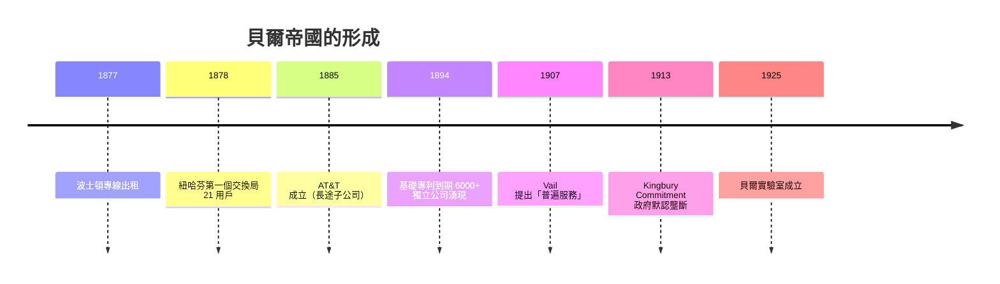

# 交換機與人工接線生：貝爾帝國

## 從專利到網路：一項發明的制度工程

1876 年的貝爾只證明了「聲音可以沿電線傳送」，但電話要成為產業，還需要回答一連串制度的問題：誰跟誰連線？線路鋪給誰？出現爭議找誰？這些問題的答案，與送話器的技術同等重要。

最初的電話是「點對點」的：兩家之間拉一條專線，像 1877 年波士頓與 Somerville 之間的租用線路。很快人們發現這不可行——$n$ 個用戶若要兩兩直連，需要 $\binom{n}{2} = \frac{n(n-1)}{2}$ 條線，一百個用戶就是將近五千條線，城市將被電線絞殺。解法是「交換」：所有用戶的線都接到一個中心點，由中間的人把任意兩條線接起來。這個中心點就是交換局（switchboard），站在中間的人就是接線生。

1878 年 1 月，紐哈芬（New Haven）啟用了史上第一個商用電話交換局：21 個用戶，單一總機板。這個小得可憐的系統，卻是現代電信網的胚胎——從此，「本地環（local loop）＋交換中心」的星狀拓撲成為電話網一百年的基本骨架，連帶誕生了電話號碼（早期用戶彼此記名字，隨著用戶增多才改成編號，並出現電話簿）與撥號禮儀。

## 「Voice with a smile」：接線生的社會史

早期的交換生多是少年——報童出身的男孩反應快、手腳靈巧。但很快，電話公司發現男孩們受不了這份工作：他們在總機板前罵粗話、跟用戶惡作劇、互擲焊錫。1870 年代末，公司開始改雇成年女性，結果出乎意料地好：女性接線生有耐心、語氣柔和、記得住數百個用戶的名字與嗓音。

這成為美國勞動史上的標誌性事件。「接線生」（operator）是繼紡織與家庭幫傭之後，女性最大宗的新興職業之一。到 1920 年代，貝爺系統雇用的女性接線生超過二十萬人。她們被要求「帶著微笑的聲音」上班，坐姿、語調、應答用語都有嚴格規範——這是工業時代對「情緒勞動」最早的系統性管理。這份工作薪資不高、升遷有限，卻給了不識字的移民女兒一份體面與獨立；而「hello」這個打招呼方式（據傳是貝爾的競爭者 Thomas Edison 所推薦）隨著每日千萬次的接線，滲透進了整個英語世界的日常禮儀。

貝爾帝國的制度設計者是 Theodore Vail。這位第一任總經理在 1907 年重回 AT&T 後，提出著名的理念：「一個政策、一個系統、普遍服務」（One Policy, One System, Universal Service）——壟斷不是罪，而是提供全民可靠服務的手段。

## 1894：專利圍牆倒塌

貝爾的基礎專利在 1894 年到期，圍牆一倒，獨立電話公司如潮水般湧入：十餘年間，全美冒出六千多家獨立電話公司，主要在農村與小鎮——那裡正是 AT&T 懶得經營的地方。農民組織電話合作社，用籬笆鐵絲接線，一個郵購的總機板就能開業。

AT&T 的反擊靠兩張王牌。其一是縱向整合：自製設備（Western Electric）、自營長途。其二是長途線本身——獨立公司只能做本地生意，而跨州通話必須借道 AT&T 的長途網。AT&T 拒絕互連，逼得獨立公司上門求售，再逐一收編。這場「電話大戰」（Telephone Wars）打得激烈：雙方遊說州議會、互相剪線、比賽鋪線速度。

## 1913：Kingbury Commitment

1913 年，聯邦政府依《謝爾曼反壟斷法》對 AT&T 提起訴訟。此時反壟斷的風頭正盛——標準石油剛在 1911 年被強制拆分。AT&T 的副總裁 Nathan Kingsbury 與司法部達成了一項曖昧的和解（因以書信形式往來，史稱 Kingbury Commitment）：政府不拆分 AT&T，默認其市場地位；作為交換，AT&T 同意出售 Western Union、承諾讓獨立公司以合理費率互連長途網，並接受州際商務委員會的監管。

這是美國電信史上最關鍵的妥協：**以「受監管的私營壟斷」取代競爭**。它塑造了此後七十年的美國電信格局——AT&T 是壟斷者，但換來普遍服務與穩定費率；獨立公司得以存活於本地市場。這種「自然壟斷＋政府監管」的模式，日後被電力、鐵路等公用事業廣泛採用，成為二十世紀資本主義治理的範本之一。

## 從維修部門到貝爾實驗室

壟斷還帶來一個意外的果實：研發的制度化。1880 年代起，美國電話電報公司設有專責設備改良的部門；1911 年，工程部門與 Western Electric 的工程師群合流；1925 年，AT&T 將研發單位正式重組為「貝爾電話實驗室」（Bell Telephone Laboratories），由 Frank Jewett 出任首任所長。

貝爾實驗室的商業邏輯極為特殊：因為母公司是受監管的壟斷者，費率由政府核定，多賺的錢交不出給股東，於是公司乾脆把超額利潤投入長期研究——反正研究改善服務品質，可以作為「合理費率」的辯護理由。這個制度漏洞造就了二十世紀最偉大的工業實驗室：電晶體（1947）、資訊論（Shannon, 1948）、宇宙微波背景的發現（1964）、Unix（1970s）都將從這座實驗室誕生。

## 結語：民主化的通訊

到 1920 年代，美國約每五個人就有一部電話，遠超歐洲各國。電話重塑了城市（摩天大樓的可行性有賴於電話取代跑腿信差）、重塑了家庭（客廳裡的電話成為社交樞紐）、催生了緊急服務（撥號求救）與新商業（郵購、股票下單）。它也留下疑問：一個由私人壟斷經營、以「普遍服務」自我正當化的通訊網，究竟是好是壞？這個問題要到 1984 年 AT&T 被拆分時才再次爆發。但在此之前，貝爾帝國先把另一個物理難題——長途的衰減——解決了。
