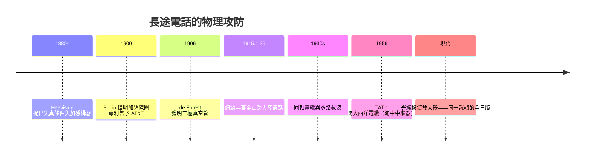

# 長途衰減與 Pupin 加感線圈

## 聲音在銅線上的死亡

在 1880 年代，從紐約打電話到芝加哥（約一千三百公里）已是奇蹟的邊緣，再遠就只剩模糊的嘶嘶聲。問題是純物理的：電話線是一條分布著電阻 $R$、電感 $L$、電容 $C$ 與電導 $G$ 的傳輸線。信號沿線傳播時振幅指數衰減：

$$V(x) = V_0\, e^{-\gamma x}, \qquad \gamma = \sqrt{(R + j\omega L)(G + j\omega C)}$$

麻煩在於衰減常數 $\gamma$ 隨頻率而變：人聲的低頻成分衰減得比高頻快，傳得越遠，聲音的高頻「齒音」先消失，剩下的悶響像隔著棉花說話。更糟的是各頻率傳播速度不同，造成延遲失真。工程師們發現銅線越粗衰減越小，於是線徑一路加粗到直徑近一公分的巨大銅棒——昂貴得荒謬，而且撐不了多遠。

## Heaviside：不被學院接納的天才

解開這道難題的人，不是任何一位電話公司的工程師，而是一個自學成材的英國電報報務員：Oliver Heaviside（1850–1925）。

Heaviside 出身貧寒，只受過中學教育，十六歲進入大西洋電報公司當報務員，因耳聾與不合群而被迫提前退休，此後終生靠親友接濟、獨自在德文郡的小屋裡做數學物理。他自創向量分析重寫了馬克士威方程組（今日教科書裡的「馬克士威方程組」形式其實是 Heaviside 的版本），提出電離層的預言、集膚效應（skin effect）的解釋，以及 1880 年代最關鍵的洞察——**失真條件**：

$$\frac{R}{L} = \frac{G}{C}$$

一般電報電話線的 $R$ 太大、$L$ 太小，無法滿足此條件，故各頻率衰減與速度不一，信號失真。Heaviside 指出：若能**增大電感 $L$**，就能逼近失真條件、大幅降低衰減與失真。換句話說——在線上「加電感」。

這個理論預言卻被 AT&T 的首席工程師公開斥為無稽之談。更深的羞辱在學界：Heaviside 論文屢被皇家學會的權威（如電學泰斗 William Preece）打壓，終其一生未獲正式學術職位、不戴博士帽、靠朋友奔走才在 1891 年勉強當選電機工程師學會會員。理論突破者的命運與專利發明人的命運，在此形成殘酷對照。

## Pupin：從牧童到哥倫比亞講座教授

把 Heaviside 的數學變成可賣錢的專利的，是 Michael Idvorsky Pupin（1858–1935）。他出身塞爾維亞農家，自述是「牧童」出身，1874 年隻身移民紐約，當過果園工人與球場雜役，靠打工讀完哥倫比亞大學，再赴柏林師從亥姆霍茲取得博士，回哥倫比亞任教，最後成為講座教授——一段典型的美國移民成功故事。

Pupin 在 1900 年前後做了一系列實驗，證明沿電話線每隔一定距離插入一枚繞在鐵芯上的線圈（加感線圈，loading coil），等效於把線路的電感 $L$ 抬高，就能讓語音傳輸距離翻上數倍。他迅速申請專利，並於 1900 年將專利授權給 AT&T。AT&T 為此支付的權利金與出售收益據稱高達數十萬乃至上百萬美元——而成為 Heaviside 洞念真正來源的人，分文未得。歷史學界至今爭論 Pupin 的專利在多大程度上真正源自 Heaviside 的理論，但制度現實很清楚：**寫在專利申請書上的名字拿走報酬，寫在論文裡的名字拿走榮譽**。1901 年起加感線圈大量裝設，長途電話的成本驟降，紐約—丹佛於 1900 年代末開通。

## 1915：跨越大陸的電話

加感線圈救了長途，卻有極限：線圈本身也衰減信號，且使高頻衰減更劇，距離一長，語音仍被吞沒。真正的殺手鐧是**放大**——而放大的關鍵，是 Lee de Forest 在 1906 年發明的三極真空管（Audion）。AT&T 的工程師群將其改良為可靠的中繼放大器（repeater）。

1915 年 1 月 25 日，跨大陸電話線開通：紐約的貝爾（已是老人，由他人代打多數行程）與舊金山的 Watson 再度對話，重演四十年前的那句話。這條線混合了粗銅線、加感線圈與沿線的真空管中繼器——物理補償與電子放大攜手，才讓三千多英里的通話成為可能。同年跨大西洋無線電話也實驗成功。

## 長尾：中繼器的百年血統

此後的通訊史，幾乎就是「衰減—補償」這對矛盾的連續劇：1930 年代貝爾實驗室開發同軸電纜與多路載波（一條線同時載數百路通話），中繼放大器沿線密布；二戰後微波中繼塔鏈橫貫美國；1956 年第一條跨大西洋電話電纜 TAT-1 內建深度海中的真空管（後為電晶體）中繼器；今天海底光纖每隔數十公里一枚摻鉺光纖放大器——同樣是「衰減了就放大」的邏輯，只是載體從電子變成光子。

## 結語：理論、專利與資本的三重奏

長途電話的故事是通訊史的縮影：**理論**（Heaviside 的失真條件）指出方向，**專利**（Pupin 的線圈、AT&T 的中繼器）把方向變成可交易的資產，**資本**（AT&T 的壟斷利潤）把資產鋪成跨越大陸的銅網。三者的節奏並不合拍——理論家窮困、發明家得利、資本家通吃——但正是這種不平衡，驅動著通訊版圖一寸寸向外推進。而在同一個年代，另一群人正在準備徹底拋棄電線。
