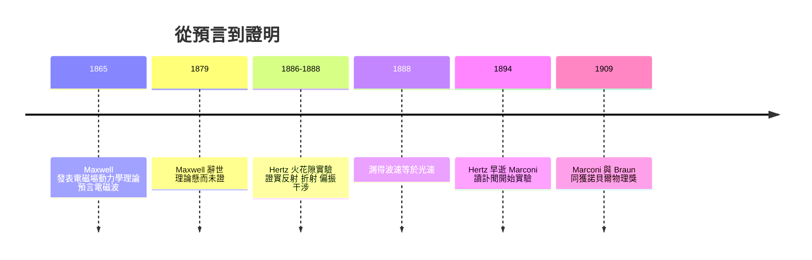

# 馬克斯韋爾與赫茲：電磁波的證明

## 一位蘇格蘭人的數學信仰

James Clerk Maxwell（1831–1879）是十九世紀物理學的巔峰人物。他生於愛丁堡的貴族家庭，自劍橋出師，先後執教亞伯丁與倫敦國王學院，最後回到劍橋主持卡文迪許實驗室。在法拉第用鐵屑與直覺描繪出「場」的概念之後，Maxwell 做的事是把它變成數學——他相信法拉第的物理直覺底下藏著一個嚴密的結構。

1865 年，Maxwell 發表《電磁場的動力學理論》（A Dynamical Theory of the Electromagnetic Field），將電與磁的一切已知定律收束為一組方程。這組方程（今日通行的形式其實由 Heaviside 簡化重寫）蘊含一個驚人的推論：變化的電場生磁場、變化的磁場再生電場，如此互為因果，形成一道在空間中自我傳播的波。這道波的速度可以從兩個電磁常數算出：

$$c = \frac{1}{\sqrt{\mu_0 \epsilon_0}} \approx 3 \times 10^8 \text{ m/s}$$

而這正是光速。Maxwell 由此提出史上最大膽的統一之一：**光就是電磁波**。可見光只是電磁波譜中狹窄的一段，理論預言還存在著比紅光更紅、比紫光更紫的、肉眼看不見的電磁波。

但 Maxwell 的理論有一個致命的尷尬：沒有人見過這種波。電磁學的實驗權威們多不接受「以太中的橫波」這套德國式抽象；Maxwell 本人於 1879 年因腹部癌症去世，年僅四十八歲，至死未見自己的預言被證實。理論懸在空中，等待一雙實驗的手。

## 赫茲：不情願的證明者

接住這雙手的，是 Heinrich Hertz（1857–1894）。他出身漢堡的富裕家庭，先學工程後轉物理，在柏林師從亥姆霍茲，1885 年出任卡爾斯魯厄理工學院教授。1886 年起，Hertz 在教學之餘的實驗室裡開始一連串實驗：他用感應線圈驅動一對帶小球的金屬棒——火花隙發射器，放電時在隙間迸出電火花；不遠處放置一個開口的金屬環——共振環接收器，若真有電磁波飛來，環隙間應出現微弱的火花。

1887–1888 年間，Hertz 一一俘獲了這道看不見的波：它會**反射**（用金屬板擋回）、會**折射**（穿過巨型瀝青棱鏡時偏折）、會**偏振**（旋轉接收環火花即消失）、會形成**駐波干涉**——而由駐波波長與振盪頻率算出的波速，正是光速。馬克士威的預言被完全證實：光、電、磁，在數學上原為一體。

有趣的是 Hertz 的態度。他的儀器簡陋、實驗曾被夫人勸阻（一說是為了節省搬家的力氣），而當被問到這現象有何用處時，他回答：「大概沒什麼用吧（Nichts, wahrscheinlich）。」——「這只是證明馬克士威大師是對的。」他還補了一句預言式的話：未來或許會有人利用它，但「那不會是我們」。Hertz 在 1894 年因血管瘤病逝，年僅三十六歲。他不知道，就在他去世前後，一個二十歲的義大利青年正讀著他的訃聞，眼睛發亮。

## 誰把數學變成技術？

Hertz 的死留下的問題是：從理論到應用，中間隔著什麼？答案是三種不同的人物類型：

- **純理論家**如 Maxwell：預言了波，卻從未想過發報機；
- **科學實驗家**如 Oliver Lodge（利物浦教授，1894 年公開演示無線電報原理）與 Karl Braun（發明陰極射線管、改良無線電調諧）：看到了潛力，停留在學術；
- **工程直覺者**如 Guglielmo Marconi：物理訓練平平，卻只有他咬牙把天線越架越高、發射功率越推越大，目標只有一個——把電磁波變成跨越海洋的商業電報。

1909 年，諾貝爾委員會以一個罕見的組合頒獎：Marconi 與 Braun 共享物理學獎——一個企業家與一個科學家同台，正是「科學預言→實驗證實→工程征服」這條通訊史範式的官方蓋章。而 Hertz 本人的名字，被永久借去做了頻率的單位：每秒一次振盪，就是一赫茲。

## 結語：理論與應用的最後一公里

這段歷史反覆出現在通訊史中：法拉第與 Maxwell 建立語言，Hertz 提供證據，Marconi 接手把證據變成帝國。科學與技術之間的「最後一公里」從來不是自然而然走完的——它需要不同的性格、不同的動機（求知 vs 求利），以及願意把數學推到斷崖邊的執拗。下一章，我們看 Marconi 如何站上那道斷崖。
