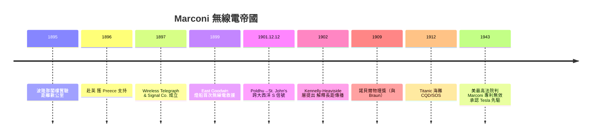

# 1901 年跨大西洋的「S」：馬可尼

## 閣樓上的貴族

Guglielmo Marconi（1874–1937）的出身決定了他做工程的方式。他生於波隆那的義大利貴族家庭，父親是地主，母親 Annie Jameson 是蘇格蘭—愛爾蘭 Jameson 威士忌家族的女兒——這層關係日後為他打開了英國的大門。Marconi 幼時家教嚴格、社交笨拙，母親為他請了家教，其中一位教他實驗方法；他在波隆那家中的閣樓上讀到 Hertz 的實驗論文後，便著了魔似地重做起來。

1895 年，二十一歲的 Marconi 做出關鍵改良：他把發射器接地、用金屬圓柱柱體天線取代 Hertz 的偶極振子，並用金屬屑檢波器（coherer，源自 Lodge 等人的改進）做接收，配合繼電器與電鈴。電磁波從閣樓傳到了花園的另一頭，再到山上——距離從幾公尺推到兩公里以上。義大利海軍與郵政當局興趣寥寥；母親當機立斷，帶著兒子與他的黑箱儀器渡海去英國。

## 英國：官僚的支持與商業的機器

1896 年抵英後，Marconi 迅速獲得英國郵政總局總工程師 William Preece 的力挺——Preece 正在推動「無線電報」以省去鋪線成本，遇見這個帶著現成機器的青年如獲至寶。在郵政總局的示範與背書下，1897 年 7 月，Marconi 與 Jameson 家族親友集資成立「無線電報與信號公司」（後稱 Marconi 公司），這是史上第一家無線電企業。

Marconi 公司的商業模式極其清晰：不賣設備，**出租**無線電報服務——燈塔、燈船、軍艦與殖民地的點對點線路，收月租費，且要求對端也用 Marconi 機器（「不互通條款」）。1899 年 3 月，East Goodwin 燈船與肯特海岸之間的無線電路正式啟用；同年 4 月，燈船被德國汽輪撞傷，靠無線電報呼來救船——史上第一次無線電救援，媒體轟動，也替公司做了最好的廣告。

## 1901 年 12 月 12 日：三個「S」

下一個目標是所有物理學家認為不可能的事：跨越北大西洋。地球是圓的，電磁波沿直線傳播，波長數百公尺的信號理論上無法繞過三千五百公里的地球曲率。開爾文男爵等權威公開表示懷疑。

Marconi 不理會理論。他在英國康沃爾的 Poldhu 建造了史上最大的無線電台（巨形天線曾被風暴吹毀，臨時改用簡化天線），在加拿大紐芬蘭的 St. John's 準備接收。1901 年 12 月 12 日，他與助手 Kemp 在矮牆上升起風箏天線，於預定的時間反覆收聽——三次微弱而規律的咔嗒聲，正是 Poldhu 發出的字母「S」（三個點）。Marconi 當場撐住，沒有聲張，先確認再宣布——這份商人式的謹慎，正是他與一般發明家不同之處。

物理學界事後找到了解釋：高層大氣存在一層導電層，會反射無線電波，使它「跳」過地球曲率。1902 年，美國的 Kennelly 與英國的 Heaviside 分別提出這一假說，即「Kennelly–Heaviside 層」（電離層）。理論與實務再次上演互救的戲碼：Marconi 不懂電離層就成功了，物理學家事後補上了為什麼。

## 專利戰：Tesla 的復仇

Marconi 的美國子公司（1901 年成立，即未來的 RCA 遠親）一開局就撞上專利牆：Nikola Tesla 在 1897 年即取得無線電傳輸的基礎專利（四線圈調諧電路），Marconi 的四電路調諧專利被拒後靠英國專利翻案，並在美國靠資本與訴訟拖延。1916 年起 Tesla 起訴，官司打了數十年。1943 年 6 月，美國最高法院在 Marconi 公司訴美國政府案中判定 Marconi 的關鍵專利無效，承認 Tesla、Lodge 與 John Stone 的先驅地位——此時 Tesla 已在年初窮困而死。這場判決部分受惠於一戰專利歸屬的政治（避免向 Marconi 公司支付戰時專利費），但技術史的評價自此改寫。

## Titanic 與無線電的道德轉折

Marconi 無線電在 1912 年 4 月的 Titanic 海難中寫下悲壯的一頁：船上兩名 Marconi 無線電員 Harold Bride 與 Jack Phillips 徹夜拍發 CQD 與新式的 SOS，呼叫到船沉前的最後一刻，Phillips 殉職。卡帕西亞號正是收到訊號才趕到現場救起七百餘人。海難促成 1913 年國際公約強制規定：船舶必須廿四小時值守無線電——無線電從商務工具升格為公共安全基礎設施。但陰影也在擴大：1912 年獨立號郵輪無線電員隱瞞 Titanic 訊息換取拍發私人電報牟利，以及 Marconi 公司的「不互通」壟斷，都讓輿論開始要求無線電的公共管制——美國 1912 年《無線電法》與日後 FCC 的遠因。

## 1909 年的諾貝爾獎與墨索里尼的陰影

1909 年，Marconi 與 Karl Braun 同獲諾貝爾物理學獎。晚年的 Marconi 選擇了另一條路：1923 年後與墨索里尼的法西斯政權日益親近，1929 年受封侯爵（marchese），1930 年出任意大利皇家學院院長，為政權站台、讓無線電成為法西斯的宣傳工具。他於 1937 年病逝，羅馬全城為他哀悼致哀——而法西斯政權用他的葬禮完成了最後一次宣傳。科技人物的道德灰區，沒有比這更刺眼的例子。

## 結語

Marconi 是通訊史上最典型的「工程征服者」：科學訓練有限，卻憑直覺、資本運作與不顧理論的蠻力，把 Maxwell 與 Hertz 的抽象真理變成橫越大洋的商業網路。他證明了一件事——技術革命未必由最懂理論的人完成，但一定由最懂「把理論賣出去」的人完成。
