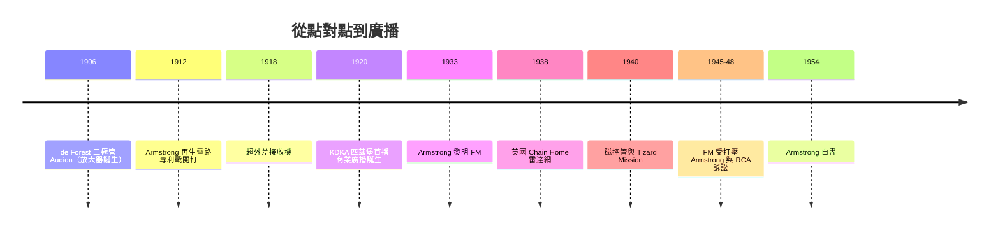

# 真空管、調製與雷達：廣播帝國

## de Forest 與「柵極」：放大器的誕生

Lee de Forest（1873–1961）是通訊史上最難蓋棺定論的人物。他出身南方牧師家庭，耶魯博士（論文是關於電波的反射），一生專利數百件、公司倒閉十餘家、捲入詐欺官司（1913 年因推銷無線電股票被控詐欺，後獲判無罪卻留下污名），同行則送他一個刻薄的綽號：「電波之父、電話之母、騙子之祖父」。

但 1906 年，他做成了一件真正的革命。Hertz 與 Marconi 時代的金屬屑檢波器又慢又鈍；Fleming 在 1904 年為馬可尼公司發明了二極真空管（整流用）。de Forest 在二極管裡塞進一片柵狀金屬網，成了三極管（Audion）：從陰極飛向陽極的電子流，被柵極上微小的電壓變化所「節制」——柵極電壓的微小波動，會在陽極上重現為被放大的電流波動。**放大器**就此誕生：微弱信號不僅能被偵測，還能被增強、再生、振盪。沒有三極管，就沒有長途電話中繼器（1915 年跨大陸電話用的正是改良的 Audion）、沒有廣播、沒有雷達——雖然 de Forest 本人對自己發明的原理始終一知半解。

## Armstrong：天才與悲劇

如果說 de Forest 是糊裡糊塗的發明家，Edwin Armstrong（1890–1954）就是天賦與執拗的化身。這位哥倫比亞大學學生在求學時期就發明**再生電路**（regenerative circuit，1912）：把放大後的信號回饋到輸入端，增益成倍提升，還能當振盪器產生連續波。這項發明引爆了通訊史上最慘烈的專利戰——de Forest 主張回饋概念源自他的一項專利，官司纏訟十四年、打到最高法院（de Forest 兩度敗訴後竟在第三審勝訴），Armstrong 最終被迫讓出再生電路的專利權，從此與司法結下心結。一戰期間他為美軍研發出**超外差接收機**（superheterodyne, 1918）——至今仍是所有收音機的基礎架構；1920 年代為 RCA 研發全向選擇性電路。

1933 年，Armstrong 完成他最大的賭注：**調頻**（FM）。他發現把載波頻率隨音頻變化（而非幅度）、並犧牲寬頻帶，可以徹底甩掉靜電雜訊——「用頻寬換品質」，這正是日後 Shannon 資訊論中的頻寬交換原理。但 AM 時代的既得利益者不歡迎 FM：RCA 的 Sarnoff 一度歡迎後翻臉，AT&T 拒絕提供 FM 廣播網的網路租用，FCC 更在 1941 年把 FM 的頻段整體搬移、又在 1945 年砍掉其功率優勢，Armstrong 的五十座 FM 電台資產幾乎歸零。1948 年，他對 RCA 與 NBC 提起侵權訴訟，訴訟拖了六年，律師費榨乾了他的財產與健康。1954 年 1 月 31 日，Armstrong 在紐約的自宅十三樓跳樓自盡，留給妻子的一紙遺書寫著：「願上帝保佑你，並替我向 RCA 索還他們欠我的。」他的遺孀接手訴訟並最終勝訴。

## 1920：KDKA 與「一對多」的意外

廣播的誕生純屬意外。1916 年，西屋電氣工程師 Frank Conrad 在自家的車庫裡用業餘電台播唱片，鄰居用接收機聽得不亦樂乎，百貨公司甚至登報賣接收機。1920 年 11 月 2 日，西屋在匹茲堡正式開設商業電台 **KDKA**，播出總統大選（Harding 對 Cox）的開票結果——史上第一次商業廣播。點對點的電報／電話商業帝國（Western Union、AT&T、Marconi 公司），誰也沒料到「一對多的廣播」會成為更大的產業：五年內美國有六百座電台、數百萬台收音機，廣告贊助（1922 年 WEAF 的第一支商業廣告）與全國廣播網（1926 年 NBC、1927 年 CBS）迅速成形。人類史上第一次，一個聲音可以同時進入千萬個客廳——政治、廣告、通俗文化從此改寫。

## 雷達與二戰：磁控管改變空戰

廣播只是真空管革命的一半；另一半在軍事。1935 年起，英國在齊伯林危機的陰影下秘密建造**本土鏈**（Chain Home）雷達網，1938 年投入運作：一排沿英格蘭東南海岸的高塔發射短波，偵測納粹轟炸機群——1940 年不列顛空戰中，雷達讓皇家空軍的戰鬥機不必在空中巡航待命，得以精準攔截，成為取勝的隱形功臣。

真正的躍進發生在伯明罕大學：1940 年 2 月，物理學家 John Randall 與 Harry Boot 製成**諧振腔磁控管**（cavity magnetron），把微波（約 10 cm 波長）功率提高了千倍——雷達終於小到能裝進戰鬥機、炸彈瞄準器與潛望鏡。當時英國資源見底，遂有史上最慷慨的技術輸出：1940 年 9 月的 **Tizard Mission**，英國把磁控管樣品與雷達機密裝進一個黑盒子送抵美國。美國科學家形容其價值「抵得上整支艦隊」。MIT 因此成立輻射實驗室（Rad Lab），Raytheon 等公司量產磁控管，微波雷達成為盟軍空海戰的標配。

戰後，這套技術回流民用：微波中繼通訊塔鏈橫貫大陸，承載長途電話與早期電視節目；微波爐的磁控管出自雷達工程師 Percy Spencer 的意外發現；戰時培育的電子工程人才與量產體系，直接餵養了戰後的電視與電晶體革命。

## 頻譜：公共資源的政治經濟學

無線電帶來一個有線時代不存在的問題：**頻譜是有限的**。1920 年代美國電台互撞干擾、秩序大亂，1934 年《通訊法》催生聯邦通訊委員會（FCC），統一管理有線與無線電信，並確立了「頻譜是公共資源、政府分配、附帶公共義務」的原則。國際層面，1865 年成立的國際電報聯盟（ITU）在 1932 年併入無線電組織、更名國際電信聯盟，協調跨國頻率與軌道——今天衛星與 5G 的頻率仍在這套機制下分配。

「頻譜歸誰所有」從此成為通訊的分配與治理問題：是政府發照（美式拍賣）、還是國家壟斷（歐陸式）、還是共產黨國家的全面管制（蘇聯模式把廣播變成宣傳機器）？技術問題就這樣變成了政治經濟學。真空管時代落幕時，留給世界的是兩份遺產：一套把聲音與影像送進千萬家庭的廣播帝國，以及一個至今未解的問題——誰有權決定什麼被廣播。
