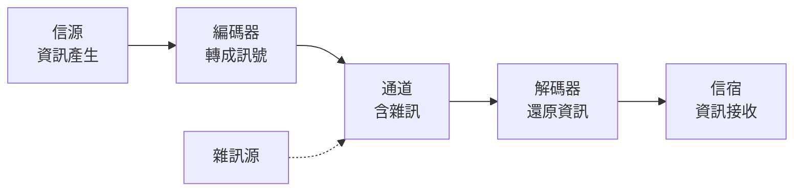

# 蕭農：位元與熵的資訊論

一九一六年，Claude Shannon（克勞德·夏農）出生於密西根州小鎮 Gaylord。父親是法官，母親是中學校長，祖父是個愛發明的農機技師。少年夏農自己裝收音機、用鐵絲網搭電報線跟朋友通話，還靠送電報賺零用錢。一九三六年他進入 MIT 當研究助理，在工程學院著名的「微分分析機」——一部巨大的機電類比計算機——底下接線。這部機器的開關、繼電器與邏輯電路，成為他第一個靈感的來源。

## 史上最重要的碩士論文

一九三七年，二十一歲的夏農寫下碩士論文《繼電器與開關電路的符號分析》。他的洞察看似簡單卻石破天驚：十九世紀英國數學家 George Boole 發明的邏輯代數（真與假、AND 與 OR），恰好可以一一對應到電路的「通」與「斷」。任何邏輯命題都能化為開關網路，任何開關網路也能化為邏輯命題。工程師從此不必靠直覺試湊設計電路，而可以用代數推導、化簡、驗證。

這篇論文把「邏輯」變成了可以製造的東西。十幾年後的數位電腦——從繼電器、真空管到電晶體——全部走在夏農這座橋上。後世稱它是「史上最重要的碩士論文」，並不誇張。

## 戰爭、密碼與圖靈的午餐

二戰爆發，夏農進入貝爾實驗室，為軍方從事火控系統與密碼學研究。他與羅斯福、邱吉爾之間那條橫越大西洋的加密電話線有直接關係。一九四三年，英國密碼學家 Alan Turing 訪問美國，兩人在貝爾實驗室食堂共進午餐。一個在破解德國 Enigma，一個在分析美國語音加密機，兩人卻因保密規定不能談各自的機密，於是聊起機器能不能思考。圖靈戰後寫下著名的「圖靈測試」論文，夏農則在心裡醞釀另一場革命。這頓午餐成為科學史傳奇：二十世紀兩位最懂「機器與資訊」的人，在戰時的餐桌旁互換了火花。

## 一九四八：資訊變成數學

戰後，夏農把多年思考寫成兩篇論文，一九四八年發表於《貝爾系統技術期刊》，題目是《通訊的數學理論》。這一年被公認為資訊論的誕生年。

夏農做了一件前無古人的事：他完全不理會訊號是電話、電報還是電視，把一切通訊系統抽象成同一個模型——

在這個模型裡，「資訊」第一次有了精確的度量。夏農問：一個信源發出的訊息，最少需要多少位元才能無損地表示？答案由信源的機率結構決定。如果擲一枚公正銅板，結果是正面或反面各占一半，你需要一個位元來表達這份「不確定」。但如果銅板兩面都是正面，你什麼都不用傳——結果早已註定，沒有任何不確定性。夏農把這個「不確定性的量」稱為熵：

$$H = -\sum_i p_i \log_2 p_i$$

熵越大，信源越難預測，每一個符號攜帶的資訊越多。度量單位就是夏農與同事 John Tukey 商量後命名的 **bit**（binary digit，二進位數字）。今日全世界——硬碟、頻寬、基因序列、加密金鑰——都用這個單位計價，而它的出生證明就是一九四八年那兩篇論文。

更耐人尋味的是，這條公式與熱力學的熵（Boltzmann 的 $S = -k\sum p \ln p$）形式幾乎相同。物理學家後來明白這不是巧合：資訊與秩序、資訊與能量之間有深刻的物理關聯。資訊論於是溢出工程學，滲入物理、生物、語言學與經濟學。

## 一個哲學上的大膽切割

夏農的理論有個驚人的「缺陷」：它完全不管意義。一句無聊的寒暄和一句改變世界的宣言，如果符號機率結構相同，資訊量就相同。夏農刻意把「語義」切掉，只處理符號的傳輸與還原。這一刀看似粗暴，卻正是理論能成為普適數學的原因——不管你傳的是中文、DNA 還是星際訊號，數學一律有效。批評者後來說資訊論「名不副實」，但歷史證明：先有可靠的管道，意義才能在其上流動。網際網路正是這個哲學決斷的巨大果實。

## 玩具王國裡的數學家

在貝爾實驗室，夏農是出了名的怪人。他會騎獨輪車穿過走廊，還能一邊騎一邊拋接三顆球；他做過會自動還原魔術方塊的機器、雜耍機器人，以及最著名的 **Theseus**——一隻用繼電器構成的機械迷宮老鼠，能自己學會走迷宮，是機器學習最早的實體示範。同事回憶，夏農的辦公室堆滿玩具，但他午後隨手在黑板上寫下的東西，常常就是別人做十年的題目。

他不是不務正業，而是把「玩」當成認識世界的方法。夏農曾說，科學家的美德之一是「對某個問題保持近乎孩子氣的入迷」。從開關到位元，他一生只做一件事：把看起來紛亂的世界，化約成乾淨的數學。

在《通訊技術的故事》的主角群中——莫爾斯、貝爾、馬可尼、費森登都還是發明家與工程師——夏農是第一個「最像純數學家的工程師」。他沒有發明電話，沒有架設天線，卻為一切通訊裝置寫下了它們共同的法律。下一章我們會看到：他甚至預言了「零錯誤傳輸」這個看似不可能的奇蹟。
