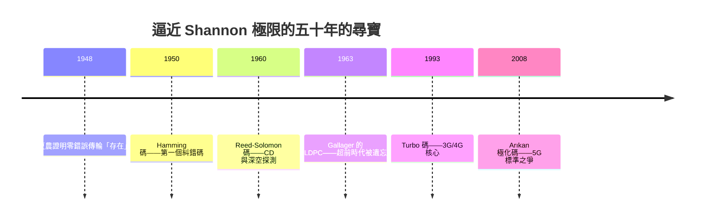

# 雜訊通道編碼定理：零錯誤傳輸

一九四八年，夏農在《通訊的數學理論》裡投下了第二顆炸彈。當時所有工程師的常識是：通道越吵，錯誤越多；想把錯誤率壓低，只能加大功率、放慢速度，或者不斷重傳。錯誤率與速度是一對無法兩全的敵人。夏農卻用數學證明了一個反直覺的結論：**只要傳輸率低於某個臨界值，就存在編碼方式，讓錯誤率任意接近零。**

## 通道容量：通訊的極速上限

這個臨界值就是通道容量。對頻寬 $B$、訊號功率 $S$、雜訊功率 $N$ 的通道，夏農與早年的 Hartley 給出今日稱為 Shannon-Hartley 定理的公式：

$$C = B \log_2 \left( 1 + \frac{S}{N} \right)$$

這條公式是整個資訊時代的憲法。頻寬加倍，容量加倍；但功率加倍，容量只增加不到一倍——因為它是對數。這解釋了為什麼電信產業拚命搶頻譜、為什麼手機基地台要蓋得密，也解釋了 Wi-Fi 與 5G 每一代升級的第一槓桿永遠是更寬的頻段。

更震撼的是定理的「存在性」部分：只要傳輸率 $R < C$，數學上就存在一組編碼，使錯誤率隨碼長增加而趨近於零。在一個被雜訊詛咒的世界裡，零錯誤傳輸不僅可能，而且是系統性的可能。這不是工程奇蹟，是數學定理。貝爾實驗室內外最初的反應是不敢相信——這等於告訴水手：暴風雨中存在一條永不出錯的航線。

## 只證存在，不給地圖

夏農的證明是典型的機率式存在證明：他算出「隨機挑一個夠長的碼，平均而言錯誤率會很低」，卻沒有告訴任何人這個碼長什麼樣、怎麼編、怎麼解。於是「尋找接近 Shannon 極限的碼」成了橫跨五十年的尋寶遊戲，幾代工程師與數學家在這條路上留下了一座座里程碑。

## 尋寶的里程碑

**Hamming 碼（1950）**。貝爾實驗室的數學家 Richard Hamming 用公司電腦做計算，週末不在，機器偵錯到錯誤就自動停機重啟，他星期一回來只找到報錯訊息，心血白費。他憤而思考：能不能讓機器自己把錯修好？他造出第一個能自動糾正單位元錯誤的線性區塊碼，開啟了整門「糾錯碼」學問。Hamming 後來的著名演講《You and Your Research》也成為科學界經典——那個憤怒的週末，改寫了電腦的可靠性。

**Reed-Solomon 碼（1960）**。MIT 的 Irving Reed 與 Gustave Solomon 用抽象代數（伽羅瓦體）造出的碼，能對抗連續區段的「突發錯誤」——劃痕、干擾、深空衰減。它守護了 CD 與 DVD 的音畫、Voyager 探測船從太陽系邊緣傳回的照片，以及今日每張 QR code。一門純數學，就這樣成為星際通訊的救生索。

**LDPC 碼（1963）**。夏農的同事 Robert Gallager 在 MIT 的博士論文提出低密度奇偶檢查碼，性能驚人地接近極限——但以當年的電腦算力根本解不動，論文被埋沒三十年。一九九〇年代電晶體夠快了，MacKay 與 Neal 等人重新挖掘，LDPC 立刻成為 Wi-Fi（802.11）、5G 資料通道與衛星通訊的主流碼。一項超前時代三十年的發明，說明了「理論先於實作」在通訊史上的常態。

**Turbo 碼（1993）**。法國工程師 Claude Berrou 等人用兩個簡單的迴旋碼交疊、迭代解碼，意外逼近 Shannon 極限，震驚學界——因為它的做法「不像正規數學家會想的」。Turbo 碼立刻成為 3G 與 4G 的核心。**極化碼（Polar code）** 則由土耳其教授 Erdal Arıkan 在二〇〇八年提出，是第一個被嚴格證明可達極限的構造性碼；二〇一六年 3GPP 制定 5G 標準時，華為力推極化碼作為控制通道編碼，與主推 LDPC 的陣營展開激烈角力——一場純數學問題演變成產業與地緣政治的戰場。

## 極限上的現代通訊

今日的 Wi-Fi、5G 與 NASA 深空網路，其編碼性能距離 Shannon 極限已不到零點幾 dB。半個世紀的尋寶，幾乎抵達了數學允許的終點。工程師們開玩笑說：香農把地圖畫好了，我們只是走完了它。

回頭看，這場遊戲的起點是兩個深刻的思想。其一是夏農的洞見：**冗餘是對抗雜訊的武器**——多餘的位元不是浪費，而是讓接收端能「投票還原真相」的保險。其二是他的作風：先以數學證明世界允許什麼，再讓工程師用幾十年把可能性變成商品。從 Hamming 的那個憤怒週末，到華為與西方在標準會議上的角力，糾錯碼的歷史告訴我們：最抽象的數學定理，最終會變成最巨大產業的基礎設施——而這正是《通訊技術的故事》一貫的主旋律。
