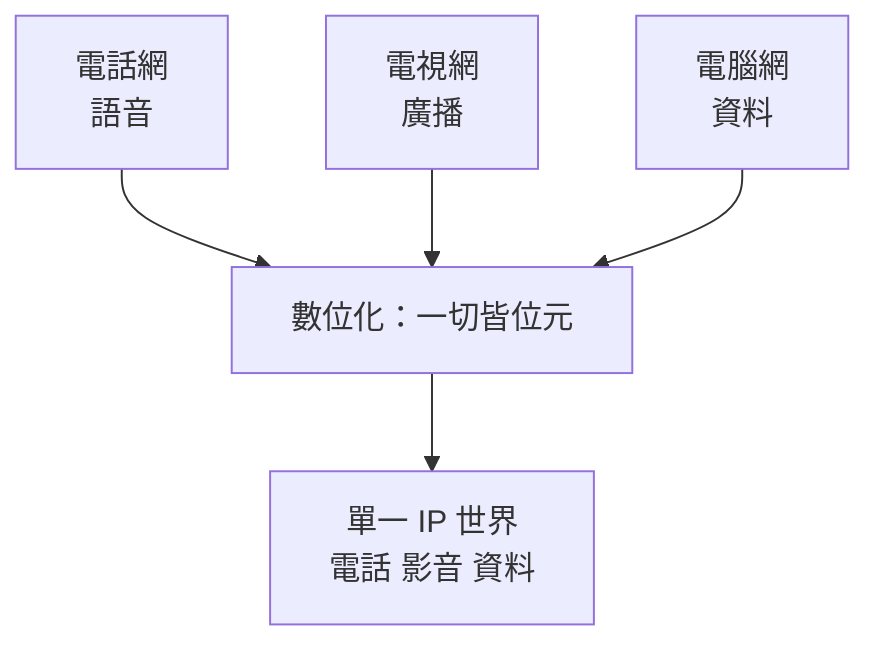

# 從類比到數位：萬物化為 0 與 1

夏農給了資訊數學的重量，但二十世紀中葉的通訊網路仍是類比的世界：語音是麥克風裡連續起伏的電壓，音樂是唱片溝槽裡的物理刻痕。類比訊號最大的宿命是**每複製一次就劣化一次**——抄錄的磁帶會多一分嘶聲，轉接一次的電話會少一分清晰。把它們全部變成 0 與 1，是通訊史上影響最深遠的一場轉譯。

## PCM：類比聲音的數位重生

早在一九三八年，英國工程師 Alec Reeves 在法國申請了脈衝編碼調變（PCM）專利：每隔一小段時間對聲音「取樣」一次，把每個取樣點的高度四捨五入成最接近的整數層級，再編成一串脈衝。聲音從此變成數字。戰爭中 PCM 被用於軍用加密通訊——數位訊號可以加擾，類比訊號的雜訊則無所遁形。戰後貝爾實驗室接手發展，PCM 從軍事機密走向電信基礎建設。

PCM 可行的理論基礎是**取樣定理**：一九二八年 Harry Nyquist 在貝爾實驗室指出，一九四九年夏農將其完備化——若訊號最高頻率為 $f_{max}$，只要取樣頻率 $f_s > 2 f_{max}$，就能完全重建原訊號，一絲不損。語音最高約 4 kHz，因此電話取樣 8,000 次每秒即可。這條定理是整個數位世界的地基：它保證了「離散的數字」足以承載「連續的物理世界」。

## T1 載波：數位骨幹的誕生

一九六二年，貝爾系統啟用 T1 載波：一條線路上把 24 路語音各自取樣編碼，以「時分多工」交錯傳送，達到每秒 154 萬位元。這是電話網數位化的起點——幹線先數位化，機房交換設備隨後跟進。工程師很快發現數位的巨大好處：**再生**。類比訊號放大時連雜訊一起放大，數位訊號卻能在每個中繼站把波形「修成正規的 0 與 1」，傳再遠也不劣化。跨洲電話從此乾淨如本地通話。

## 壓縮革命與盜版的地震

數位化也帶來新課題：位元很貴，於是「壓縮」成為顯學。夏農的熵告訴工程師壓縮的理論下限，此後的 JPEG（1992）壓縮影像、MP3 壓縮音樂——德國 Fraunhofer 研究所在一九九〇年代利用人耳聽不見的頻段可以捨棄的心理聲學原理，把 CD 音質壓成十分之一大小。

MP3 的後果遠超技術範疇：一首歌從幾十 MB 變成幾 MB，恰好小到能在撥接網路上傳播。Napster、P2P 網路讓音樂複製的成本歸零，唱片產業的收入在十年內腰斬。這是「一切皆位元」的第一堂社會課：**當複製零成本，智慧財產的舊契約就崩解**——數位版權管理（DRM）、加密與取締盜版的立法戰爭，從此成為二十一世紀政治的常設議題。

## 數據機：兩個世界的接線生

電腦一出生就是數位的，但它是透過類比電話網連上世界的。數據機（modem）把 0/1 調變成音調塞進電話線：從一九六〇年代的 300 bps，到撥接末代的 56K，工程師把夏農公式裡每一分可用容量都榨了出來。當電話網核心全面數位化、數據機退位給寬頻，電腦與通訊終於匯入同一個 0/1 的世界——這不再是兩個產業，而是一個產業。

## 匯流：三網歸一

電話網、電視網、電腦網原本是三套技術、三種法規、三個產業。數位化之後，它們傳遞的都是位元，於是必然匯流：電信公司賣電視、有線系統賣電話、電腦網路吃掉一切。管制機關被迫重劃監管疆界，「網路中立」之類的新政治議題於焉誕生。歷史的韻腳在此清晰可聞——正如查佩的光學網被電報取代、電報被電話與無線電邊緣化，每一次載體躍遷，都伴隨舊產業的衰落與新產業的無中生有。

數位化對社會的重塑遠不止於娛樂：當文字、聲音、影像、金錢、乃至基因序列全部化為位元，複製、傳輸與運算的邊際成本趨近於零，經濟學的稀缺假設被動搖，國家的資訊管制面臨加密技術的對抗。一場始於夏農的數學、落實於 PCM 的工程轉譯，最終把物理世界整個搬進了 0 與 1 的宇宙——行動通訊與網際網路，正是踩著這塊基石登場的。
