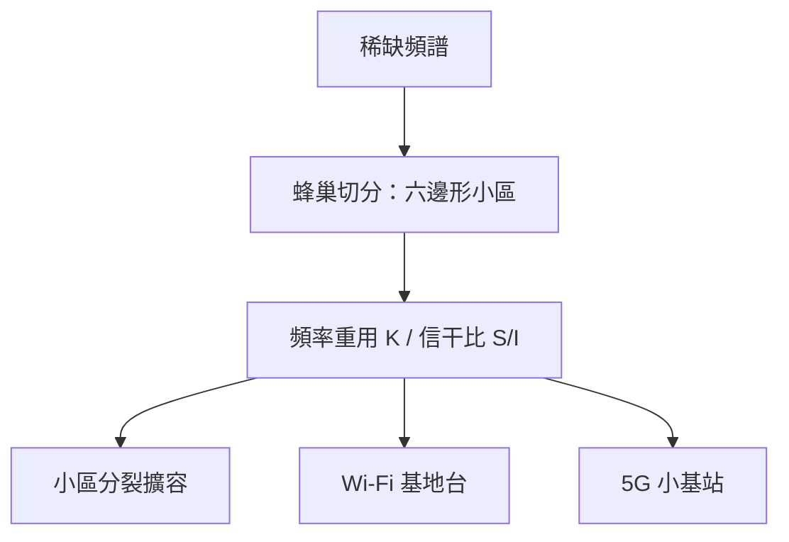

# 蜂巢式網路與頻率重用

一九四七年 Ring 與 Young 的備忘錄、一九七〇年代 Amos Joel 的切換專利，把行動通訊的藍圖畫好了；但讓它落地成為產業的，是一場跨越十年、貫穿技術與政治的角力——而點燃引信的，是一個不願再等待的摩托羅拉工程師。

## 蜂巢的數學之美

蜂巢式網路的核心是「資源切分」的幾何學。把服務區切成一格格**正六邊形**小區（cell）——六邊形是能無縫鋪滿平面、且邊界最接近圓形的多邊形，浪費最少。每格中央一座低功率基地台，只覆蓋幾公里。關鍵在於：相隔夠遠的格子可以**重用同一組頻率**，因為距離與低功率讓同頻干擾衰減到可容忍。

工程師用重用因子 $K$ 描述這個幾何設計：每 $K$ 個小區構成一個「重用叢集」，頻譜在叢集內各用一次、叢集間重複。同頻小區之間的信號與干擾之比（信干比 $S/I$）由小區半徑與重用距離的幾何關係決定：

$$\frac{S}{I} \approx \frac{1}{\text{干擾小區數}}\left(\frac{D}{R}\right)^{\gamma}$$

其中 $D$ 是同頻小區間距、$R$ 是小區半徑、$\gamma$ 是路徑衰減指數（市區約 3–4）。$K$ 越小，頻譜用得越省、容量越大，但 $S/I$ 越差——這是容量與品質之間可以精確計算的取捨。想再擴容？把格子切小（cell splitting），容量再翻倍。**頻譜容量從此隨城市大小線性甚至可調地擴展**，MTS 時代「一城一頻率」的死牢籠被徹底砸開。

## 1973.4.3：一通挑釁的電話

一九七三年四月三日，紐約曼哈頓。摩托羅拉的系統工程主管 Martin Cooper 站在第六大道上，從口袋裡掏出一台磚頭大小的原型機，撥出一通電話。受話方是貝爾實驗室的 Joel Engel——AT&T 陣營裡負責行動電話專案的對手。

「喬爾，我是馬丁·庫柏，我正在用一台真正的手持行動電話跟你講話。」這通電話的挑釁意味毫不掩飾。AT&T 發明瞭蜂巢概念，卻著眼於車載電話；摩托羅拉決心證明「電話應該屬於口袋，不是車庫」。Cooper 事後說，那是工程文化的勝利宣言：摩托羅拉以無線電起家，相信行動的自由；AT&T 則難以擺脫有線帝國的思維。第一通手持電話打給競爭對手，這個選擇本身就是二十世紀產業競爭史的註腳。

## DynaTAC：三千九百美元的磚頭

從原型到商品又走了十年。一九七〇年代末，AT&T 與摩托羅拉在芝加哥進行了大規模的蜂巢試驗網：貝爾實驗室的工程師架起數十座小功率基地台，驗證頻率重用與切換在真實城市電波環境中的可行性——高樓反射、陰影衰落、同頻干擾，每一項都逼著設計者修改參數。這些試驗證明了理論藍圖經得起實戰，也讓規制機關終於有信心核發商用執照。值得玩味的是，這場試驗的頭號推手之一正是 Bell Labs，但收割行動市場果實的卻是牆外的競爭者。

一九八三年，摩托羅拉 DynaTAC 8000X 獲准商用：近 800 克、長逾 25 公分的「磚頭」，充電 10 小時只能通話 30 分鐘，售價 3,995 美元——約當今日上萬美元。它不實用，卻是身分的圖騰：華爾街的雅皮士排隊搶購，因為「隨時找得到我」本身就是稀缺資源。

## AMPS：第一個商用蜂巢網路

同年，Ameritech 在芝加哥開通第一個商用蜂巢網路，採用貝爾系統設計的 AMPS（Advanced Mobile Phone System）制式：類比調頻（FM）、以頻分多址（FDMA）把頻段切成一格格 30 kHz 的語音頻道，配合蜂巢重用。FCC 的 Band A/B 雙執照制在此發揮制度效力——每個城市兩家網路競相鋪設，行動電話從實驗品變成競爭性產業。

## 1G 的榮光與裂縫

1G 時代的體驗是革命與缺陷並存。通話能移動了，但**漫遊不互通**：芝加哥的用戶到了紐約未必能上網，各家系統、各國制式各行其是。**加密形同虛設**：類比 FM 訊號用一台掃描器就能竊聽，名人通話外洩成為八卦小報的固定專欄。**容量再受限**：類比語音一頻道一通話，用戶暴增的都會區又開始重演排隊與斷線。

蜂巢思想的深遠之處，在於它是一種可遷移的資源典範：Wi-Fi 的基地台、5G 的密集小基站、乃至無人機通訊與衛星星鏈的區域覆蓋，全是「切格、低功率、重用頻率」這個幾何直覺的後裔。而 1G 的裂縫——不互通、易竊聽、容量窮盡——正好指向下一步的答案：數位化，以及一次前所未見的跨國標準合作。
