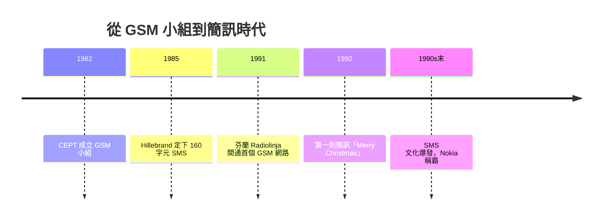

# 1G 到 2G：GSM 與簡訊革命

一九八〇年代初，歐洲的行動電話是一片巴別塔：北歐有北歐制式，英國有 TACS，西德有 C-Netz，互不相通——德國人開車過境法國，車載電話立刻變成廢鐵。各國類比系統規模太小、設備不通用、市場被切碎。解藥只有一種：**一個歐洲，一個數位標準**。

## 制度創新：GSM 小組的誕生

一九八二年，歐洲郵電主管會議（CEPT）成立了一個跨國工作小組，全名 Groupe Spécial Mobile——縮寫 GSM。這個小組的成員來自各國郵電當局，他們要做的不是設計某國的系統，而是協調十幾個主權國家接受同一套規範。後來 GSM 被重新詮釋為 Global System for Mobile Communications，恰好見證了它從歐洲計畫變成世界標準的命運。

這是歐共體政治的直接產物：單一市場需要跨國電信，跨國電信需要統一標準，統一標準需要制度化的協商。歐洲用「先立規則再建系統」的方式，做了美國從未做的事——美國的 AMPS 是事實標準，GSM 則是協商出來的法理標準。此後三十年，這兩種標準化哲學在全球電信政治中反覆對撞。

GSM 的技術決斷同樣關鍵：放棄類比，直接採用**數位**制式——以 TDMA（時分多址）把每個頻道切成八個時槽，八個用戶輪流共享；語音經數位編碼壓縮，更省頻譜也更難竊聽（GSM 內建加密）。兩項制度性發明更是影響深遠：**SIM 卡**把用戶身分從話機裡抽出來——換機不換號，用戶第一次擁有了可攜的電信身分；**國際漫遊**讓 SIM 卡在歐洲各國網路間暢行無阻。

一九九一年，芬蘭的 Radiolinja——一家打破國營電信壟斷、拿到二次執照的新進業者——開通了世界上第一個 GSM 網路。這個細節意味深長：GSM 的首航不在老牌郵電巨頭手裡，而在規制改革創造出的新競爭者手裡。歐洲的標準化與自由化雙輪並進，缺一不可。

## SMS：規範夾縫裡的意外革命

簡訊（SMS）從來不是 GSM 的主產品。一九八五年，德國工程師 Friedhelm Hillebrand 與同事在規劃 GSM 規範時，注意到系統的信令通道裡有一小塊閒置的邊角資源，可以順便塞進短短的文字訊息。訊息能多長？Hillebrand 在打字機上敲了些典型的句子，數一數：一百六十個字元足夠表達大意，而且 160 字元恰好能塞進現有信令封包的空間。SMS 於是以「160 字元、借道信令通道」的姿態誕生——一個幾乎無人看好的附屬功能。

一九九二年十二月三日，英國工程師 Neil Papworth 用電腦透過沃達豐的網路發出第一則 SMS：「Merry Christmas」。收訊的是一部重得像磚的手機。此後數年 SMS 仍乏人問津——按鍵輸入吃力、資費不清、行銷缺席。

然後，青年發現了它。便宜的簡訊成為歐亞青少年社交的命脈，用戶自創了省字縮寫的文化——「cu l8r」「88」、注音文與火星文——語言學家驚呼文字正在突變，電信公司則驚喜地發現這條信令通道的附屬品帶來了驚人的純利。SMS 證明了一條通訊史的鐵律：**最重大的應用往往誕生於規範的邊角，而非策略藍圖的正中央**。

## 芬蘭奇蹟與摩托羅拉的失誤

2G 的最大贏家是 Nokia。這家芬蘭公司從造紙與橡膠起家、一九六〇年代才轉入電信，卻押注 GSM 數位化與消費者品味——把手機從工程器材做成時尚消費品，機殼可換、操作簡單、待機驚人。芬蘭這個五百萬人的小國，因為押中標準與設計，誕生了歐洲市值最高的公司；Nokia 與 Radiolinja 一同構成「芬蘭奇蹟」，成為小國在全球化電信產業中彎道超車的教科書案例。

而 1G 的霸主 Motorola 則錯失了轉折。它把賭注押在自家類比制式與衛星計畫（銥計畫 Iridium）上，低估了數位 GSM 與消費市場的速度；等它回頭，歐洲標準已席捲全球，Nokia 的直板機占領了大眾口袋。DynaTAC 的發明者，親手把自己發明的產業讓了出去。

1G 到 2G 的十年，範式清晰得近乎工整：**類比到數位、語音到文字、標準分裂到統一**。數位化（05 章的伏線）在行動領域結出了第一顆果實，而文字簡訊預告了下一步——當手機不只是電話，它終將連上那個名叫網際網路的世界。
