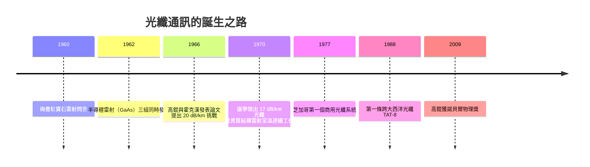

# 高錕的光纖遠見：1dB/km

1960 年 5 月，加州馬里布的休斯實驗室裡，西奧多・梅曼（Theodore Maiman）把一枚指甲大小的合成紅寶石柱裹在螺旋狀的閃光燈中，注入能量。那道深紅色的相干光束閃現的瞬間，人類第一次握住了一種前所未有純淨的光——波長一致、相位一致、方向一致。通訊工程師們立刻意識到：這正是載波的理想極限。無線電用了六十年，從長波、短波一路爬升到微波，頻率越高、頻寬越大；而光的頻率比微波高了四個數量級，理論上一束光就能承載全人類同時通話。

兩年之後的 1962 年，載體的另一半也到位了。奇異（GE）、IBM 與 MIT 林肯實驗室的三組人馬，在幾個月內先後示範了砷化鎵半導體雷射——接上電流就能發光的微小晶片。用光通訊所需的「發射機」似乎唾手可得。全世界都熱血沸騰，可熱情很快被澆了一盆冷水：光要從甲地送到乙地，總得有條路。空氣會被雨、霧、雪攪亂；實驗室裡人們嘗試用玻璃傳光，但當時最好的光學玻璃，損耗率約為每公里一千分貝（1000 dB/km）——這個數字意味著，光走幾米就衰減殆盡，連一個房間都跨不出去，更別提橫跨城市與海洋。紅寶石與雷射二極體已經點燃了火把，可是道路在哪裡？

## 東方來的年輕工程師

就在多數人認定「玻璃天生不行」而轉向空氣傳光、空心波導等歧路時，一位三十三歲的年輕工程師在英格蘭的郊區實驗室裡，選擇了最不合時宜的一條路。

高錕，1933 年生於上海金山一個書香之家，童年住的法租界宅邸裡，小男孩曾用泥巴自製氯酸鉀火藥、用廢燈泡做實驗，父親是律師，家中卻瀰漫著動手做的氣息。1949 年舉家南遷香港，先後就讀聖若瑟書院；後赴英國，一邊在標準電話電纜公司（STC）工作，一邊以在職身分攻讀倫敦大學附屬的伍爾维奇理工學院（Woolwich Polytechnic）學位。這種「白天做工程、晚上做學問」的養成路徑，塑造了他務實而徹底的風格：不迷信權威，只相信測量。

1960 年代，STC 的研究部門——位於哈洛（Harlow）的標準電信實驗室（STL）——正面對一個尴尬的處境：母公司靠電纜吃飯，微波與衛星卻來勢洶洶，通訊的未來究竟在哪裡？高錕被指派研究光通訊的可行性。1964 年前後，他走遍各大公司與學府，考察空氣光傳輸的方案，結論是悲觀的：大氣中光通訊會被天候摧毀，無法成為可靠的電信系統。那麼，只剩玻璃。

當時的物理常識是殘酷的：玻璃對光天生的不透明，這是材料「本徵」的損失，一千年來玻璃就是半透明的象徵。許多頂尖物理學家斷言，就算做得再純，玻璃也終究吸光，光通訊不過是浪漫幻想。高錕的過人之處，在於他拒絕接受這個未經檢驗的常識。他與同樣年輕的澳洲裔同事霍克漢（George Hockham）——一位專精波導理論與天線的工程師——展開了系統性的拆解：霍克漢負責計算光纖的傳輸模式與彎曲損耗，確認若介質夠純，光可以束縛在極細的玻璃絲中長距離傳播；高錕則遍查文獻、走訪玻璃製造商，逐一分析玻璃吸光的每一個機制。

他們得到的結論，後來被證明是二十世紀通訊史上最重要的一次「想清楚了」：玻璃的 1000 dB/km 損耗，根本不是玻璃的本性，而是雜質的罪——鐵、銅等過渡金屬離子，含量只需百萬分之一，就足以吞噬光；氫氧根（水分子殘留）則在特定波長上瘋狂吸收。這些是製造問題，不是物理定律。只要純度做到每公里 20 dB 以下，光纖就能實用化通訊；理論極限甚至可以低於 1 dB/km——比當時的銅軸電纜還乾淨一百倍。這不是修正，這是把一門「不可能」的學問，翻案成「工程難題」。

## 一篇論文，一個時代的挑戰書

1966 年 11 月（發行於 1966 年 7 月號的 IEE Proceedings），高錕與霍克漢發表了那篇注定載入史冊的論文：〈光學頻率的介電纖維表面波導〉（*Dielectric-fibre surface waveguides for optical frequencies*）。論文的敘事結構本身就是宣言：前半部證明光纖在理論上可以承載電信級的頻寬，後半部直指問題核心——障礙不在波導理論，而在玻璃純度——並向全世界發出挑戰：請玻璃業界製造出損耗 20 dB/km 以下的玻璃。

這份挑戰書起初得到的多是冷眼。物理學界的主流認為玻璃天生不純、高錕算錯了什麼；電信業者則認為就算做得出來，把一比頭髮還細的玻璃絲接起來鋪設幾千公里，接續損耗就是無解的噩夢。在多場國際會議上，高錕被迫一遍又一遍地為自己的計算辯護。他不是辯才無礙的演說家，而是以工程師的方式回應：給出測量、給出機制、給出可以驗證的預言。他甚至親自走訪世界各地的玻璃工廠，說服材料工程師動手一試——一位電信工程師，向整個材料工業發出訂單式的挑戰。

回應在 1970 年夏天到來。美國康寧玻璃公司（Corning）的毛瑞爾（Robert Maurer）、凱克（Donald Keck）與舒爾茨（Frank Schultz）採用化學氣相沉積（CVD）方法，用超高純度的原料沉積出石英玻璃纖芯，做出了損耗 17 dB/km 的光纖——第一次跨過高錕設下的 20 dB 門檻。凱克在實驗記錄本上寫下興奮的字跡，今天那份筆記本已成為科技史的聖物。次年，康寧把數字推進到 4 dB/km；1970 年代末，最佳光纖損耗降至 0.2 dB/km，逼近理論極限。高錕的預言，一字一句兌現。

後續的配套也一一到齊：同樣在 1970 年，貝爾實驗室與蘇聯團隊各自實現了能在室溫連續工作的雷射二極體（雙異質結構），光纖的 0.85 微米低損耗窗口恰好被半導體雷射填上。介質、光源、探測器，三大支柱在同一年代合攏。1977 年，AT&T 在芝加哥鋪設了第一個商用光纖電話系統；1988 年，第一條跨大西洋光纖 TAT-8 啟用。從哈洛實驗室的計算紙到海底的纜線，前後不過二十二年。

## 校長、諾獎與謙遜的背影

高錕沒有靠光纖專利致富——STL 當年申請的專利範圍有限，真正的財富流向了康寧與電信巨頭。但他並不在意。1987 年，他出任香港中文大學校長，任內推動學術自由與擴張，包括迎接九七前夕的移民潮與人才流動。有趣的是，這位「光纖之父」任內推動的校園光纖網路，正是他自己發明的技術；他晚年卻笑說自己「落後了」，跟不上網路時代的細節。

2009 年，瑞典皇家學院把諾貝爾物理獎頒給高錕，表揚「光在光纖中傳輸的開創性成就」。此時的高錕已罹患阿茲海默症多年，記憶如潮水般退去，甚至不太記得光纖與自己的關聯。領獎時，諾獎委員會特別免除他發表演說；他平靜地站在台上，由妻子黃美芸在旁扶持。典禮過後有記者問他感想，他淡淡地說：「我很高興。」那張略顯茫然卻安詳的面孔，與四十年前在會議場上被圍攻仍堅持數據的年輕工程師重疊在一起——歷史有時殘酷，但也有它溫柔的還債方式。

高錕將部分獎金捐出，與夫人在香港創立「高錕慈善基金」，服務認知障礙症患者。他把榮耀變成他者的光。2018 年他辭世，香港人以「一個人的遠見，照亮了整個世界」送別這位離開上海、途經香港與英國、最後讓全球資訊得以在玻璃中奔流的工程師。

回頭看，高錕那篇論文最動人的地方，不是它的數學，而是它的姿態：一個年輕工程師，憑著徹底的測量與推理，敢於對整個物理學界的「常識」說——你們量得不夠乾淨。玻璃沒有錯，錯的是我們沒有把它做純。這種「先問事實、再問權威」的工程理性，正是二十世紀通訊革命一再重現的火種。
