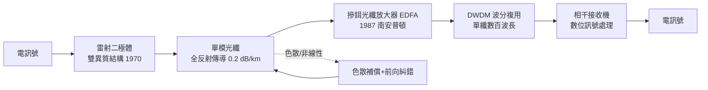

# 雷射二極體與全反射：光脈衝革命

高錕在 1966 年指出了道路——純玻璃可以把光送到千里之外。但一條通訊系統從來不是一根介質就能成事的。它需要三根支柱：把電訊號變成光脈衝的光源、把光束縛在細絲裡奔行的介質結構、以及在終點把光讀回電訊號的探測器。這三根支柱的合攏，花了整整十年，而每根支柱背後，都是一段物理洞察與工業競賽交織的故事。

## 全反射：一條十八世紀的物理定律

光纖的核心原理古老得驚人：全反射。當光從折射率高的介質射向折射率低的介質，入射角超過臨界角時，光會百分之百被彈回，一點也不漏。玻璃與空氣的邊界就能做到這件事。早在 1840 年代，瑞士工程師科拉東（Daniel Colladon）在日內瓦示範了「光的噴泉」——讓光沿著水流內部彎彎曲曲地前行；巴黎的工程師更用光沿細水柱傳光的把戲裝飾歌劇院。這原理在二十世紀被放進醫療內視鏡，把光送進人體。

要把這個把戲變成千公里的通訊幹道，結構上得解決兩件事。第一是「包層」：光不能靠玻璃與空氣的界面導引，因為表面沾污、水汽都會漏光；正確做法是製造「纖芯折射率略高於包層」的雙層玻璃，讓全反射發生在受保護的內部界面上。第二是「模態色散」：最粗淺的階梯折射率光纖（step-index）中，不同角度行進的光走過的路徑長短不一，一個銳利的脈衝走出去幾百米就被拉寬、彼此重疊，頻寬蕩然無存。解法優雅至極——漸變折射率光纖（graded-index）：讓纖芯折射率從中心向外連續遞減，走外圍的光雖然路程長，卻一路跑在「較快」的玻璃裡，走中軸的光路程短但較慢，兩者幾乎同時抵達。設計得當時，模式色散可以壓低千倍。後來長途幹道乾脆走向極端：把纖芯縮到直徑不到十微米，只留一個傳播模式——單模光纖，色散問題只剩材料本身的效應可管理。

## 1962：三組人馬的四個月競賽

光源的故事則是典型的「臨界點競賽」。1962 年秋天，奇異（GE）的 Robert Hall 團隊、IBM 的團隊、MIT 林肯實驗室的團隊，在短短幾個月內先後展示了半導體雷射——在砷化鎵的 p-n 接面上注入大電流，讓電子與電洞復合發光，再用垂直拋光的兩個晶面當作共振腔，光在裡頭來回放大，射出相干光束。原理上這是最完美的通訊光源：體積小、可直接由電流調變（每秒億次開關）、波長恰好落在新光纖的低損耗窗口。

但初代接面雷射有個致命缺陷：只能在液態氮的低溫下以脈衝方式工作。電流注入時，發光區又薄又熱，電子四處亂竄，室溫下根本無法連續發光。業界等這個「室溫連續工作」等了八年。1970 年春天，貝爾實驗室的林嚴雄（Izuo Hayashi）與 Panish（Morton Panish）用雙異質結構（double heterostructure）破解難題：把發光的砷化鎵薄層夾在兩層能隙更寬的砷化鋁鎵之間，像兩面牆把電子與光都困在中央夾層裡——載子被能障限制，光被折射率差導引，效率暴增、發熱驟降。室溫連續雷射終於誕生，而且壽命從幾秒鐘一路被磨到百萬小時。同年，康寧的 17 dB/km 光纖問世。光源與介質，在同一年準時赴約——工程史上少有如此戲劇性的會師。

## 芝加哥 1977 與海底 1988

探測器相對順利：PIN 光二極體與雪崩光二極體（APD）早在半導體光學裡成熟可用，只需針對通訊波長調整材料（後來長波長窗口改用 InGaAs）。於是系統開始成真。1977 年，AT&T 在芝加哥鋪設第一個商用光纖電話系統，用的是 45 Mbps 的多模光纖；此後十年，電話公司以光纖替換飽和的銅軸電纜，市話與長途幹線接連「光纖化」。1988 年，TAT-8 橫跨大西洋光纖啟用，4 萬路電話同時在玻璃中奔向歐洲——電報時代延續百年的銅纜海底帝國，正式交棒。

TAT-8 仍是多模光纖與昂貴的每數十公里一個電子中繼器；真正的長跑選手是單模光纖。1980 年代末起，1.3 與 1.55 微米窗口的單模系統成為主流：1.3 微米零色散、1.55 微米最低損耗（0.2 dB/km），工程師甚至發明了「色散位移光纖」，把零色散點搬到 1.55 微米，兩全其美。色散——不同波長跑得快慢不一導致脈衝展寬——與光纖的非線性效應，成為此後三十年光通訊工程的核心戰場。

## EDFA：不需要變回電子的放大

但真正的質變發生在 1987 年。此前的光纖系統，每走幾十公里就必須把光變回電子、放大、再變回光——光電轉換是昂貴、緩慢、且把系統鎖死在單一波長的瓶頸。英國南安普頓大學的 David Payne 團隊示範了摻鉺光纖放大器（EDFA）：在光纖纖芯中摻入鉺離子，用 980 或 1480 奈米的幫浦雷射激發它，當 1.55 微米的訊號光通過時，鉺離子受激輻射，把訊號原封不動地放大——全程在光域完成，不用任何電子。更妙的是，鉺的增益頻寬有好幾十奈米，一個放大器可以同時放大許多不同波長的訊號。

這直接催生了波分複用（WDM）：一根光纖裡同時跑多個波長，每個波長是一道獨立的「光之頻道」，如同把一條單線鐵路改成多線電氣化。1990 年代中期商用 WDM 系統從 8、16 個波長起步，到 2000 年代「密集波分複用」（DWDM）已是單纖百波以上，配合每波 10G、40G、100G，一根頭髮細的玻璃容量暴增至數十 Tbps。沒有 EDFA，WDM 是天方夜譚；有了 EDFA，長途系統的成本曲線斷崖式下降——這正是 1990 年代末網路頻寬大膨脹、以及隨之而來的光纖投資泡沫的技術地基。色散補償光纖、前向糾錯、拉曼放大、相干光通訊（2010 年後）接連登場，把非線性與色散馴服成可計算、可補償的工程參數。

回望這場光脈衝革命，它的美在於層層疊加的洞見：十九世紀的全反射原理、1960 年代的雜質分析、1970 年代的異質結構、1980 年代的稀土離子——沒有任何一項是憑空發明，每一環都是前人知識在恰當時刻的重新組合。當 2010 年代光纖直達家戶、資料中心之間以百 Tbps 互聯時，我們每天刷的每一則訊息，其實都是在高錕那根玻璃絲裡，以全反射的舞步奔行。
