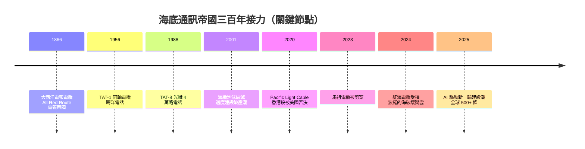

# 海底光纖：全球的隱形神經

人類文明的神經系統，絕大部分埋在海床的淤泥裡。當你在手機上查一筆美股報價、看一部好萊塢電影、跟海外的家人視訊時，那些資料有超過 99% 的機率不是走衛星，而是沿著數千公尺深的海底光纖，以光速在玻璃中穿行。這個隱形帝國的誕生、繁榮、崩壞與重生，是通訊史上最壯闊、也最政治的一章。

## TAT-8 之後：纜線軍備競賽

1988 年 12 月，TAT-8 啟用，跨大西洋 4 萬路電話在玻璃中流動——這是第一百零八年的接力：1866 年大西洋電報電纜鋪成（第 2 章的電報帝國）、1956 年 TAT-1 同軸電話纜、1988 年 TAT-8 光纖。此後擴張一發不可收拾：1990 年代，每一代新纜的容量都翻上幾倍，跨太平洋的 TPC 系列、連接歐亞的 SEA-ME-WE 系列相繼鋪設。投資主體也從電信聯盟（由各國電話公司組成的財團）轉向市場化：1990 年代末，民營電信與新創公司（Global Crossing、360networks 之類）以驚人的槓桿投入海纜，全球鋪纜量一年翻倍。

泡沫在 2001 年破滅。網路股崩盤後，業界才發現海纜容量嚴重過剩——需求成長再快也趕不上「每根纜數百倍容量」的供給曲線，電路批發價格崩跌九成以上。Global Crossing 破產（史上最大的破產案之一，後被出售）、360networks 破產，數十億美元的纜線以廢鐵價易手。但泡沫留下意外的遺產：過度建設的低價頻寬，恰好餵養了此後二十年網路巨頭的成長——Google、Facebook、Netflix 正是在這片廉價頻寬的廢墟上長成的。

## 技術奇蹟：三萬伏特點亮的海底放大器

現代海底光纖是工程美學的極致。一條跨洋系統長達上萬公里，光在 0.2 dB/km 的光纖中每百公里衰減數百倍，必須每隔五六十公里放置一個海底中繼器——內含摻鉺光纖放大器（EDFA）。但海底沒有電源，於是供電成為奇觀：岸上供電站以數千至上萬伏特的直流電，沿著纜線內的銅導體把電送到海底，中繼器串聯如一串深海燈泡，整條系統像一根橫越大洋的高壓導線。中繼器要承受每平方公分六百公斤的深海壓力、二十五年免維修——所以設計餘裕大到近乎偏埢，故障率以「整條系統四十年故障少於三次」為目標。

纜的結構本身就是戰爭與風浪的產物：深海段是直徑不到五公分的細纜（外層仍裹著鋼絲與銅管防鯨咬防拖網），淺海段則披上重型鎧裝。埋設在近岸泥沙中，用專門的海底犁開溝掩埋。船上工程師把兩百公里重的纜盤在巨型纜艙裡，以每小時十餘公里的速度徐徐放纜，橫越大西洋需時約兩週。今天一條纜可承載數百 Tbps——相當於把 1998 年全網際網路的總容量塞進一根手指粗的玻璃。

## 地緣政治回到海底

當基礎設施承載 99% 的跨洋資料、每日十兆美元的外匯交易、全球雲端服務與金融結算，海底就不再是單純的工程場域，而是地緣棋盤。21 世紀 2010 年代起，三股力量改寫了海纜政治。

第一是美中對抗。2016 年後 Google、Meta、微軟等美國巨頭取代電信公司成為最大投資者，私人電纜帝國成形——Google 累計投資數十條纜線。但 2020 年，美國司法部以國家安全為由，罕見否決了 Pacific Light Cable Network 部分登陸香港的路徑（該纜原計畫連接洛杉磯、香港與菲律賓，由 Google、Meta 與香港公司合作），主張資料落地的端點可能受中國法律管轄。此後「香港落地」的海纜計畫幾乎全數改道或擱置，台灣、呂宋、關島成為新的樞紐。電纜的每一個登陸點選擇，都是一次主權表態。

第二是灰色地帶衝突。2023 年 2 月，台灣馬祖的兩條海底電纜先後被一艘懸掛香港籍的貨船破壞切斷，馬祖一度斷網，靠微波備援維持聯繫——這是對台灣「數位孤島化」脆弱性的直接示警，也促使各國把海纜列入關鍵基礎設施保護。2024 年，紅海的 SEA-ME-WE 等多條歐亞主幹纜在葉門外海受損，胡塞武裝活動陰影下，全球約一成亞歐流量改道；波羅的海上，幾起疑似商船拖錨切斷海底電纜的事件，讓北約成立專責監控任務。修復船——全球僅約六十艘的稀有事業——一夜之間成為戰略資產。

第三是 AI 的新一輪建設潮。2024-25 年，大型語言模型訓練集群分散在各洲的資料中心之間，Google、Meta（Waterworth 環球專案，五萬公里級）、微軟與亞馬遜紛紛宣布前所未有的巨型海纜，全球在役海纜超過五百條、總長逾百萬公里。頻寬的飢渴，與 1990 年代的泡沫有著相似的臉孔。

## 數位主權的誕生

把鏡頭拉遠，會看見一個深刻的歷史回聲。十九世紀末，大英帝國以「All-Red Route」串起所有屬地的電報纜線，確保帝國通訊不經過任何外國中繼——電纜路徑就是權力。二十世紀中葉，美國接管海底霸權。二十一世紀 2020 年代，「數位主權」重新成為各國政策語彙：台灣推動衛星備援與多登陸點冗餘、歐盟制定海纜安全議程、太平洋島國爭取不依賴單一纜線。一百六十年前，帝國用電報鋼纜圈定勢力範圍；今天，大國用光纖登陸點、路由與修復能力重新畫線。技術換了三代（電報、同軸、光纖），海床上的政治邏輯卻幾乎沒變——這正是通訊史最冷靜的教訓：基礎設施永遠是政治的延長線。

下一章，我們回到陸地上另一場革命：當頻寬不僅抵達國家與城市，而是抵達每個人手中的那塊螢幕——行動通訊的世代交替。
