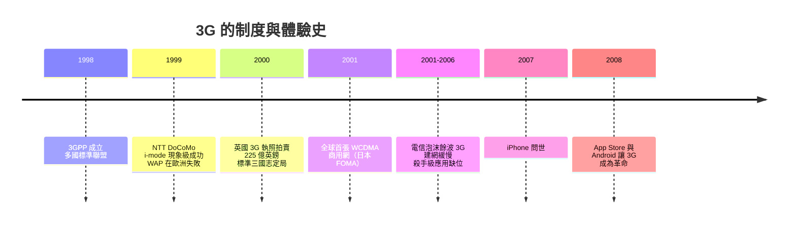

# 3G：語音到行動數據的升級

2001 年 10 月，日本東京。NTT DoCoMo 開通了全球第一張 WCDMA 商用網路（FOMA），宣傳影片裡的人們用手機進行視訊通話，臉孔小小地出現在折疊機的小螢幕上。這是第三代行動通訊（3G）許諾的未來：手機不再只是打電話，而是可以看、可以上網的多媒體終端。但這個未來的到來，比許諾慢了將近十年——而真正把 3G 從昂貴的實驗變成文明級革命的不是電信公司，而是兩個「外人」：一支手機與一家應用商店。

## 3GPP：標準政治的成熟

3G 的故事要從制度說起。2G 時代，世界被撕裂成 GSM（歐陸與多數國家）與 CDMA（韓國、美國部分、日本部分）兩大陣營，設備商與營運商各自為政。到了 3G，所有人都不想重演這場浪費：歐洲的標準組織 ETSI 主動打開大門，1998 年聯合日本的 ARIB/TTC、韓國的 TTA、美國的 T1、中國的 CWTS，成立了第三代夥伴計畫（3GPP）——一個跨國標準聯盟，大家把各自提案放上談判桌，以共識製定一套全球適用的技術規範。這個制度創新的影響遠超 3G 本身：此後的 4G、5G，乃至物聯網標準，都沿用 3GPP 的運作模式。標準的制定從「帝國擴張」變成「多方博弈的持續會議」，專利則成為博弈的籌碼。

但共識制度蓋不住三強爭霸。無線介面的核心選擇上是「標準三國志」：歐洲與日本力推 WCDMA（寬頻分碼多重存取，GSM 陣營的平滑升級）；美國的高通（Qualcomm）握有 CDMA 專利基礎，推出 CDMA2000，企圖讓 2G 時代的 IS-95 路線直接進化；中國則由大唐電信主導提出 TD-SCDMA——中國第一個自主的國際行動標準，背後是「不能永遠交專利費」的國家意志。三條路線最終都被 3GPP/ITU 收編為 IMT-2000 家族，商業命運卻天差地遠：WCDMA 成為全球主流，CDMA2000 逐漸萎縮，TD-SCDMA 在國內靠政策撐起規模、為後來 TD-LTE 與中國 4G/5G 的話語權鋪路——一次「以市場換技術」的長線布局。

## 高通：不賣手機賣專利

三國志裡最值得細看的是高通的商業模式革命。創辦人 Irwin Jacobs 是 MIT 出身的資訊理論教授，1985 年創立高通時，先做衛星與物流，後來賭上當時被主流視為異端的 CDMA：把每個通話用不同的偽隨機碼展開在整個頻段上，靠碼的相關性分離用戶——頻譜效率高、軟性換手，但系統複雜，而且每一項關鍵技術高通都握有專利。2G 時代高通硬是說服韓國全國採用 CDMA，用一個國家當實驗場證明技術；3G 時代更進一步，因為 WCDMA 的底層也繞不開 CDMA 專利，高通坐收兩個陣營的權利金。

然後高通做了一件電信史上最聰明的戰略收縮：把手機部門賣掉（2000 年給索尼），只留下兩件事——晶片與專利。它不做終端、不經營網路，專心把 CDMA/WCDMA 的智慧財產做成了「稅制」：全球每賣一支 3G 手機，晶片內建的專利組合就抽一次成，再靠不斷收購與研發把專利牆加高。這種「晶片+授權」的商業模式，讓一家不直接面對消費者的公司，成為行動時代最強的收租者，也埋下了日後與蘋果、與各國反壟斷機構的長年訴訟。

## 執照拍賣：政策如何燒掉一個產業

技術與商業模式之外，3G 還示範了制度設計的巨大威力——以及破壞力。2000 年，英國政府拍賣五張 3G 執照，結果五家電信公司合計付出 225 億英鎊——超出預期近十倍。德國拍賣更狂，六大集團競價 505 億歐元。電信公司相信「行動上網是下一個石油」，瘋狂加價；各國財政部樂得數錢，這是賽局理論拍賣設計的教科書案例，也是教科書等級的災難：巨額執照費吃掉了建網資本，3G 網路鋪設遲緩，歐洲電信業債台高築，股價崩跌，整整五年抬不起頭。經濟學家事後總結：拍賣設計本身沒錯，錯在需求端的故事被過度定價——而故事之所以可信，是因為一個來自日本的奇蹟。

## i-mode 的先行與 WAP 的羞辱

1999 年 2 月，NTT DoCoMo 推出 i-mode：折疊機上的一個按鈕，按下去就是一個微型網路世界——新聞、鈴聲下載、占卜、遊戲、電子郵件。關鍵設計是包月費用低廉（每月日幣數百元）且與內容商分成（DoCoMo 抽 9%），讓數萬個內容網站自發地為 i-mode 製作內容。i-mode 兩年內用戶破兩千萬，日本人均手機上網時長冠絕全球，DoCoMo 市值一度超過微軟。歐洲業者看傻了眼，急起直追——卻端出了 WAP。

WAP 是一場災難的教科書：為了省頻寬而設計的精簡協議，讓網頁又慢又醜；按秒計費讓用戶每讀一頁都在付錢；內容匱乏、連線要撥接、操作繞口。歐洲媒體把 WAP 戲稱為「Wait And Pay」。2000 年代的頭幾年，3G 的實際體驗與宣傳之間有巨大落差：視訊通話在廣告裡很美，現實中沒人對著手機小螢幕舉手機半小時；手機瀏覽網頁依然是一種刑罰。3G 網路鋪好了，舞台搭好了，演員卻遲遲不上台。

## 觸媒：網路是舞台，殺手應用才是演員

2007 年 1 月，賈伯斯在 Macworld 發表 iPhone：全觸控、真正的瀏覽器、iPod 與電話三合一。電信業者起初咬牙配合——AT&T 交出營收分成換獨家，卻失去了對手機的傳統掌控權。真正的核爆在 2008 年：App Store 上線，第三方開發者第一次能把軟體直接放到十億人口袋裡；同年，Google 的 Android 手機問世，開放陣營隨即跟進。應用經濟誕生，行動數據用量開始以每年翻倍的速度起飛。3G 網路終於找到了它的演員——地圖、社群、音樂、遊戲——而且演員們自己帶來了觀眾。電信公司花了數千億鋪路，收穫卻大部分流向了平台與開發者：這是 3G 時代最深刻的制度教訓——價值不在管線，而在管線上奔跑的生態系。

3G 的歷史地位因此是雙重的：它一方面是標準協作制度（3GPP）、頻譜拍賣制度、專利商業模式的一次大演習；另一方面，它用十年的挫折證明了技術單獨不成革命——WCDMA 沒有變出行動網路時代，iPhone 才是。而當數據洪流真正湧來時，3G 的頻譜效率立刻不夠用了。下一章，4G 登場：這一次，工程師們決定把數學榨到極限。
