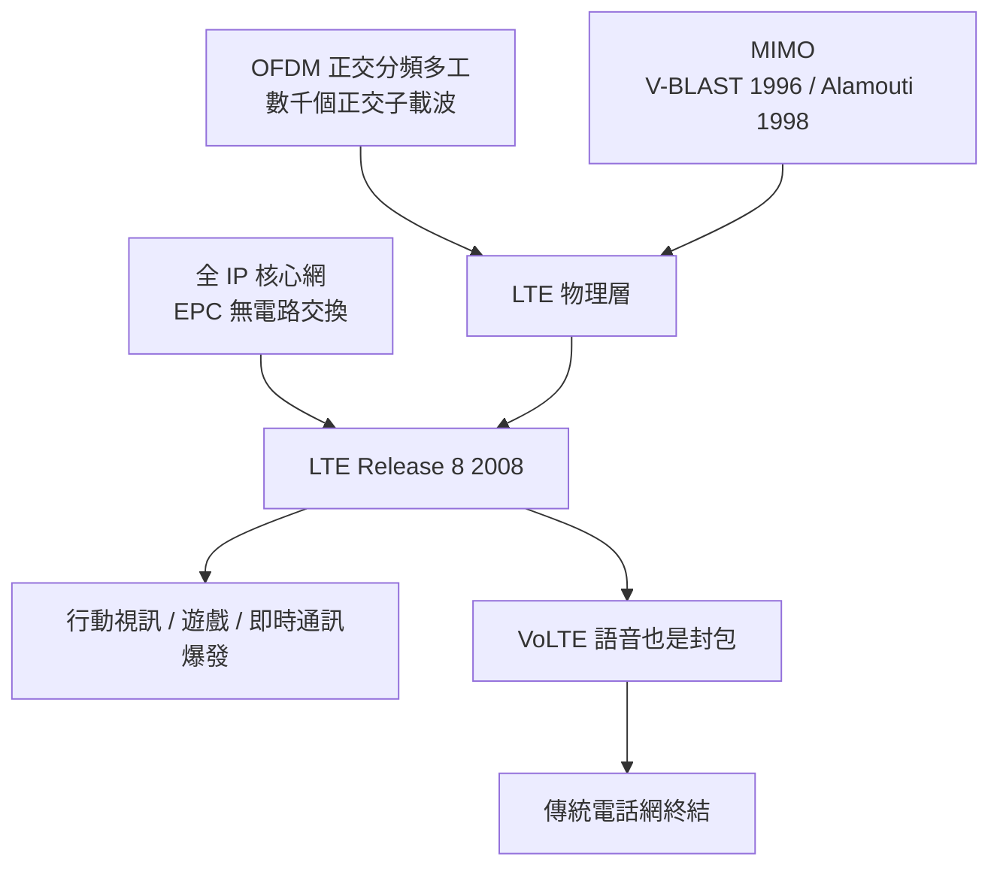

# 4G LTE 與 OFDM：榨乾頻譜的工業美學

2008 年 12 月，3GPP 凍結了 Release 8 規範——LTE（Long Term Evolution）正式定義。這個名字起得低調：「長期演進」，彷彿只是 3G 的又一次小步升級。實際上它是一場斷裂：LTE 抛棄了行動通訊三十年來的兩大基石——電路交換與 CDMA，改用全 IP 網路與 OFDM/MIMO。這是行動通訊史上第一次，數學的優雅、矽的算力與電信的工業需求三者完美對齊。

## 為什麼是 OFDM

3G 的 CDMA 在語音時代是優雅的，但到了數據洪流時代暴露出根本限制：所有用戶共享同一頻段、靠功率控制互相容忍，高速數據下功率控制的複雜度爆炸，接收端要做的運算也隨頻寬線性暴增。頻譜工程師要的是一種「把寬頻譜切成一大把窄頻道」的架構——這正是 OFDM（正交分頻多工）。

OFDM 的核心數學美妙得近乎藝術：把一個 20 MHz 的頻譜切成上千個窄帶子載波，每個子載波上緩慢地載運資料，這樣每個子載波只感受到平坦的通道，惱人的頻率選擇性衰落在窄帶裡消失。關鍵在「正交」二字：子載波的間隔恰為符元長度的倒數，任何兩個子載波在一個符元區間內的積分為零——

$$\int_0^T e^{i2\pi(f_1-f_2)t}\,dt = 0,\quad (f_1-f_2)=\frac{k}{T}$$

所以子載波可以緊密相疊、頻譜零浪費，接收端又因這份正交性可以用一次快速傅立葉轉換（FFT）把上千個子載波「一鍵」解調——全部的並行解調，化為一個 $O(N \log N)$ 的運算。抗多路徑干擾的秘密則是加在每個符元前的循環前綴（cyclic prefix）：多徑反射晚到的訊號只會落在保護區裡，不會污染下一個符元。都會區裡從千百個建築物反射而來的亂碼回音，就這樣被一段數學禮讓掉了。

OFDM 的思想源流頗長：1970 年代 Chang 與 Saltzberg 提出多載波傳輸的專利與理論，但當時 FFT 硬體昂貴，只能束之高閣；1990 年代，美國學界（Bell Labs、Codex 等）重燃此路，數位訊號處理晶片終於便宜到讓 FFT 落地；Wi-Fi 的 802.11a（1999）率先把 OFDM 帶進市場，有線的 DSL 也用上同族技術（DMT）。到 3GPP 選定 OFDMA 作為 4G 無線介面時，這套數學已經過消費電子市場的十億次淬鍊。這是典型的技術史節奏：理論等硬體，硬體等市場，市場等標準。

## MIMO：天線的空間自由度

第二根支柱是 MIMO（多輸入多輸出）。傳統思維裡，多天線是為了分集抗衰落或波束指向。1990 年代後期，兩項工作改寫了遊戲規則：Bell Labs 的 Foschini 提出 V-BLAST（1996，垂直分層空時結構），證明在散射豐富的環境中，$N$ 根發射天線、$M$ 根接收天線可以同時傳送 $N$ 路獨立資料流，容量隨天線數線性成長——頻譜不變、功率不變，純靠空間自由度榨出倍數頻寬；1998 年，AT&T 的 Alamouti 發表了驚人的簡潔編碼（Alamouti 碼）：兩根發射天線交錯發送共軛版本的訊號，接收端只需線性合併就能獲得完整的發射分集增益——不需要接收端多天線，於是可以裝進當時的手機。LTE 把兩者一起打包：2×2、4×4 MIMO 成為標配，加上可變頻寬（1.4 到 20 MHz）、自適應調變（QPSK 到 64QAM），理論峰值 300 Mbps，是 3G HSPA 的十倍以上。

## All-IP：電話網的安樂死

第三根支柱最不起眼卻最具顛覆性：LTE 是純 IP 網路。行動通訊自 1G 以來，語音走電路交換——每通電話佔一條專屬電路，這是十九世紀電話網的基因。LTE 把這基因剪掉了：網路裡只有封包，沒有電路。語音怎麼辦？答案是由 IP 封包模擬語音（VoLTE，基於 IMS 架構）——語音降格為「一種應用」。傳統電話交換網的商業模式與維運組織，自此走上安樂死的軌道；這也是「網際網路吞噬電信網」這場三十年長劇的終章之一。

工業面上，4G 標準的收編同樣精彩：3GPP 吸收了 WiMAX 陣營的 OFDM 路線壓力，把原本互相敵視的 WCDMA 陣營與 CDMA 陣營（高通系）都納入 LTE 大傘——LTE-FDD 與 TD-LTE 成為一家人的兩種雙工方式。晶片戰場上，高通靠先進基頻維持霸主地位，Intel 重金收購英飛凌基頻事業企圖進場（最終未竟全功，2019 年將基頻賣給蘋果）；華為、愛立信、諾基亞在設備端三強並立，中國的 TD-LTE 規模商用則讓華為完成從追隨者到標準領導者的轉身。

## 體驗革命與漫長的餘生

4G 的體驗革命發生在 2010-2015 年之間。下行 100 Mbps 的現實網速，讓「行動視訊」從宣傳詞變成日常：YouTube 轉向行動優先，2012 年後行動觀看量超越桌面；行動遊戲脫離貪吃蛇等級，出現《王者榮耀》《PUBG Mobile》這類需要低延遲的即時對戰；即時通訊（WhatsApp、微信、LINE）全面取代簡訊——電信業的簡訊營收在 4G 年代斷崖式下跌，這是「被自己建造的網路淘汰」的黑色幽默。直播、外賣、網約車、行動支付，全部踩在 4G 的頻寬與延遲之上。

而 4G 最驚人的特質是長壽。2024-25 年回望，5G 已商用五年，全球覆蓋最廣的行動技術卻仍是 LTE：5G 多採非獨立組網（NSA），控制信號依然走 4G 錨點；偏鄉、室內深處、海上，手機訊號圖示一從 5G 掉回 4G，體驗幾乎無感。業界有句自嘲：「5G 的 fallback 永遠是 LTE。」Release 8 那批 2008 年寫下的規範條文，至今仍在為數十億台裝置服務——工程美學的最好報酬，就是被用得最久。
