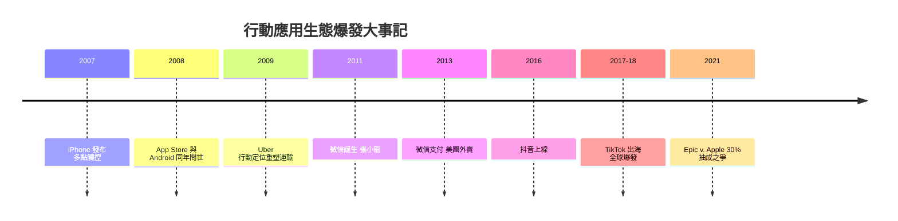

# 行動應用生態爆發：手機成為隨身電腦

通訊技術史寫到 4G，故事的重心發生了一次根本位移：主角不再是貝爾、高錕、或 3GPP 的工程師們，而是數十億普通人手中的那塊螢幕。當網路鋪到每個人的口袋，通訊就不再只是傳遞訊息的工具——它成了生活的環境本身。這一章講的是這場位移如何發生，又把人類社會帶到了哪裡。

## iPhone 與 Android：兩種哲學的對決

2007 年 1 月 9 日，賈伯斯在 Macworld 上說出那段著名的鋪陳：「今天，我們發表三樣革命性產品：一台寬螢幕觸控的 iPod、一部革命性的手機、一台突破性的網路通訊裝置——你們聽懂了嗎？這不是三台設備，這是一台設備。」iPhone 的本質不是規格，而是兩個洞察：第一，手指就是最好的輸入裝置——多點觸控把鍵盤消滅了，螢幕即介面；第二，手機的價值不在通話，而在「裝在口袋裡的網際網路」。AT&T 當時答應了前所未有的條件——放棄對手機功能與品牌的控制權換取獨家，這個讓步改寫了電信業與設備業的權力結構：從此營運商淪為「管線」，設備與平台登基。

2008 年 7 月，App Store 上線，真正的平台革命到來。賈伯斯起初抗拒第三方應用（想用 Safari 網頁應用糊弄過關），但董事會與市場的壓力讓蘋果讓步，而讓步的方式極其聰明：蘋果當店東，開發者拿七成、蘋果抽三成，審核上架、統一結算。這套「分潤制度」把全球軟體開發者變成蘋果生態的僱傭軍——應用數量一年破十萬，十年破兩百萬。同年，Google 发布 Android（Andy Rubin 團隊，2005 年被收購的小公司），走完全相反的路：開放原始碼、免費授權給所有手機廠商，用「開放」對抗「封閉」，用規模對抗體驗。兩種哲學的對決結果是雙寡頭：蘋果賺走行動業大部分利潤，Android 拿下七成市場份額。手機產業的舊王者——Nokia、Motorola、BlackBerry——在五年內相繼謝幕；三星與後來的中國品牌（華為、小米、OPPO、vivo）在 Android 的地基上崛起。

## 應用大爆發：重塑實體世界的名單

App Store 開閘之後，湧出的不只是遊戲與工具，而是一波波對實體產業的重塑。這份名單值得一讀再讀，因為每一項的共同配方都是：行動網路（隨時在線）+ 定位（GPS）+ 支付（綁卡）+ 社群（評分與推薦）。

**Uber（2009，舊金山）**：Garrett Camp 與 Travis Kalanick 的原始構想只是「一鍵叫高級車」。真正的洞察是把閒置的私家車與隨時上網的乘客即時配對——定位讓「車在哪裡」透明化，評分讓陌生人信任成為可能。它重塑了運輸業、挑戰了全球計程車管制制度、發明了「零工經濟」（gig economy）這個既是機會又是爭議的勞動形態，2010 年代的全球城市交通版圖為之改寫。

**微信 WeChat（2011，廣州）**：張小龍率領的騰訊廣州團隊，最初只是一款對抗小米「米聊」的即時通訊應用。「搖一搖」「附近的人」讓它病毒式擴散；2013 年的紅包功能一夜之間讓數億人綁定銀行卡，完成支付冷啟動；2017 年的小程序把微信變成「作業系統裡的作業系統」。張小龍的產品哲學——「好的產品讓用戶用完即走」——與微信無所不包的現實之間的張力，正是超級應用悖論的縮影。微信重新定義了「應用」一詞：它不是一個程式，而是通訊、支付、身份證、政府服務、媒體、商店的複合體。

**行動支付的中國奇蹟**：支付寶（2004 年誕生於淘寶的擔保交易）與微信支付的掃碼革命，讓中國跳過了信用卡普及階段，直接進入行動支付社會——一個有趣的路徑依賴：正因為信用卡基礎設施薄弱，行動支付反而毫無包袱地碾壓而過。街邊煎餅攤掛著二維碼、乞丐用二維碼行乞的新聞，標誌著一場制度躍遷：支付不再是銀行的專屬領域，而是平台生態的一部分。美國同期的 Apple Pay / Google Pay 反而進展緩慢——既有卡組織的利益結構成了絆腳石。這是「後發優勢」在金融基建上的完美案例。

**共享經濟與服務上門**：Airbnb（2008）、共享單車、外賣平台（美團 2013 年上線，隨後與餓了麼的補貼大戰重塑了餐飲業；DoorDash 在西方複製同樣劇本）——「隨叫隨到」成為城市生活的預設值。**短視頻**：抖音 2016 年上線，演算法推薦 + 15 秒短片 + 便捷創作工具，兩年內席捲中國；海外版 TikTok 2017-18 年出海收購 Musical.ly 後爆發，成為史上第一款中國原生、全球主流的消費級應用——通訊技術的全球流動，第一次出現了自東向西的主流產品。

## 抽成、訴訟與注意力：生態的政治經濟學

平台權力必然帶來反彈。App Store 的 30% 抽成（「蘋果稅」）成為全球反壟斷的焦點：2020 年 Epic Games（《要塞英雄》開發商）故意繞過支付系統被下架，隨即起訴蘋果。2021 年的 Epic v. Apple 判決結果曖昧而深刻——法院裁定蘋果不構成壟斷（多數指控 Epic 敗訴），但依加州法律要求蘋果允許開發者提供外部購買連結；此後歐盟《數位市場法》（DMA）更直接強制第三方應用商店與側載。平台抽成制度的合法性，在 2020 年代被重新談判——這是十九世紀鐵路運價之爭的數位迴聲：誰控制了必經之路，誰就收稅；而社會遲早要來收服收稅者。

## 系統性反思：當通訊成為環境

4G 時代的最後一課是反思。三十億人隨身上網帶來了空前的賦權——偏鄉學童接觸世界級課程、小商家直連全球市場、弱勢者的聲音被聽見；也帶來了空前的失衡：注意力經濟把人類的專注力變成可競價的商品，演算法推送與社交比較助長焦慮與極化，「已讀不回」成為新的社交暴力；數位鴻溝從「有沒有網路」升級為「有沒有被演算法善待」。各國開始為未成年人設計防沉迷制度，科技公司被迫推出「螢幕使用時間」——產品的發明者開始為產品的副作用道歉，這是每一項通訊技術都經歷過的成年禮：電報曾造成資訊過載的恐慌，電話曾被指責毀壞家庭生活，電視曾被視為白痴盒子。手機只是最新的被告，但它的規模是空前的——它不是客廳裡的一台機器，而是與身體相連的器官。

回望這十五年，可以這樣總結 4G 時代的歷史意義：電報把訊息的速度提到極限，電話把聲音送進家庭，行動電話把人掛在網上，而 4G 讓網路把人「住」了進來——通訊不再是我們使用的東西，而是我們棲居的空間。接下來的 5G 與萬物互聯，將把這個空間從「人的網路」擴張為「物的網路」。那將是本書下一章的主題。
