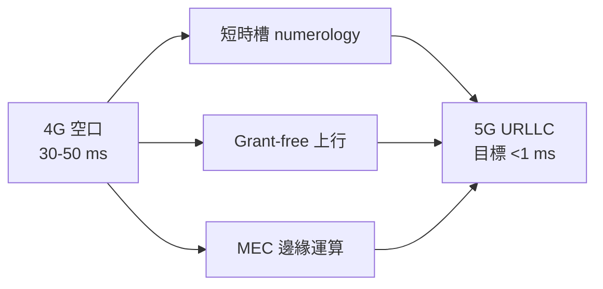

# URLLC：毫秒級響應的苛求

## 從 50 毫秒到 1 毫秒

4G LTE 的空口延遲大約 30–50 毫秒，對刷影片、看網頁綽綽有餘，但對某些場景遠遠不夠：工業機器人協作要求控制迴路在毫秒級完成，車輛緊急煞車的決策窗口同樣以毫秒計。5G 標準因此訂出了近乎苛刻的目標——**URLLC**（超可靠低延遲通訊）要求空口延遲低至 1 毫秒、可靠度達 99.999%。這是行動通訊史上第一次把「確定性」而非「速率」當成設計核心。

## 技術手段：把時間切碎、把排隊取消

為了壓榨出每一毫秒，5G 的工程師做了三件關鍵的事。第一是**靈活 numerology（子載波間距）**：把 1 毫秒的無線幀切成更短時槽，子載波間距可擴大到 120 kHz，傳輸時間間隔縮到 0.125 毫秒——時間被切碎了，排隊等下一個時槽的機會成本便大幅降低。第二是**Grant-free 上行**：傳統 LTE 中，設備要發資料得先向基地台「申請許可」（scheduling request），這一來一回就是十幾毫秒；Grant-free 允許設備直接發射、事後糾錯，用冗餘重複換取確定性。第三是**邊緣運算（MEC）**：把伺服器搬到基地台旁邊，資料不必穿越數百公里的骨幹網到雲端繞一圈，單程傳輸延遲從幾十毫秒壓到個位數毫秒。

## 智慧工廠：最認真的客戶

在所有 URLLC 應用中，工業場景是最認真投入的。西門子在安貝格與紐倫堡的工廠測試用 5G 專網取代有線與 Wi-Fi，讓自動導引車（AGV）實現無線控制與即時重新排程；博世在德國的工廠部署了 5G 校園網路，用於移動機器人與精密工具的無線連接。他們的共同動機很實際：工廠裡鋪滿了乙太網線纜，每次產線改版都要重新布線，動輒耗時數月；如果機器能無線且確定性地連網，工廠就獲得了「柔性」——這是工業 4.0 的核心夢想。德國也因此成為全球 5G 專網頻譜政策的先驅，直接發放給企業本地頻譜執照。

## 遠距手術與自駕車：里程碑與現實

2019 年 3 月，中國解放軍總醫院與海南醫院之間完成了全球首例基於 5G 的遠程人體腦外科手術——神經外科專家在三千里之外操控機械臂為帕金森氏症患者植入腦起搏器，全程約三小時。這場手術證明了技術鏈路的可行性，也成為 5G 宣傳片的常客。但冷靜地看：外科手術對「絕對不能斷線」的要求，使得醫療界對無線遠程手術始終謹慎，真實落地遠比示範稀少。

自動駕駛則捲入了標準之爭。車聯網（V2X）存在兩條技術路線：美國 IEEE 主導的 **DSRC**（基於 Wi-Fi 技術，1990 年代起累積了十幾年測試）與 3GPP 的 **C-V2X**（蜂窩路線，可演進到 5G）。2010 年代末，這場「Wi-Fi 派對抗蜂窩派」的戰爭最終以政治與產業力量定勝負：2020 年美國 FCC 將 5.9 GHz 頻段重新分配，實質放棄 DSRC 路線；中國則堅定押注 C-V2X。車廠的實際進度卻遠比標準之爭冷靜——多數業者最終選擇讓車輛靠自身感測器與 AI 決策，V2X 只是輔助而非依賴。

## 電網與無人機：示範工程試點遍地開花

深圳和合肥先後開展無人機物流試點，美團、順豐的送餐送藥無人機在劃定航線上常態化運行；電力行業嘗試用 5G 網路對電網的差動保護進行無線化——這是對延遲與可靠度要求最苛刻的場景之一。這些試點展示潛力，但規模化仍卡在空域管理與監管審批，而非技術本身。

## 務實的反思：苛求的市場在哪裡？

十餘年過去，對 URLLC 誠實的盤點是：真實需求存在，但遠比宣傳來得小。絕大多數工廠至今仍以工業乙太網、現場匯流排與 Wi-Fi 為主力——有線的確定性無可取代，而 Wi-Fi 6 的性能已能滿足多數工業場景，且成本遠低於 5G 專網。遠程手術、毫秒級自駕協同，更多停留在展示與試點。「1 毫秒」是工程師對物理極限的漂亮回答，卻未必是市場提出的問題。URLLC 的教訓或許是：通訊史上一再重演的劇本——技術能做的，與世界需要的，中間永遠隔著一段需要商業與制度來搭橋的距離。這段距離，與當年鋪海底電纜的菲爾德所面對的並無本質不同：再偉大的管道，也要等人們真的有話要說。這也為下一節「5G 的商業冷思考」埋下了伏筆。
