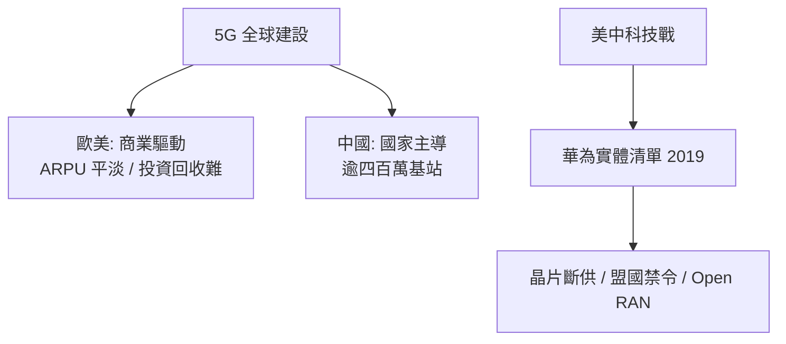

# 5G 的商業冷思考

## 修一條貴得驚人的高速公路

5G 是通訊史上最昂貴的一代。基地台密度要求更高——中頻段覆蓋半徑小於 4G，毫米波更是只到一兩百公尺；每座巨量 MIMO 基地台的功耗是 4G 的數倍，還需要光纖拉到每一座塔。全球電信業為此投入了數千億美元：歐洲的頻譜拍賣屢屢天價，德國 2019 年拍出逾 65 億歐元，義大利更創下每 MHz 人口單價紀錄；中國三大運營商每年資本支出維持在千億人民幣量級。這是一場豪賭——賭的是「修好高速公路，車流自然會來」。

## 車流沒有變多

賭注的結果至今曖昧。最刺眼的事實是 **ARPU（每用戶平均收入）幾乎沒有上漲**：全球多數市場的行動資費在 5G 時代延續了無限流量價格戰的慣性，用戶多付的錢有限，運營商卻背上了三倍的電費與折舊。「殺手級應用」至今未現——曾經被寄予厚望的 VR/AR、雲遊戲、8K 串流，沒有一個成為大眾現象。多數消費者誠實地說：**感知不到 5G 和 4G 的差別**。重度用戶下載快了幾秒，僅此而已。4G 時代孕育了短影音與直播的爆發，5G 時代的爆款應用卻依然寄生在 4G 就能支撐的需求之上。「高速公路修好了，但車流沒變多」，成了產業自嘲的口頭禪。

## 中國：國家主導的另一種劇本

中國走了一條完全不同的路：不是等需求，而是「適度超前建設」。2019 年 5G 發照商用後，三大運營商在政策驅動下以每年數十萬座的速度鋪站，至 2024 年建成 5G 基站超過四百萬座——占全球一半以上。這背後不是純粹的商業計算，而是把通訊基礎設施當成高鐵式的國家工程：戰略產業、就業、數位經濟的地基。代價由運營商的利潤率承擔，收益則外溢到整個數位生態。

而中國 5G 的另一面是**華為事件**。2019 年 5 月，美國商務部將華為列入實體清單，切斷其與美國供應鏈的往來；2020 年收緊規則，任何使用美國技術的晶圓廠不得為華為代工——台積電斷供，麒麟晶片一度絕版。2018 年 12 月孟晚舟在溫哥華被捕、歷經近三年引渡拉鋸後於 2021 年獲釋返中，成為這場博弈最戲劇性的註腳。華盛頓同時展開外交施壓，英國、澳洲、日本等盟國相繼宣布在 5G 網路中移除或禁用華為設備。這是通訊史上頭一遭：一國的基地台設備供應商，成為大國科技戰的中心。標準、晶片、頻譜、設備——通訊基礎設施的每一層都被政治重新定價。

## 意外的成功者：FWA 與專網

5G 真正賺到錢的地方，幾乎沒有人預料到。美國 T-Mobile 與 Verizon 的**固定無線接入（FWA）**——用 5G 訊號替代家中有線寬頻——在鄉村與郊區大受歡迎，成為美國寬頻市場增長最快的產品，也被普遍視為 5G 最實在的收入來源。邏輯很樸素：偏遠地區拉光纖成本極高，而 5G 中頻基站順手就能覆蓋方圓數公里的家庭。數位平權與商業利益，在此難得地重合。

另一個成功面是**專網**：礦場用 5G 遠控挖礦設備、港口用 5G 遠控吊車、工廠用 5G 連接產線。對企業客戶而言，5G 不是「更快的 4G」，而是一種可編程的確定性基礎設施。這些市場單體不大，卻是運營商首次跳出消費者紅海的嘗試。

## 分配正義之辯

5G 的冷思考最終指向電信產業的結構性困境：高資本支出、強監管、低回報，價值卻被OTT平台整鍋端走——用戶為了看 YouTube、刷抖音而升級 5G，廣告與訂閱收入卻屬於平台。運營商淪為「賣流水的」，平台則是「淘金的」。這引發了一場分配正義之辯：基礎設施者該不該分享應用層的價值？歐洲電信商呼籲大型平台分擔網路成本（所謂「公平分攤」提案），平台則反駁這是網路費的變體。這場辯論延續了通訊史的老命題——從鐵路時代的路權與運費，到網路時代的網速與流量，承載者與使用者的利益分配，從來不是技術問題，而是政治經濟問題。5G 教會產業的一課或許是：頻寬本身不是價值，價值永遠在頻寬之上生長出來的東西。
